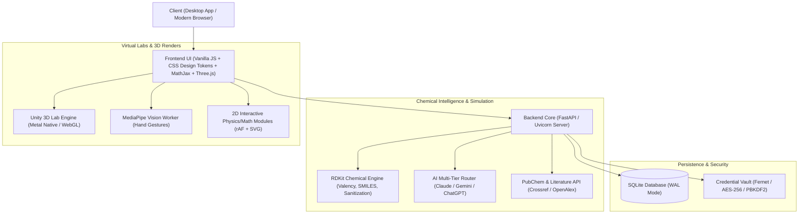

<div align="center">

# 🧪 CHEMISTRY

**AI-Powered Organic Reaction Solver · 2D Physical Chemistry Simulations · 3D Virtual Laboratory**

[](https://www.python.org/)
[](https://fastapi.tiangolo.com/)
[](https://www.rdkit.org/)
[](https://unity.com/)
[](https://www.electronjs.org/)
[](tests/)
[](LICENSE)

[Tổng quan](#tổng-quan-dự-án) • [Tính năng chính](#tính-năng-nổi-bật) • [Kiến trúc hệ thống](#kiến-trúc--công-nghệ) • [Cấu trúc thư mục](#cấu-trúc-thư-mục) • [Cài đặt & Khởi động](#cài-đặt--khởi-động) • [Kiểm thử](#kiểm-thử--đảm-bảo-chất-lượng)

</div>

---

## 📌 Tổng quan dự án

**CHEMISTRY** là nền tảng số hoá và ứng dụng AI chuyên sâu trong hoá học và khoa học tự nhiên, hỗ trợ giải quyết từ các bài toán cơ bản trong chương trình GDPT 2018 đến các chuỗi biến hoá phức tạp cấp Học sinh Giỏi (HSG) Quốc gia / Quốc tế, kết hợp mô phỏng tương tác 2D và phòng thí nghiệm thực tế ảo 3D.

Ứng dụng có thể vận hành đa nền tảng:
- **Ứng dụng Web / Máy chủ cục bộ:** Chạy mượt mà trên macOS, Linux, Docker, hoặc deploy lên dịch vụ Cloud (Render, Fly.io, Cloudflare Tunnel).
- **Ứng dụng Máy tính Độc lập (macOS Native):** Đóng gói trọn gói qua Electron + PyInstaller backend (`CHEMISTRY.app`), tối ưu riêng cho chip Apple Silicon (M1/M2/M3/M4).
- **Phòng Lab Hoá học 3D (Unity Native & WebGL):** Mô phỏng không gian thực hành thí nghiệm chuẩn ISO với hiệu năng cao (120 FPS, Metal API).

---

## ✨ Tính năng nổi bật

### 1. 🧬 Giải chuỗi phản ứng hữu cơ bằng AI chuyên sâu
- **Đa dạng dữ kiện đầu vào:** Nhận dạng đề qua văn bản gõ trực tiếp hoặc tải ảnh đề bài (chữ viết tay, hình in, ảnh chụp sách giáo khoa/đề thi).
- **Suy luận chuỗi ẩn X, Y, Z:** Tự động giải mã các chất chưa biết, chất đa chức, este/peptit phức tạp, cơ chế chuyển vị, đóng/mở vòng theo chuẩn biện luận 4 bước hoá học.
- **Tích hợp kiểm chứng hoá tin học RDKit:** Kiểm tra tính hợp lệ của SMILES, cân bằng bảo toàn nguyên tố, điện tích, và đối chiếu công thức phân tử (CTPT) tự động sửa sai tối đa 2 vòng lặp.
- **Biểu diễn cấu trúc chuẩn quốc tế:** Xuất công thức khung (skeletal formula), tải file vector SVG, ảnh phân giải cao PNG 1920px, gói dữ liệu cấu trúc (.mol, .sdf, .cdxml) và mở trực tiếp bằng ChemDraw.

### 2. ⚡ Mô phỏng Hoá lý 2D tương tác thời gian thực
- **Động cơ nhiệt (Heat Engines):** Chu trình Carnot, Otto, Diesel, Stirling với đồ thị $p–V$, piston chuyển động theo góc quay trục khuỷu, tính toán hiệu suất nhiệt $\eta$.
- **Khí lý tưởng (Ideal Gas):** Mô phỏng vi mô các hạt va chạm đàn hồi trong xi lanh, khảo sát các định luật Boyle–Mariotte, Charles, Gay-Lussac với đồ thị áp suất, thể tích, nhiệt độ thời gian thực.
- **Cân bằng hoá học & Le Chatelier:** Mô phỏng phản ứng thuận nghịch $N_2 + 3H_2 \rightleftharpoons 2NH_3$, dịch chuyển cân bằng khi thay đổi áp suất, nhiệt độ, nồng độ kèm đồ thị $Q_c / K_c$.
- **Động học & Tốc độ phản ứng:** Khảo sát phương trình Arrhenius $k = A e^{-E_a/RT}$, năng lượng hoạt hoá, quy tắc thực nghiệm Van 't Hoff, phân bố Maxwell–Boltzmann và bậc phản ứng 0, 1, 2.
- **Thư viện 34 công thức Hoá lý toàn diện:** Chứng minh từng bước (kèm Cách 2 giải tích/nhiệt động học), hình vẽ động SVG + requestAnimationFrame độc lập, MathJax CHTML hiển thị tiếng Việt offline 100%, bộ tính số tương tác trực tiếp đối chiếu số liệu mẫu.

### 3. 🧪 Phòng thí nghiệm thực tế ảo 3D (Virtual Lab)
- **Unity Native & WebGL Embedded:** Toà nhà phòng lab 36m × 30m với 7 khu chức năng, sảnh trần cao 8m, Bảng tuần hoàn 118 nguyên tố 3D kích thước 7m × 3.6m.
- **Dụng cụ chuẩn ISO quốc tế:** Burette ISO 385, Bình tam giác ISO 1773, Cốc thuỷ tinh ISO 3819, Ống nghiệm ISO 4142.
- **5 trạm thực hành tiêu chuẩn:**
  1. *Chuẩn độ axit–bazơ:* Chuẩn độ HCl và $CH_3COOH$ bằng NaOH, đổi màu chỉ thị phenolphthalein / methyl da cam, xác định điểm tương đương.
  2. *Nhận biết ion:* Nhận biết các cation ($Fe^{2+}, Fe^{3+}, Cu^{2+}, Al^{3+}$) và anion ($SO_4^{2-}, Cl^-, CO_3^{2-}$), phản ứng tạo kết tủa, hoà tan kết tủa, thử ngọn lửa.
  3. *Điện hoá học:* Pin điện hoá Daniell Zn–Cu ($E^\circ = 1.10\text{ V}$), điện phân dung dịch $CuSO_4$ điện cực trơ theo định luật Faraday.
  4. *Cơ chế phản ứng hữu cơ:* Mũi tên cong biểu diễn dịch chuyển cặp electron ($S_N1, S_N2, E1, E2$, cộng electrophin, cộng nucleophin, este hoá).
  5. *An toàn phòng thí nghiệm:* Nhận diện 9 biểu trưng nguy hiểm GHS, xử lý sự cố tràn hoá chất, giải đố tình huống.

### 4. 🖐️ Phòng Lab Sinh học 3D & Điều khiển cử chỉ tay không chạm
- **MediaPipe Hand Landmarker:** Nhận diện bàn tay qua Web Worker luồng riêng chạy tăng tốc GPU, độ trễ cực thấp (8–25 ms), ổn định 30–60 FPS.
- **Điều khiển không gian 3D:** Chụm ngón cái và trỏ để kéo xoay mô hình giải phẫu tim, não, phổi, xương; lướt để di chuyển; chạm nhẹ để chọn cơ quan chi tiết.

### 5. 🤖 Hệ thống AI định tuyến thông minh (Smart Multi-Tier Routing)
- **Tự động phân loại độ khó:**
  - *Dễ (SGK, gọi tên, chuỗi cơ bản):* Sử dụng Gemini Flash-Lite tối ưu tốc độ và chi phí.
  - *Trung bình (Biện luận vừa, cơ chế cơ bản):* Sử dụng Gemini Flash.
  - *HSG (Chuỗi thi HSG, lập thể, chuyển vị):* Sử dụng Gemini Pro hoặc Anthropic Claude Sonnet 3.5.
- **Cơ chế dự phòng 3 tầng (Triple-Tier Fallback):** Tự động chuyển đổi giữa Claude $\to$ Gemini $\to$ OpenAI (ChatGPT) khi gặp sự cố mạng, hạn mức API hoặc lỗi máy chủ.
- **Tra cứu tài liệu khoa học hợp pháp:** Tích hợp Crossref, Unpaywall, OpenAlex, Europe PMC, PubChem trích dẫn tài liệu học thuật theo mã định danh DOI.

---

## 🏗️ Kiến trúc & Công nghệ



| Tầng | Công nghệ sử dụng | Vai trò |
|---|---|---|
| **Backend Core** | Python 3.11, FastAPI, Uvicorn, SQLite | API RESTful, quản lý tiến trình tính toán, xác thực, cơ sở dữ liệu |
| **Hoá tin học (Cheminformatics)** | RDKit, PubChemPy, Playwright | Phân tích cấu trúc phân tử, tạo vector toạ độ 2D/3D, kiểm chứng phương trình |
| **Trí tuệ nhân tạo (AI)** | Gemini SDK, Anthropic Claude SDK, OpenAI SDK | Phân tích bài toán, lập luận hoá học, trích xuất dữ liệu đa phương thức |
| **Giao diện Web** | Vanilla JS (ES Modules), CSS Tokens, MathJax 3.2.2 CHTML | Giao diện chuẩn Awesomic tokens, tối ưu tải trang, hiển thị công thức offline |
| **3D & Game Engine** | Unity 6000 (Universal Render Pipeline), WebGL, Three.js | Dựng mô hình thiết bị thí nghiệm chuẩn ISO, tương tác không gian thực |
| **Desktop App** | Electron 34, PyInstaller | Đóng gói bộ cài native macOS (.dmg, .zip, .app) |

---

## 📁 Cấu trúc thư mục

```
Antigravity/
├── backend/                  # Mã nguồn Backend FastAPI
│   ├── ai/                   # Bộ định tuyến AI, providers (Claude, Gemini, OpenAI)
│   ├── literature.py         # Tra cứu tài liệu khoa học (DOI, OpenAlex, Crossref)
│   ├── rdkit_kiem_tra.py     # Thẩm định hoá học và cấu trúc qua RDKit
│   ├── quan_tri.py           # Nghiệp vụ quản trị hệ thống và người dùng
│   ├── hoa_ly/               # Dữ liệu và logic mô phỏng Hoá lý
│   └── app.py                # Điểm khởi tạo FastAPI Application
├── frontend/                 # Giao diện người dùng Web & Client Assets
│   ├── hoa-hoc/              # Trang giải chuỗi, 3D phân tử, cơ chế phản ứng
│   │   ├── hoa-ly/           # 5 trang chuyên đề Hoá lý (Động cơ, Khí, Cân bằng, Tốc độ, Công thức)
│   │   └── phong-thi-nghiem/ # Giao diện Phòng thí nghiệm 3D
│   ├── sinh-hoc/             # Phòng Lab giải phẫu 3D Sinh học & Hand tracking
│   ├── vendor/               # Thư viện ngoại tuyến (MathJax, Three.js, MediaPipe, Motion)
│   └── style.css             # Hệ thống Design Tokens CSS (Dark/Light mode)
├── desktop/                  # Ứng dụng Desktop Electron cho macOS
│   ├── main.js               # Tiến trình chính Electron
│   ├── preload.js            # Cầu nối an toàn Context Bridge
│   ├── build-mac.sh          # Script đóng gói .app, .dmg và .zip
│   └── may_chu/              # Cấu hình PyInstaller cho backend nhúng
├── unity/                    # Dự án Unity 3D (PhongLabHoa3D)
│   └── PhongLabHoa3D/        # Assets, Scripts C#, Scenes và cấu hình URP
├── scripts/                  # Kịch bản tự động hoá và quản trị
│   └── macos/                # Kịch bản vận hành macOS (.command)
│       ├── setup.command     # Cài đặt môi trường một chạm
│       ├── start.command     # Khởi động máy chủ và mở trình duyệt
│       ├── tu-chay.command   # Quản lý dịch vụ chạy nền launchd
│       └── cau-hinh-*.command# Các kịch bản cấu hình khoá API và dịch vụ
├── docs/                     # Tài liệu kỹ thuật dự án
│   ├── guides/               # Hướng dẫn đưa lên web, triển khai, dạy AI
│   ├── prompts/              # Nhật ký thiết kế kỹ thuật (Engineering Prompts)
│   └── specs/                # Giáo trình, tiến độ và đặc tả hoá học
├── tests/                    # Bộ kiểm thử toàn diện
│   ├── js/                   # 169 bài test đơn vị JavaScript (Node.js Test Runner)
│   └── test_*.py             # 657 bài test chức năng Backend (Pytest)
├── tools/                    # Công cụ kiểm tra tự động E2E (Playwright CDP)
├── admin_cli.py              # CLI quản trị hệ thống chuyên nghiệp
├── Dockerfile                # Cấu hình đóng gói Docker Container
├── requirements.txt          # Danh sách thư viện Python
├── package.json              # Quản lý script NPM và dự án
└── README.md                 # Tài liệu giới thiệu dự án
```

---

## 🚀 Cài đặt & Khởi động

### 1. Yêu cầu hệ thống
- **Hệ điều hành:** macOS (khuyến nghị chip Apple Silicon M1/M2/M3/M4) hoặc Linux / Windows (WSL2).
- **Python:** Phiên bản 3.11 (cài qua Homebrew: `brew install python@3.11`).
- **Trình duyệt:** Google Chrome (để hỗ trợ tính năng tra cứu tự động qua Playwright).

### 2. Cài đặt nhanh trên macOS (Khuyến nghị)
Nháy đúp trực tiếp vào file **`setup.command`** ở thư mục gốc (hoặc chạy lệnh):
```bash
./setup.command
```
Kịch bản sẽ tự động:
1. Khởi tạo môi trường ảo Python `.venv` bằng Python 3.11.
2. Cài đặt toàn bộ phụ thuộc từ `requirements.txt`.
3. Kiểm tra khả năng kết nối của Playwright với Google Chrome.
4. Sinh file cấu hình bảo mật `.env` từ `.env.example`.

### 3. Cấu hình biến môi trường
Mở file `.env` và cung cấp ít nhất một API Key của trí tuệ nhân tạo:
```env
# Google Gemini (AI chính – Lấy key miễn phí tại https://aistudio.google.com/apikey)
GEMINI_API_KEY=your_gemini_api_key_here

# Anthropic Claude (Tuỳ chọn cho bài HSG – https://platform.claude.com/)
ANTHROPIC_API_KEY=your_claude_api_key_here

# OpenAI ChatGPT (Tuỳ chọn dự phòng – https://platform.openai.com/)
OPENAI_API_KEY=your_openai_api_key_here
```

### 4. Khởi chạy ứng dụng
Nháy đúp file **`start.command`** hoặc dùng lệnh:
```bash
./start.command
```
Ứng dụng sẽ tự động chọn cổng khả dụng (`8000` hoặc `8001`), khởi động FastAPI server và tự mở Google Chrome tại địa chỉ:
```
http://127.0.0.1:8000
```

### 5. Triển khai bằng Docker
```bash
# Xây dựng Docker image
docker build -t chemistry:latest .

# Khởi chạy container
docker run -d --name chemistry-app \
  -p 8000:8000 \
  -e GEMINI_API_KEY="your_api_key" \
  chemistry:latest
```

---

## 🧪 Kiểm thử & Đảm bảo chất lượng

Dự án trang bị hệ thống kiểm thử tự động hai tầng đạt độ bao phủ cao:

```bash
# 1. Chạy toàn bộ 657 bài test Backend (Pytest)
.venv/bin/pytest -q

# 2. Chạy toàn bộ 169 bài test Giao diện & Động học (Node.js Test Runner)
node --test tests/js/*.test.mjs

# 3. Hoặc chạy đồng thời cả hai bộ test qua npm:
npm test
```

### Kiểm thử trực quan E2E (Playwright Chrome CDP)
```bash
# Nghiệm thu tự động 42 kịch bản Hoá lý 2D, phông chữ tiếng Việt MathJax và chụp ảnh bằng chứng:
./.venv/bin/python tools/kiem_tra_hoa_ly.py

# Nghiệm thu ứng dụng Desktop và Unity WebGL nhúng:
./.venv/bin/python desktop/kiem_tra/kiem_tra_app.py
```

---

## 🛠️ Quản trị hệ thống (CLI)

Hệ thống cung cấp công cụ `admin_cli.py` mạnh mẽ phục vụ bảo trì trực tiếp:
```bash
# Xem trợ giúp các lệnh quản trị
python3 admin_cli.py --help

# Xem chi phí và lượng token AI đã sử dụng
python3 admin_cli.py usage --week

# Quản lý người dùng và trạng thái trực tuyến
python3 admin_cli.py online
python3 admin_cli.py users

# Tạo mã kích hoạt tính năng Claude cho học sinh
python3 admin_cli.py code create --luot 20 --ghi-chu "Đội tuyển HSG Hoá"
```

---

## 📄 Bản quyền & Đóng góp

Dự án được phát hành theo giấy phép mã nguồn mở **MIT License**. Mọi đóng góp (Pull Requests, Báo lỗi, Đề xuất tính năng mới) đều được hoan nghênh và đánh giá cao.

---
<div align="center">
<i>Phát triển với sự tận tâm dành cho nền giáo dục Khoa học Tự nhiên Việt Nam.</i>
</div>
