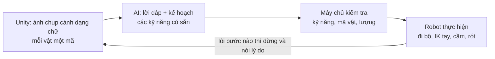
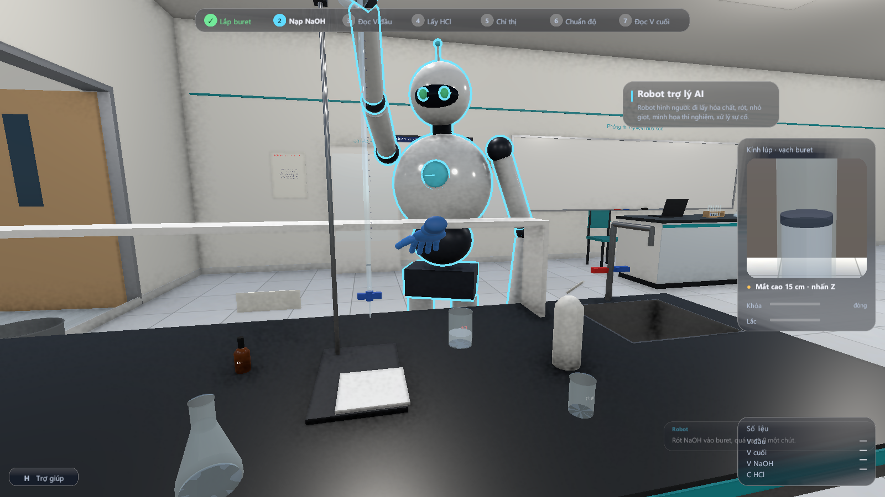
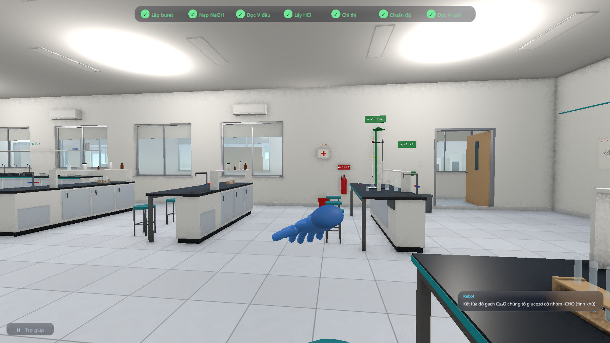
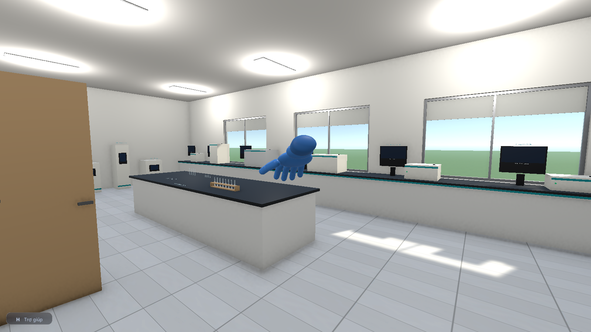
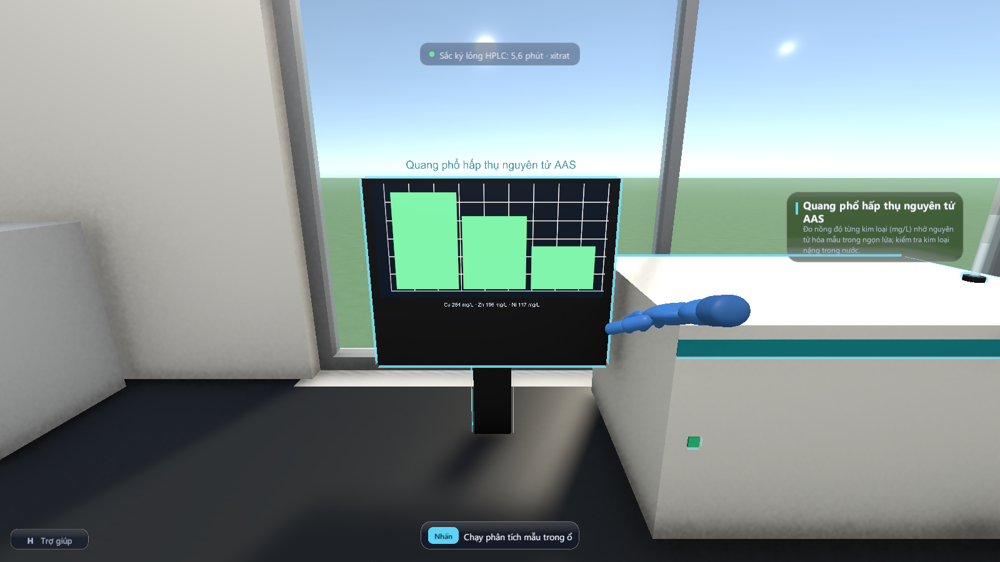
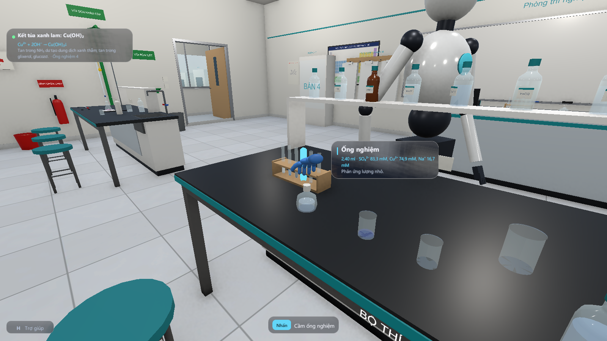
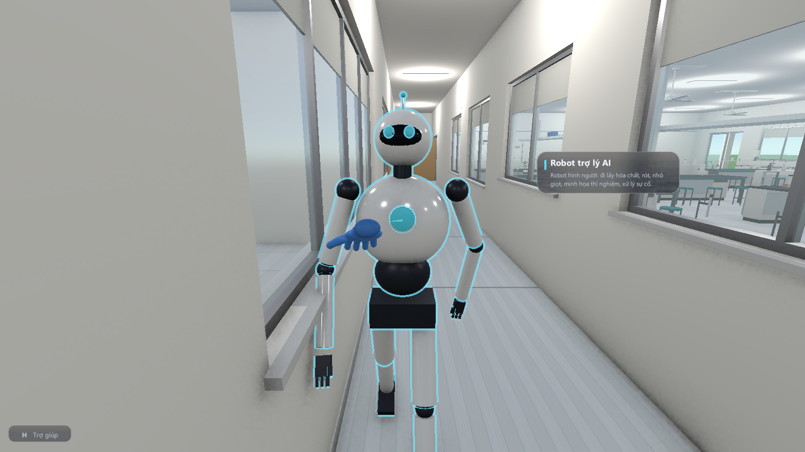

# Web quản lý, mạng lưới khóa AI, robot hình người và dãy phòng mới

## Chạy

```bash
pip install -r requirements.txt
uvicorn server.ai.main:app --host 127.0.0.1 --port 8000
```

Mở <http://127.0.0.1:8000> trên trình duyệt. Cùng máy chủ này phục vụ ứng dụng Unity (chú thích hiện tượng, robot), nên chỉ cần chạy một lần. Dữ liệu ghi vào `data/lab.db` (SQLite, đã có trong `.gitignore`); muốn dùng file khác thì đặt biến môi trường `KHKT_DB`.

## Web quản lý phòng thí nghiệm

| Trang | Làm được gì |
| --- | --- |
| Tổng quan | Số hóa chất, chất sắp hết, dụng cụ hỏng / đang mượn, sự cố 7 ngày, số khóa AI dùng được; biểu đồ hóa chất theo nhóm; hoạt động gần đây |
| Kho hóa chất | 720 chất: tìm theo tên có dấu hay không, công thức, số thứ tự, vị trí kệ (`K06-6-07`); lọc theo nhóm, chỉ chất sắp hết; nhập / xuất (ghi nhật ký), sửa mức tối thiểu, hạn dùng |
| Thiết bị | 80 loại: số lượng, hỏng, đang mượn, còn sẵn sàng, vị trí; sửa số trong bảng là lưu |
| Nhật ký | Phòng lab ảo tự ghi hiện tượng, sự cố (mức cảnh báo / nguy hiểm), kết quả máy phân tích, lệnh robot; giáo viên ghi chú buổi thực hành |
| Mạng lưới khóa AI | Thêm, thử, bật/tắt, xóa, đặt ưu tiên khóa Groq, DeepSeek, Gemini; xem trạng thái, số lần gọi / lỗi, độ trễ, thời gian còn nghỉ |
| Thử AI & robot | Hỏi thử qua mạng lưới khóa; gửi một ảnh chụp cảnh mẫu để xem kế hoạch robot mà AI lập và các bước máy chủ đã loại |

API nằm dưới `/api` (`server/lab/api.py`), giao diện là một file `server/web/index.html` không cần cài thêm gì.

## Mạng lưới khóa API

Nhiều khóa của nhiều nhà cung cấp dùng chung như một (`server/lab/keypool.py`). Cả ba đều có API kiểu OpenAI (`chat/completions`) nên chung một cách gọi.

| Nhà cung cấp | Lấy khóa ở | Mô hình mặc định |
| --- | --- | --- |
| Groq | console.groq.com → API Keys | `llama-3.3-70b-versatile` |
| DeepSeek | platform.deepseek.com → API keys | `deepseek-chat` |
| Gemini | aistudio.google.com → Get API key | `gemini-2.5-flash` |

- **Chọn khóa:** khóa đang bật, không trong thời gian nghỉ, **ưu tiên** nhỏ trước; cùng ưu tiên thì khóa lâu chưa dùng nhất (xoay vòng, chia đều hạn mức miễn phí).
- **429 (quá giới hạn tốc độ):** khóa nghỉ theo `Retry-After` (5 giây đến 10 phút) rồi tự quay lại; lần gọi đó chuyển ngay sang khóa kế tiếp.
- **401 / 403 (khóa sai, hết quyền):** khóa nghỉ 1 giờ, đánh dấu "Khóa sai"; bật lại tay trên web là dùng tiếp.
- **Lỗi mạng / máy chủ 5xx:** nghỉ ngắn (20–30 giây), thử khóa kế tiếp.
- **Hết khóa dùng được:** máy chủ chuyển sang Claude (nếu đặt `ANTHROPIC_API_KEY`), rồi API kiểu OpenAI (`LLM_BASE_URL`). Không còn gì thì ứng dụng vẫn chạy: chú thích soạn sẵn, robot hiểu lệnh cơ bản tại chỗ. `AI_PROVIDER=mang_luoi_khoa|claude|openai_compat` để chỉ dùng một nhà.
- **Bảo mật:** khóa chỉ nằm trong `data/lab.db` trên máy chạy máy chủ. Web chỉ hiện dạng che (`gsk_…1234`), ứng dụng Unity không bao giờ nhận khóa. Máy chủ chỉ nghe `127.0.0.1`; muốn cho máy khác trong lớp truy cập thì cần thêm đăng nhập trước khi đổi sang `0.0.0.0`.

## Robot trợ lý hình người: AI không thấy cảnh 3D thì điều khiển thế nào?

Mô hình ngôn ngữ chỉ đọc và viết chữ; nó không biết bàn ở đâu, ống nghiệm nào trống, tay robot dài bao nhiêu. Nên chia việc như robot thật: **AI là bộ não lập kế hoạch, chương trình là mắt và tay chân**.



1. **Mắt (`RobotWorld.Capture`)**: Unity liệt kê các vật trong bán kính 3,5 m quanh người dùng, mỗi vật một mã: `hoa_chat:253` (lọ CuSO₄), `ong_nghiem_2`, `coc_1`, `thiet_bi_3` (đèn cồn), `may_1` (máy phân tích), `cho_dat_4` (ổ đặt mẫu)... kèm tên, loại, khoảng cách, đang chứa gì (do bộ máy hóa học tính: chất, pH, nhiệt độ), ai đang cầm, hiện tượng vừa xảy ra.
2. **Não (`POST /robot/ke-hoach`)**: mô hình nhận ảnh chụp cảnh + câu hỏi, trả về JSON đúng lược đồ: lời đáp và danh sách bước. Mỗi bước là một kỹ năng trong danh sách trắng, tham chiếu vật **bằng mã**, không có tọa độ hay góc khớp.
3. **Kiểm tra (`server/ai/robot_plan.py`)**: bỏ kỹ năng lạ, bỏ bước dùng mã vật không có trong cảnh, đổi tên hóa chất ("CuSO4", "natri hiđroxit") thành số thứ tự trong danh mục, tên thí nghiệm mẫu thành khóa, giới hạn lượng (rót ≤ 100 ml, nhỏ ≤ 20 giọt, xúc ≤ 5 thìa, đun ≤ 100 °C, sục khí ≤ 30 giây, cân ≤ 20 g), tối đa 20 bước. Bước bị loại được trả về kèm lý do và ghi vào nhật ký.
4. **Thân (`LabRobot`, `LabRobot.Skills.cs`)**: mỗi kỹ năng là code xác định: tìm đường A* trên lưới sàn 0,25 m (`NavGrid`, tránh bàn tủ bằng va chạm), bước đi có dáng chân, IK hai khớp cho tay, cúi người khi với xa, nghiêng chai 100° để rót đúng số ml, giữ lọ úp để nhỏ giọt. Không với tới, chai hết, bình đầy, vật đang bị người dùng cầm... thì dừng và nói lý do.

### 36 kỹ năng

Robot **tự đi lấy dụng cụ** cần cho kỹ năng (máy đo pH cầm tay, nhiệt kế, máy đo độ dẫn, giấy quỳ, giấy pH, pipet bầu, bình tia, cân, máy ly tâm, máy khuấy từ, đèn cồn, bếp, tủ hút) và **dùng xong cất đúng chỗ cũ**. Mọi số đo, màu, kết tủa do bộ máy hóa học tính; robot chỉ đọc ra và nói lại.

| Nhóm | Kỹ năng |
| --- | --- |
| Di chuyển, cầm nắm | `di_toi`, `chi_vao`, `cam`, `dat`, `tra_ve`, `lay_hoa_chat` (vào kho lấy lọ đúng kệ) |
| Chuyển chất | `rot` (ml), `nho_giot` (giọt), `xuc` (thìa chất rắn), `hut_pipet` (pipet bầu 25 ml, chỉnh đúng vạch), `tia_nuoc` (nước cất), `suc_khi` (khí độc thì tự đưa bình vào tủ hút trước), `do_bo` (vào cốc thải / thùng chất thải, không đổ xuống bồn) |
| Xử lý | `lac`, `khuay` (máy khuấy từ), `dun_nong` (ống nghiệm hơ đều trên đèn cồn, cốc đặt lên bếp, tới nhiệt độ yêu cầu rồi tắt lửa), `ly_tam`, `dua_vao_tu_hut`, `doi` |
| Đo, quan sát | `quan_sat` (nói rõ chất, pH, nhiệt độ, kết tủa, khí, hiện tượng), `do_ph`, `do_nhiet_do`, `do_do_dan`, `thu_quy`, `thu_giay_ph`, `can`, `can_chat_ran` (đặt cốc lên cân, trừ bì, xúc tới đủ gam), `phan_tich` (đặt mẫu vào máy phân tích, mẫu ở cốc thì tự chuyển 3 ml sang ống nghiệm) |
| Thiết bị, an toàn | `bat_tat`, `bat_tu_hut`, `tat_lua`, `don_ban`, `rua_mat`, `noi` |
| Quy trình trọn gói | `chuan_do`, `thi_nghiem_mau` |

**`chuan_do`**: robot làm trọn bài chuẩn độ đang chọn ở bàn 1, như một người làm thật: lắp buret, nạp dung dịch chuẩn quá vạch 0, xả về vạch 0 vào cốc thải và đọc V đầu, dùng pipet bầu lấy đúng 25 ml mẫu, nhỏ chỉ thị, đặt bình nón dưới buret. Sau đó mở khóa cho chảy thành dòng và lắc đều. Thấy màu chỉ thị thoáng hiện quanh chỗ giọt rơi thì cho chảy chậm, màu mất chậm hơn thì nhỏ từng giọt. Màu bền thì khóa buret, chờ 30 giây rồi đọc V cuối và tính nồng độ. Robot chỉ dựa vào màu nhìn thấy, không dùng thể tích tương đương. Chạy thử: C(HCl) = 0,1072 M so với giá trị đúng 0,1074 M (**sai số −0,19%**, vượt 0,5 giọt).

**Thí nghiệm mẫu** (`Assets/Scripts/Demo/RobotDemos.cs`; khóa trùng với `TEMPLATES` trên máy chủ, có kiểm thử đối chiếu):

| Khóa | Thí nghiệm |
| --- | --- |
| `nhan_biet_cu2`, `nhan_biet_cl`, `nhan_biet_so4`, `nhan_biet_fe3` | nhận biết Cu²⁺ (NaOH), Cl⁻ (AgNO₃), SO₄²⁻ (BaCl₂), Fe³⁺ (KSCN) |
| `chi_thi_axit_bazo` | phenolphtalein hóa hồng trong NaOH, thêm HCl dư thì mất màu (trung hòa) |
| `kim_loai_axit` | robot vào kho lấy kẽm hạt, cho vào HCl: sủi bọt H₂ |
| `do_ph_dung_dich` | rót HCl, NaOH, nước cất vào 3 ống rồi đo pH: 1,00 / 13,00 / 7,00 |
| `ly_tam_ket_tua` | tạo Cu(OH)₂ rồi ly tâm cho kết tủa lắng |
| `glucozo_cu_oh2` | lấy glucozơ trong kho, hòa tan Cu(OH)₂ trong kiềm (xanh lam), hơ trên đèn cồn |
| `phan_tich_nuoc` | sang phòng máy, đo kim loại trong nước giếng và nước thải mạ điện bằng AAS |
| `chuan_do` | như trên |

**Không cần AI** (khung trò chuyện, phím T): "làm mẫu chuẩn độ", "thí nghiệm mẫu" (xem danh sách), "làm nhận biết Fe3+", "đo pH bình này", "đun nóng", "lắc", "khuấy", "ly tâm", "cân", "thử giấy quỳ", "đổ bỏ", "trong bình có gì", "đưa vào tủ hút", "lấy CuSO4 ra bàn", "KMnO4 ở đâu", "dọn bàn". Các lệnh dạng "bình này" dùng bình bạn đang trỏ chuột, đang cầm, hoặc bình có dung dịch gần nhất trước mặt. Có AI thì ra lệnh tự do; AI chọn thí nghiệm mẫu hoặc tự ghép kỹ năng.

Robot cao 1,8 m, đứng ở trạm sạc trong phòng tự động hóa; khi rảnh tự đi theo người dùng.

| | |
| --- | --- |
|  |  |

## Dãy phòng phía nam (cùng tầng)

Tòa nhà chỉ còn một tầng. Hành lang (z −2,2…0) nối phòng thí nghiệm với hai phòng mới:

| Phòng | Có gì |
| --- | --- |
| **Phòng máy phân tích hiện đại** (phím 7), x 0–13,5 | 6 máy **chạy thật** trên mẫu: đặt ống mẫu vào ổ trên nóc máy, bấm máy, màn hình vẽ đồ thị và kết quả tính từ đúng thành phần mẫu. Bàn chuẩn bị với 8 ống mẫu có sẵn, cuvet, ống trống. Trưng bày có thẻ thông tin: SEM, XRD, NMR để bàn, tủ sấy, lò nung, máy cất nước, nồi hấp, bom nhiệt lượng |
| **Phòng tự động hóa & robot** (phím 8), x 13,5–27 | Trạm sạc robot trợ lý, cánh tay robot cộng tác (cobot) chạy chu trình, máy hút nhả tự động, máy in 3D, 2 góc kính VR, tủ máy chủ AI đèn nhấp nháy, màn hình lớn chỉ đường tới web quản lý, bàn họp nhóm |

| Máy | Kết quả |
| --- | --- |
| Quang phổ UV-Vis | phổ hấp thụ 380–780 nm, λmax, độ hấp thụ, màu bù |
| Hồng ngoại FTIR | nhóm chức: O-H, C=O (este, anđehit, axit), N-H, C=C, vòng thơm, ion CO₃²⁻, SO₄²⁻, NO₃⁻ |
| Hấp thụ nguyên tử AAS | nồng độ từng kim loại tan, mg/L |
| Sắc ký khí - khối phổ GC-MS | sắc ký đồ chất hữu cơ dễ bay hơi, thời gian lưu, m/z |
| Sắc ký lỏng HPLC | sắc ký đồ chất hữu cơ tan (đường, axit hữu cơ...) |
| Chuẩn độ điện thế tự động | định liều động (thô 0,5 ml, mịn 0,01 ml), đường cong pH, thể tích tương đương, nồng độ đương lượng |

Ống mẫu có sẵn: nước giếng, nước thải mạ điện (Cu, Zn, Ni), giấm ăn, rượu, nước cam, đất chua, dầu chuối, nước thải xi mạ crom. Mỗi kết quả phân tích được ghi vào nhật ký web.

## Lỗi "vừa nhấn phím đi vừa rê chuột thì không xoay được"

Nguyên nhân thường gặp trên laptop: Windows **tạm khóa touchpad khi bàn phím đang được nhấn** (chống chạm nhầm lòng bàn tay), nên giữ W rồi rê touchpad thì camera không quay. Đây là cài đặt của Windows, ứng dụng không nhận được tín hiệu chuột nào.

- Trong ứng dụng: thêm phím **← →** để xoay và **PageUp / PageDown** để ngẩng / cúi; dùng được cả khi đang giữ WASD.
- Trên Windows 11: Cài đặt → Bluetooth & thiết bị → Bàn di chuột → Chạm → **Độ nhạy của bàn di chuột: Nhạy nhất** (Most sensitive) thì touchpad không bị khóa khi gõ phím.
- Hoặc dùng chuột rời (chuột rời không bị khóa).

## Tối ưu đồ họa và cấu hình máy (đo thật)

Đo bằng bản .exe (Windows, 1920×1080 toàn màn hình, đồ họa mức PC, tắt vsync) trên laptop **Intel Core i5-1334U, card tích hợp Intel Iris Xe, 24 GB RAM**: đứng 5 giây tại mỗi khu và lướt camera dọc phòng. Đo xen kẽ bản trước và bản sau vì laptop nóng lên làm số dao động. Số liệu gốc: `docs/anh-demo/v5/bench_*.csv`.

| Khu | Trước (FPS) | Sau (FPS) |
| --- | --- | --- |
| Bàn chuẩn độ | 32–55 | 53–69 |
| Bàn định tính | 48–60 | 60–79 |
| Bàn đun nóng | 35–41 | 49–51 |
| Phòng hóa chất (729 lọ) | 26–32 | 47–55 |
| Góc toàn cảnh | 33–36 | 50–57 |
| Phòng máy phân tích | 58–66 | 63–95 |
| **Trung bình cả lượt** | **41–48** | **60–70** |
| 1% khung hình chậm nhất | 19–31 | 39–44 |

Đã làm (không bỏ hiệu ứng đẹp nào: vẫn có SSAO, bóng mềm, HDR):
- **Chữ 3D** (~1.800 nhãn) viết lại shader theo URP để SRP Batcher gộp được, vẽ thành một nhóm riêng thay vì xen giữa các lọ thủy tinh trong suốt. Số lần đổi vật liệu mỗi khung hình ở phòng hóa chất giảm từ 1.361 xuống 47–62.
- **Lọ trong kho** dùng chung vật liệu theo màu dung dịch / màu bột (trước đây mỗi lọ một bản tô màu riêng nên không gộp lô được).
- **Không vẽ chi tiết ở xa**: chữ nhãn lọ quá 6 m, chữ thường quá 15 m, vật dưới 20 cm quá 14 m (ở các khoảng cách đó chúng chỉ còn vài điểm ảnh). Vật nhỏ dưới 25 cm thôi đổ bóng.
- **Bóng mặt trời** 2 tầng trong 30 m (trước 4 tầng trong 50 m, trong khi cả tòa nhà dài 27 m), lọc mềm mức vừa.
- **SSAO** tính ở nửa độ phân giải từ ảnh độ sâu, sau lượt vẽ chính. Trước đây SSAO bắt vẽ lại cả cảnh thêm một lượt để lấy pháp tuyến.
- **Đèn**: 21 đèn điểm tầm xa thay cho 46 đèn tầm gần, độ sáng gần như cũ.
- **Bỏ** 4 quạt trần (cùng hộp số quạt) và dãy nhà đối diện ngoài sân. Quạt hút của phòng hóa chất vẫn giữ vì có chức năng thông gió.

Cấu hình đề nghị:

| Mức | Máy | Dự kiến |
| --- | --- | --- |
| **Tối thiểu (đã đo)** | Laptop Intel Core i5 thế hệ 11 trở lên hoặc Ryzen 5 5500U trở lên, card tích hợp Iris Xe hoặc Radeon Vega 7, 8 GB RAM, Windows 10/11 64-bit | 60–70 FPS trung bình, chỗ nặng nhất ~47 FPS ở 1080p: mượt |
| Yếu hơn | Card Intel UHD 620 (laptop đời cũ) | ước chừng một nửa Iris Xe (~30 FPS); nên chọn mức đồ họa Mobile (độ phân giải vẽ 80%) |
| Khuyến nghị | GTX 1650 / RTX 3050 / RX 6500 XT | dư sức trên 100 FPS (ước tính) |
| Đeo kính VR sau này | RTX 3060 / RX 6600 XT trở lên | cảnh vẽ hai lần cho hai mắt (ước tính) |

Laptop nên cắm sạc, chọn chế độ nguồn hiệu suất cao. Máy có hai card thì chọn card rời cho `PhongThiNghiemAo.exe` (Cài đặt → Hệ thống → Màn hình → Đồ họa).

## Kiểm thử

```bash
python -m unittest discover -s tests -p "test_*.py"
```

Chạy thử trong Unity (bản sao project, chế độ batch, ~110 giây): robot đi từ phòng robot sang phòng hóa chất lấy CuSO₄ mang ra bàn 4 (lọ cách mắt người dùng 0,69 m); thực hiện kế hoạch 4 bước (nói → rót 2 ml CuSO₄ → nhỏ 8 giọt NaOH → chỉ vào ống) và ống nghiệm ra kết tủa Cu(OH)₂; sáu máy phân tích cho kết quả:

| Máy · mẫu | Kết quả |
| --- | --- |
| AAS · nước thải mạ điện | Cu 254 mg/L · Zn 196 mg/L · Ni 117 mg/L |
| Chuẩn độ tự động · giấm ăn | pH đầu 2,41 · V tương đương 99,59 ml NaOH 0,1 M · 0,830 N |
| GC-MS · rượu | 7,3 phút · etanol · m/z 46 |
| UV-Vis · nước thải xi mạ crom | λmax ≈ 458 nm (dung dịch da cam) |
| FTIR · dầu chuối | O-H ancol 3330 · C=O este 1740 · C-O este 1200 cm⁻¹ |
| HPLC · nước cam | xitrat 5,6 phút · glucozơ 7,9 phút · saccarozơ 8,4 phút |

| | |
| --- | --- |
|  |  |
|  |  |

62 kiểm thử Python đều qua (kể cả đối chiếu danh sách kỹ năng và thí nghiệm mẫu giữa máy chủ và Unity). `tests/test_lab_web.py`: xoay vòng khóa, 429 nghỉ và chuyển khóa, 401 khóa 1 giờ, khóa tắt không dùng, khóa không bao giờ lộ ra API, tìm kiếm kho, nhập/xuất ghi nhật ký, giới hạn số thiết bị hỏng, kiểm tra kế hoạch robot (kỹ năng lạ, mã vật không có, đổi tên hóa chất, giới hạn lượng, tối đa 12 bước), điểm cuối `/robot/ke-hoach` với nhà cung cấp giả, chuỗi nhà cung cấp tự chuyển khi lỗi. Không gọi mạng thật.
