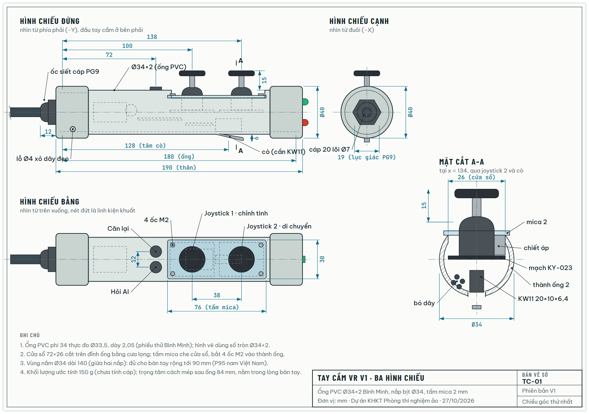
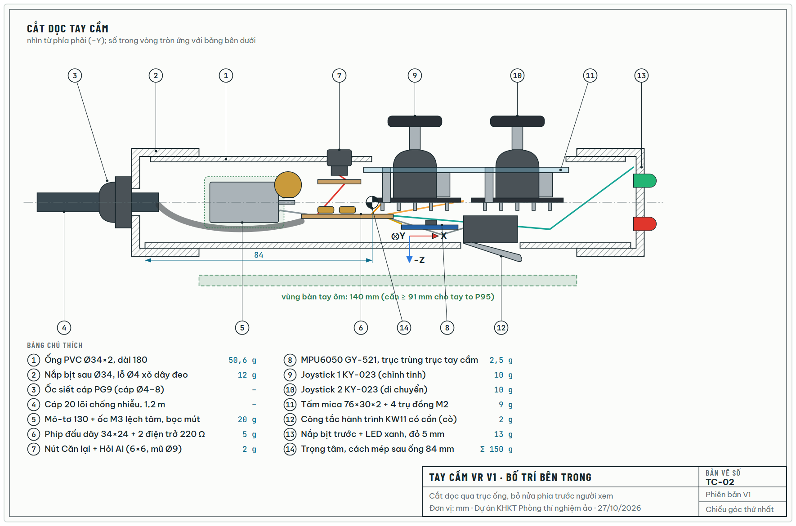
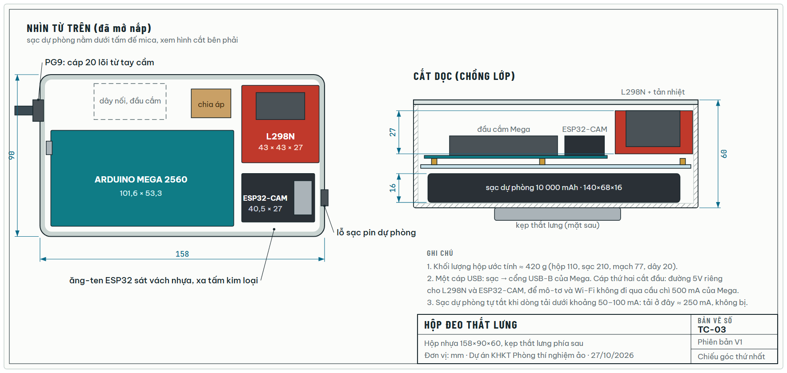
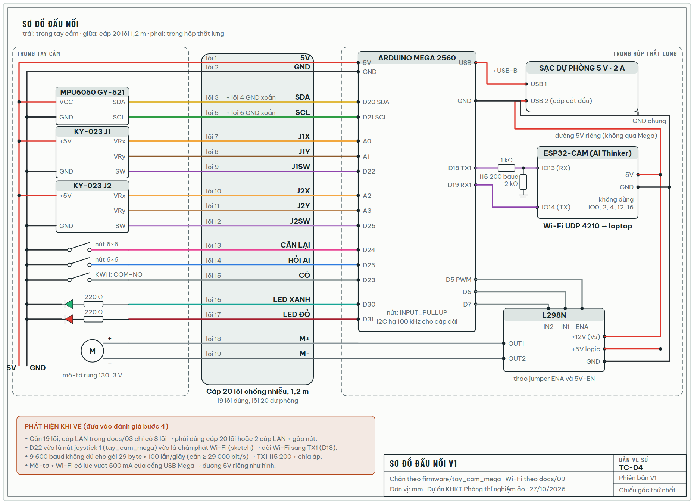
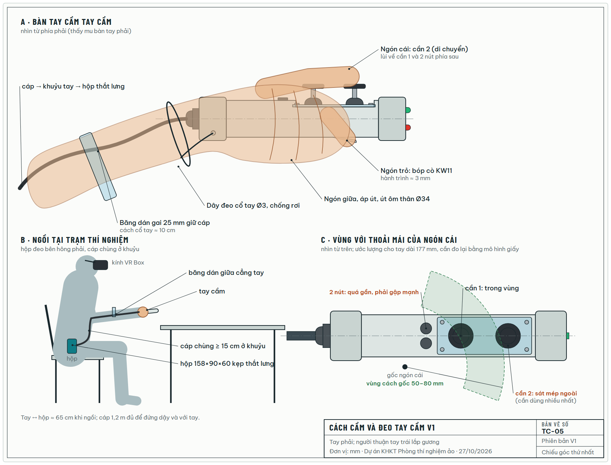

# Bản vẽ tay cầm VR (bản V1)

> **Tài liệu cũ.** Bản V1 (ống PVC + hộp thắt lưng) đã được thay bằng tay cầm V2 "Halo". Xem [docs/15](15-tay-cam-v2-halo.md). Số đo bàn tay trong tài liệu này vẫn được dùng cho V2.

Tài liệu ngày 27/10/2026. Đây là bước 1 (số liệu) và bước 2 (bản vẽ 2D) trong kế hoạch thiết kế tay cầm. Các bước sau chưa làm:

- bước 3: mô hình 3D;
- bước 4: đánh giá khả thi;
- bước 5: bản cải tiến V2.

**Bản V1 gồm hai phần:**

- **Tay cầm:** theo [docs/01](01-de-xuat-dieu-khien.md) và `firmware/tay_cam_mega`. Ống PVC chứa MPU6050, 2 joystick, 3 nút, 2 đèn và mô-tơ rung.
- **Hộp đeo thắt lưng:** nối với tay cầm bằng cáp 20 lõi. Trong hộp có Arduino Mega, L298N và ESP32-CAM. ESP32-CAM phát Wi-Fi theo cách ở [docs/09](09-tay-cam-esp32-cam.md).

Các file:

- Bản vẽ: [`docs/anh-tay-cam/TC-01..TC-05`](anh-tay-cam/), mỗi bản có cả `.svg` và `.png`.
- Script vẽ:
  - `tools/ve_tay_cam/ve_2d.py` vẽ các bản vẽ.
  - `tools/ve_tay_cam/xuat_png.sh` xuất PNG.
  - `tools/ve_tay_cam/trang_html.py` tạo trang tổng hợp.

## 1. Số liệu đầu vào

### Bàn tay → đường kính tay nắm

Số đo bàn tay nam người Việt (Imrhan, Nguyen & Nguyen 1993):

| Số đo | Trung bình ± độ lệch (mm) | P5 – P95 (mm) |
| --- | --- | --- |
| Chiều dài bàn tay | 177 ± 12 | 157 – 197 |
| Chiều rộng bàn tay | 79,2 ± 6,9 | 68 – 91 |
| Độ dày bàn tay | 28,2 ± 3,0 | 23 – 33 |

- **Đường kính:** theo Kong & Lowe (2005), tay nắm dễ chịu nhất khi đường kính bằng **19,7% chiều dài bàn tay**. Áp vào số đo trên thì được 31 mm (P5), 34,9 mm (P50) và 38,8 mm (P95). Ống PVC phi 34 Bình Minh thực đo Ø33,5, nằm giữa dải này, nên **giữ ống phi 34**.
- **Chiều dài vùng nắm:** cần ít nhất 91 mm, bằng chiều rộng tay to P95. Bản V1 có 140 mm.
- **Cần kiểm lại:** số liệu là của nam, khảo sát từ năm 1993. Nhóm nên đo tay khoảng 10 bạn trong lớp, cả nam và nữ.

### Kích thước linh kiện

| Linh kiện | Kích thước (mm) | Khối lượng | Nguồn |
| --- | --- | --- | --- |
| Joystick KY-023 | bo 34 × 26; cần cao 32 kể cả mũ | ≈ 10 g | datasheet Joy-IT (bo mạch) |
| MPU6050 GY-521 | 21 × 16 × 3 | ≈ 2,5 g | module phổ biến, cần đo lại |
| Arduino Mega 2560 | 101,6 × 53,3 | 37 g | Arduino |
| ESP32-CAM | 40,5 × 27 × 4,5 | 10 g | Ai-Thinker |
| L298N | 43 × 43 × 27 | ≈ 30 g | module phổ biến, cần đo lại |
| Công tắc KW11 | 20 × 10 × 6,4 | 2 g | cần đo lại |
| Mô-tơ 130 + ốc lệch tâm | dài 25, mặt cắt 20 × 15 | ≈ 20 g | cần đo lại |
| Ống PVC phi 34 | Ø33,5 × 2,05 | 0,28 g/mm | phiếu thử Nhựa Bình Minh |

Sau khi đo lại bằng thước kẹp, sửa hằng số ở đầu `ve_2d.py` rồi chạy lại script để vẽ lại.

### Chi phí

- **Phải mua thêm khoảng 318.000 đ.** Giá joystick, MPU6050 và L298N lấy ở Hshop ngày 27/10/2026; các món nhỏ còn lại là ước tính.
- **Không tính** Mega, ESP32-CAM và sạc dự phòng, vì nhóm đã có.
- Bảng chi tiết nằm trong trang tổng hợp.

## 2. Bản vẽ

Bản vẽ theo phương pháp **chiếu góc thứ nhất** (TCVN, như sách Công nghệ). Kích thước tính bằng mm, đo từ mép sau của ống. Hệ trục theo docs/02: X dọc ống ra đầu, Y sang trái, Z lên trên.

| Bản vẽ | Nội dung |
| --- | --- |
| [TC-01](anh-tay-cam/TC-01.png) | Ba hình chiếu và mặt cắt A–A qua joystick 2 và cò. Ghi các kích thước chính: thân 190, ống 180, nắp Ø40, cần cách đuôi 100 và 138, cò cách đuôi 128, cần nhô 15 mm |
| [TC-02](anh-tay-cam/TC-02.png) | Cắt dọc: chỗ đặt 13 linh kiện, khối lượng từng món, trọng tâm cách đuôi 84 mm (nằm trong lòng bàn tay), tổng ≈ 150 g |
| [TC-03](anh-tay-cam/TC-03.png) | Hộp thắt lưng 158×90×60: bố trí Mega, L298N, ESP32-CAM; sạc dự phòng nằm dưới tấm đế; tổng ≈ 420 g |
| [TC-04](anh-tay-cam/TC-04.png) | Sơ đồ đấu nối: 19 lõi cáp, chân Mega, L298N, chia áp sang ESP32-CAM, đường 5V riêng |
| [TC-05](anh-tay-cam/TC-05.png) | Cách cầm (ngón cái, ngón trỏ, dây đeo cổ tay), cách đi cáp khi ngồi tại trạm, vùng với của ngón cái |

### Bảng đấu nối cáp 20 lõi

| Lõi | Tín hiệu | Đầu tay cầm | Đầu hộp |
| --- | --- | --- | --- |
| 1 | 5V | VCC GY-521, +5V hai KY-023 | Mega 5V |
| 2 | GND | thanh GND | Mega GND |
| 3 + 4 | SDA + GND xoắn | GY-521 SDA | D20 |
| 5 + 6 | SCL + GND xoắn | GY-521 SCL | D21 |
| 7, 8, 9 | J1X, J1Y, J1SW | KY-023 J1 | A0, A1, D22 |
| 10, 11, 12 | J2X, J2Y, J2SW | KY-023 J2 | A2, A3, D26 |
| 13, 14, 15 | Căn lại, Hỏi AI, Cò | nút về GND | D24, D25, D23 (INPUT_PULLUP) |
| 16, 17 | LED xanh, LED đỏ | 220 Ω → LED → GND | D30, D31 |
| 18, 19 | M+, M− | mô-tơ 130 | L298N OUT1, OUT2 (ENA = D5, IN1 = D6, IN2 = D7) |
| 20 | – | dự phòng | – |

Đấu nối trong hộp:

- **Mega → ESP32-CAM:** D18 (TX1) qua điện trở 1 kΩ vào IO13, IO13 nối 2 kΩ xuống GND (chia áp xuống 3,3 V), chạy 115 200 baud.
- **ESP32-CAM → Mega:** IO14 vào D19 (RX1).
- **Nguồn:**
  - Cổng USB 1 của sạc nối vào Mega.
  - Cổng USB 2 dùng cáp cắt đầu, cấp 5V riêng cho L298N và ESP32-CAM.
  - Mọi GND nối chung.

## 3. Vấn đề phát hiện khi vẽ (chuyển sang bước 4)

1. **Cáp không đủ lõi.** Cần 19 lõi, trong khi cáp LAN ghi trong docs/03 chỉ có 8.
2. **Trùng chân D22.** Firmware `tay_cam_mega` dùng D22 cho nút joystick 1, còn sketch Wi-Fi dùng D22 làm chân phát. Bản vẽ đã dời đường Wi-Fi sang TX1.
3. **9 600 baud không đủ.** Gói 29 byte gửi 100 lần/giây cần ít nhất 29 000 bit/s.
4. **Nguồn qua Mega có thể quá tải.** Mô-tơ lúc khởi động cộng với Wi-Fi lúc phát có thể vượt 500 mA của cổng USB Mega.
5. **Ngón cái phải với xa.** Hai cần và hai nút trải dài 90 mm. Hai nút nằm quá gần gốc ngón cái, còn cần 2 (dùng nhiều nhất) ở sát mép vùng với. Đây là ước lượng, cần thử bằng mô hình giấy.
6. **Không ai thấy đèn LED.** Người đeo kính VR không nhìn thấy đèn ở đầu tay cầm.

## Nguồn

- Zheng và cs., AHFE 2018, bảng 4, trích số liệu của Imrhan, Nguyen & Nguyen (1993): https://openaccess-api.cms-conferences.org/articles/download/978-1-4951-2105-0_32
- Kong & Lowe (2005), *Optimal cylindrical handle diameter for grip force tasks*: https://stacks.cdc.gov/view/cdc/197408
- Phiếu thử ống PVC-U Bình Minh DN34 × 2,0: https://binhminhplastic.com.vn/Data/Sites/1/Product/8889/34x2,0mm%20PN12.pdf
- Datasheet KY-023 (Joy-IT): https://asset.conrad.com/media10/add/160267/c1/-/en/001707629DS01/datasheet-1707629-joy-it-ky023jm-1-pcs-compatible-with-development-kits-raspberry-pi-pcduino-banana-pi-arduino.pdf
- Hshop: [joystick](https://hshop.vn/mach-joystick), [MPU6050](https://hshop.vn/cam-bien-6-dof-bac-tu-do-gy-521-mpu6050), [L298](https://hshop.vn/mach-dieu-khien-dong-co-dc-l298), [ESP32-CAM](https://hshop.vn/kit-rf-thu-phat-wifi-ble-esp32-cam)

Không tìm được khảo sát bàn tay người Việt nào đăng bằng tiếng Việt, nên phải dùng nguồn tiếng Anh.
