# Mạng dòng chảy (giai đoạn C3)

## Mục tiêu

Bộ dụng cụ gia công ở khu chế tạo phải **chạy được như thật** cho nhiều loại thí nghiệm, không chỉ chuẩn độ:

- chưng cất, đun hồi lưu (este hóa);
- điều chế – dẫn – rửa – thu khí;
- nhiệt phân chất rắn;
- lọc thường, lọc hút, chiết, cô cạn;
- phản ứng giữa các chất ở các bình nối với nhau.

Mạng dòng chảy (`FluidNetwork`) chạy **10 lần mỗi giây** trên cây lắp ráp (các khớp nối của C1 + C2). Phản ứng vẫn do bộ máy hóa học có sẵn (`ChemEngine`) tính.

Đây là **mô hình mạng ở mức giáo dục**, không phải mô phỏng chất lỏng từng hạt: hiện tượng đúng định tính, số liệu gần đúng định lượng.

## Thành phần

| Tệp | Vai trò |
|---|---|
| `data/chem/nhiet_do_soi.json` (+ bản Unity `Assets/Lab/Data/`) | Nhiệt độ sôi và nhiệt hóa hơi của khoảng 110 chất lỏng trong danh mục |
| `Simulation/Chem/Volatility.cs` | Áp suất hơi (Clausius – Clapeyron), định luật Raoult có hệ số hoạt độ, điểm sôi hỗn hợp, thành phần hơi |
| `Interaction/LabContainer.cs` | Nhiệt độ sôi theo thành phần, nhiệt dư khi sôi, nhiệt khi đun khô, khí sinh ra chờ dẫn đi, lấy đúng một phần (lớp, nước lọc, hơi) |
| `Assembly/Flow/FluidNetwork.cs` | Dẫn khí, hơi, chất lỏng theo khớp nối; sinh hàn; lọc; chiết; nhiệt phân; áp suất hệ kín; cảnh báo an toàn |
| `Assembly/Flow/FlowValve.cs` | Khóa phễu chiết / phễu nhỏ giọt: bấm vào tay khóa để mở / đóng |

## Các quy luật

### Khí

Khí sinh ra trong bình (CaCO₃ + HCl → CO₂, Zn + HCl → H₂...) đi theo các khớp **cùng kênh dẫn chất** tới lối thoát.

| Đường đi | Kết quả |
|---|---|
| Qua bình rửa khí, vào ống **dài** | Khí tan / phản ứng được bị giữ lại; khí còn lại ra ống ngắn |
| Bình rửa khí lắp **ngược** (vào ống ngắn) | Cảnh báo: khí đẩy dung dịch ra ngoài |
| Đầu ống **ngập** trong dung dịch | Sục khí: khí tan / phản ứng (CO₂ + nước vôi trong → CaCO₃↓; dư CO₂ thì kết tủa tan dần) |
| Vào **kệ chậu nước** có ống úp | Khí đẩy nước, dồn vào ống úp; ống đầy thì sủi qua mặt nước |
| Đầu ống trong **lọ ngửa** | Thu bằng đẩy không khí nếu khí nặng hơn không khí (M > 29); khí nhẹ thì báo "úp ngược bình" |
| Hệ **kín** | Áp suất tăng theo pV = nRT; quá 2 atm thì nút cao su bật ra (khớp nhám: báo rò, nguy cơ vỡ) |
| Thoát ra phòng | Khí độc ngoài tủ hút: cảnh báo nguy hiểm. Khí dễ cháy gần ngọn lửa đang cháy: cảnh báo cháy nổ |

Khí tan trong nước được quy về dạng trong dung dịch: CO₂ → H₂CO₃; SO₂ → H₂SO₃; H₂S; NH₃; HCl; Cl₂; NO₂ → HNO₃ + HNO₂; HCN. Khí ít tan (O₂, H₂, N₂, CH₄, C₂H₂, C₂H₄, NO) đi tiếp.

### Hơi: chưng cất, đun hồi lưu, cô cạn

- **Điểm sôi theo thành phần.** Nước sôi 100 °C; rượu loãng sôi thấp hơn (rượu 30° khoảng 85 °C).
  - Cách tính: Σ xᵢ·γᵢ·p*ᵢ(T) = 1 atm.
  - p*ᵢ tính theo Clausius – Clapeyron từ nhiệt độ sôi và nhiệt hóa hơi.
  - γᵢ là hệ số hoạt độ Margules theo nhóm chất: ancol lệch mạnh khỏi lý tưởng, axit cacboxylic gần lý tưởng.
  - Chất không tan trong nước là pha riêng (chưng cất lôi cuốn hơi nước).
- **Khi đã sôi**, nhiệt cấp thêm dùng để hóa hơi. Thành phần hơi yᵢ ∝ xᵢ·γᵢ·p*ᵢ, nên chất sôi thấp (etanol) ra trước.
- **Hơi đi tới ống sinh hàn:**

  | Tình huống | Kết quả |
  |---|---|
  | Có nước làm lạnh: ống cao su nối vòi nước vào (dưới) với vòi cấp, vòi ra (trên) với ống thoát | Ngưng tụ hết |
  | Nối ngược chiều | Chỉ ngưng khoảng 60%, cảnh báo |
  | Không có nước | Hơi thoát ra, cảnh báo; hơi dễ cháy gần lửa thì cảnh báo cháy |

- **Chất ngưng tụ** chảy theo đầu dưới của sinh hàn:
  - về bình đang đun: **đun hồi lưu**;
  - sang đầu nối hứng: nhỏ giọt vào bình hứng ngay bên dưới (chưa đặt bình hứng thì báo chảy ra ngoài).
- **Nhiệt kế** ở đầu nối chưng cất đọc nhiệt độ hơi; không còn hơi đi qua thì nguội dần.
- **Không có sinh hàn** (bát sứ, cốc): hơi bay đi, tức là **cô cạn**. Cạn còn chất rắn thì báo "cô cạn xong"; bình thủy tinh cạn khô thì cảnh báo nứt vỡ.

### Chất lỏng

| Dụng cụ | Cách chảy |
|---|---|
| Phễu lọc (giấy lọc) | Khoảng 1,5 ml/s; chất rắn, kết tủa ở lại trên giấy, nước lọc chảy xuống bình / cốc bên dưới |
| Phễu Buchner | Khoảng 0,6 ml/s; nhánh bình hút lọc nối ống cao su tới vòi hút chân không thì khoảng 5 ml/s |
| Phễu chiết | Mở khóa thì **lớp nặng hơn** chảy ra trước (dầu ăn nhẹ hơn nước: nước ra trước; clorofom nặng hơn: clorofom ra trước) |
| Phễu nhỏ giọt | Mở khóa thì nhỏ từ từ (khoảng 0,5 ml/s) vào bình bên dưới qua nút cao su |

Lưu lượng giảm dần khi phễu cạn (theo √ mực chất lỏng). Đuôi phễu cắm qua nút / miệng bình thì chảy thẳng vào bình đó; để hở thì giọt rơi thẳng xuống: trúng miệng bình thì vào, không thì báo chảy ra ngoài.

### Nhiệt phân chất rắn

Chất rắn trong ống đun khô nóng lên theo nhiệt dung (ống nghiệm + chất rắn) và tỏa nhiệt ra không khí; với đèn cồn, nhiệt độ tối đa vào khoảng 500 – 600 °C.

| Chất | Nhiệt độ | Phản ứng |
|---|---|---|
| KMnO₄ | 220 °C | 2KMnO₄ → K₂MnO₄ + MnO₂ + O₂↑ |
| KClO₃ | 380 °C (240 °C khi có MnO₂) | 2KClO₃ → 2KCl + 3O₂↑ |
| CuSO₄·5H₂O | 110 °C | CuSO₄·5H₂O → CuSO₄ + 5H₂O (hơi nước đi theo ống) |
| NH₄Cl | 340 °C | NH₄Cl → NH₃ + HCl |
| Cu(OH)₂ | 80 °C | Cu(OH)₂ → CuO + H₂O |

Khí sinh ra đi theo mạng như mục Khí (thu O₂ bằng đẩy nước). Nung chất rắn ngậm nước mà miệng ống hướng lên thì cảnh báo nước ngưng chảy ngược làm vỡ ống.

### Thao tác mới

- **Mở / đóng khóa** phễu chiết, phễu nhỏ giọt: bấm chuột trái vào tay khóa màu xanh (không cầm cả phễu).

## Sửa kèm theo

| Chỗ sửa | Trước | Sau |
|---|---|---|
| Tỏa nhiệt của bình (`LabContainer`) | Nguội theo °C/giây, không phụ thuộc thể tích: bình 100 ml ở 86 °C mất khoảng 200 W, đèn cồn gần như không đun sôi được | Tỏa nhiệt theo diện tích bề mặt (∝ V^2/3): bình 100 ml ở 86 °C mất khoảng 20 W |
| Đá vôi, FeS... (cacbonat, sunfit, sunfua không tan) | Tan hết trong nước thường rồi kết tủa lại; nhỏ HCl vào sau thì không sủi CO₂ | Chỉ tan khi có axit, nhanh chậm theo độ axit; nhỏ HCl lên đá vôi ngâm nước vẫn sủi CO₂ |
| Chất lỏng danh mục không ghi khối lượng mol (dầu ăn, dầu hỏa) | Cho vào bình được 0 mol (chỉ có thể tích) | Dùng khối lượng mol ước lượng của loài hữu cơ, nên tách lớp và bay hơi được |

## Kiểm thử

### Bộ máy hóa học và dữ liệu

- `tests/test_nhiet_do_soi.py`: 5/5 đạt. Gồm: tên khớp danh mục, giá trị hợp lý, thứ tự sôi quen thuộc, mọi chất lỏng dễ cháy / ancol / este đều có nhiệt độ sôi, bản Unity giống bản gốc.
- `tests/ChemEngineTests.cs`: 55/55 đạt. Có thêm mục "Bay hơi, chưng cất" và mục "đá vôi ngâm nước, nhỏ HCl vào sau vẫn sủi CO₂".

**Điểm sôi tính được** (so với thực tế):

| Hỗn hợp | Điểm sôi | Giọt cất đầu | Thực tế |
|---|---|---|---|
| Nước | 100,0 °C | – | 100 °C |
| Rượu 10° | 93,2 °C | 51% etanol | khoảng 92 °C, hơi khoảng 50% |
| Rượu 30° | 85,7 °C | 73% etanol | khoảng 85 °C |
| Rượu 50° | 82,3 °C | 80% etanol | khoảng 82 °C |
| Cồn 96° | 78,5 °C | 96% etanol | 78,2 °C (đẳng phí) |

### Bài chạy tự động `dong_chay` (bản sao project ở ổ D)

**Cách chạy:**
1. Dựng 9 bộ trong giao diện lắp ráp 3D.
2. Gia công ra các bàn đích.
3. Cho hóa chất vào, châm đèn cồn, mở khóa phễu.
4. Theo dõi 480 giây (thời gian trong mô phỏng, chạy nhanh gấp 8 lần).

| Bộ | Kết quả |
|---|---|
| **Chưng cất** rượu 30° (100 ml), bàn thí nghiệm lắp ráp, sinh hàn nối vòi nước thật | Giọt đầu sau 107 s. 5 ml đầu chứa **73% etanol**, nhiệt kế **86,3 °C**, rồi tăng dần 87 → 90 → 95 → **99,5 °C**. Hứng 57,7 ml (52% etanol); bình còn 42,3 ml, chỉ 1% etanol |
| **Đun hồi lưu** có nước làm lạnh | 50,0 → 50,0 ml (không mất) |
| Đun hồi lưu **quên nối nước** | 50 → 0 ml, kèm cảnh báo "Ống sinh hàn chưa có nước làm lạnh" |
| **Điều chế CO₂**: CaCO₃ + HCl 1 M (nhỏ từ phễu nhỏ giọt), dẫn vào cốc nước vôi trong | HCl chảy vào bình qua nút cao su. Khoảng 9 mmol đá vôi tan, nước vôi trong **đục: 1,2 mmol CaCO₃↓** (hết toàn bộ Ca²⁺). CO₂ dư sủi qua cốc rồi bay ra |
| **Nhiệt phân KMnO₄** (5 g), thu O₂ bằng đẩy nước | Chất rắn nóng tới khoảng 490 °C; KMnO₄ phân hủy hết (còn MnO₂ 15,8 mmol). **Ống úp đầy O₂** (19/20 ml); O₂ dư sủi qua mặt nước chậu |
| **Phễu chiết** dầu ăn 30 ml + nước 40 ml | 30 ml đầu ra là **nước** (dầu 0,0 ml); dầu ra sau. Tính riêng clorofom + nước: lớp dưới là clorofom |
| **Lọc** kết tủa Cu(OH)₂ (CuSO₄ + NaOH) | Nước lọc 45 ml, **không có chất rắn, Cu²⁺ 0,000 mmol**; Cu(OH)₂ 10 mmol ở lại trên giấy lọc |
| **Lọc hút** Buchner | 3,7 ml/s, nhanh gấp **2,8 lần** lọc thường (1,3 ml/s). Tháo ống hút chân không thì còn 0,37 ml/s |
| **Đun ống nghiệm đậy nút đặc** (hệ kín) | Sau 8 s nút **bật ra** (áp suất vượt 2 atm), có cảnh báo nguy hiểm |
| **Cô cạn** NaCl 1 M (20 ml) trong bát sứ | Bát cạn (còn 0,03 ml), lượng Na⁺ giữ nguyên 20,0 mmol; thông báo "cô cạn xong" |

### Hồi quy

| Bài | Kết quả |
|---|---|
| `lap_rap` | 9 bộ mẫu gia công đúng, lệch khớp 0 mm, không bộ nào đổ |
| `che_tao` | Đạt |
| `khu` | Tải / gỡ khu đúng |
| Bài đầy đủ | Chuẩn độ sai số 0,69%; robot chuẩn độ −0,25% |

### Ảnh

| | |
|---|---|
| 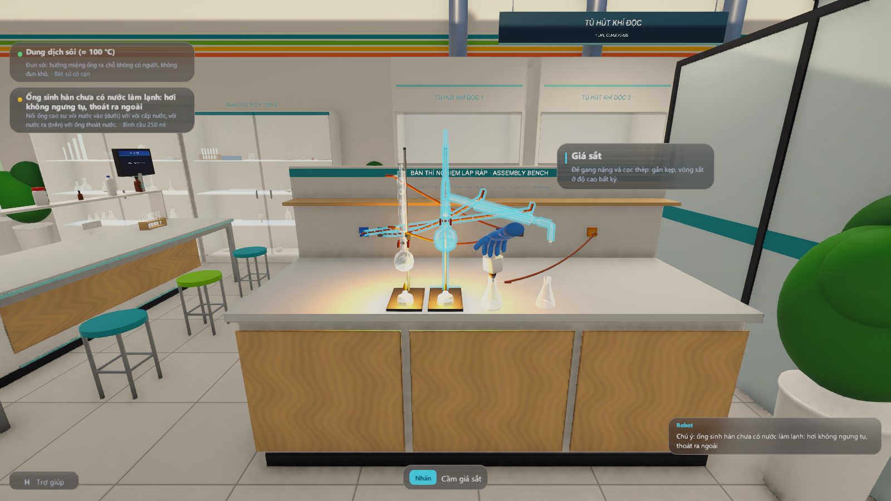 Chưng cất đang chạy | 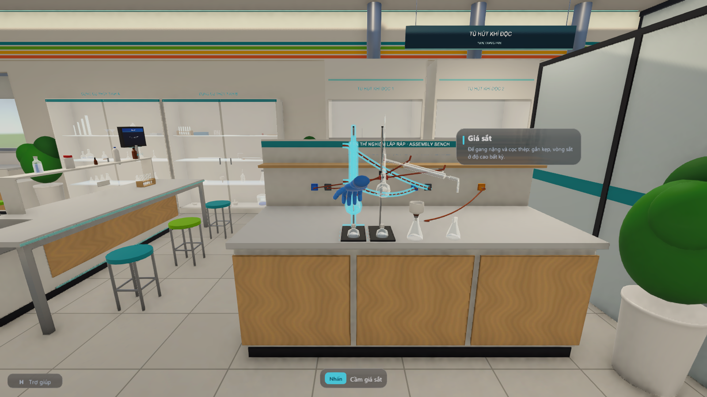 Bàn lắp ráp: chưng cất, hồi lưu, lọc hút |
| 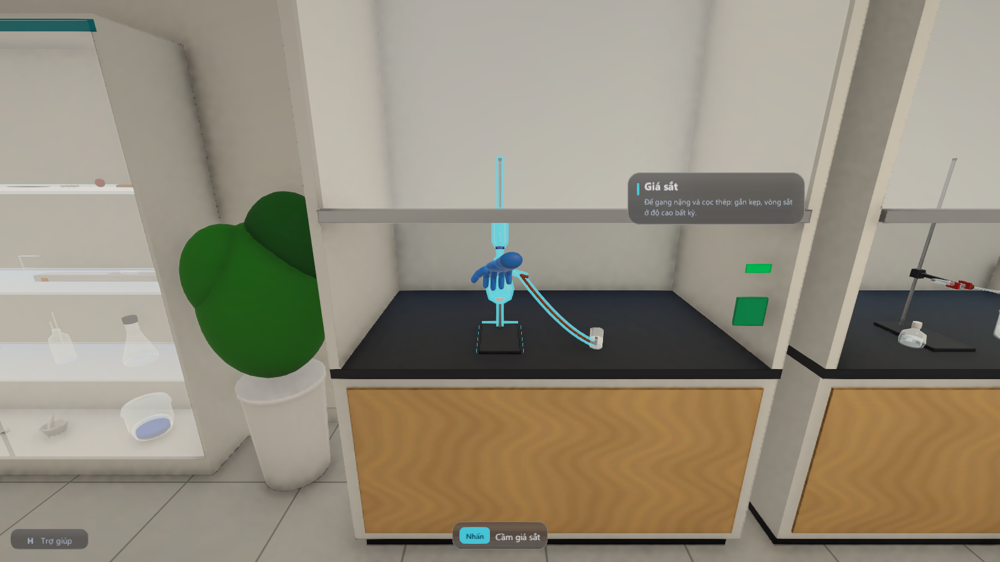 CO₂ dẫn vào nước vôi trong | 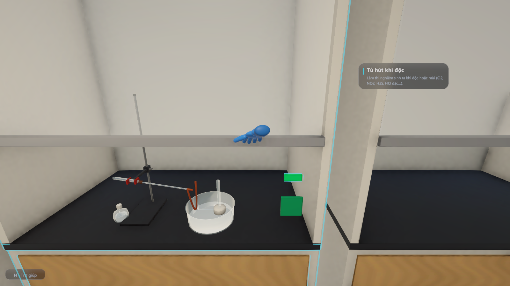 Nhiệt phân KMnO₄, thu O₂ |
| 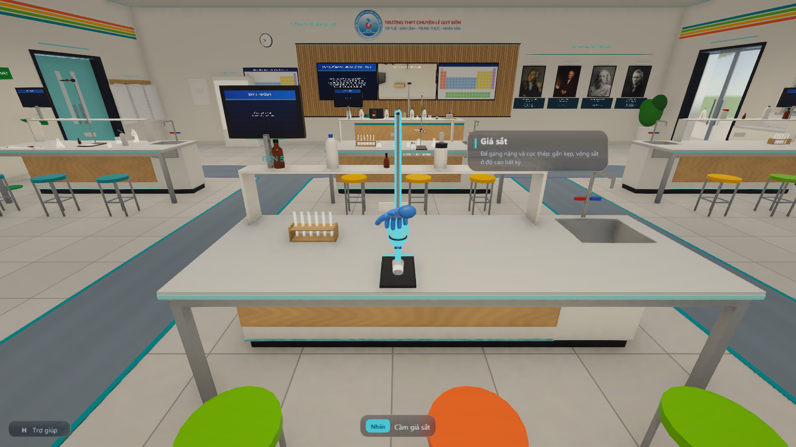 Phễu chiết | 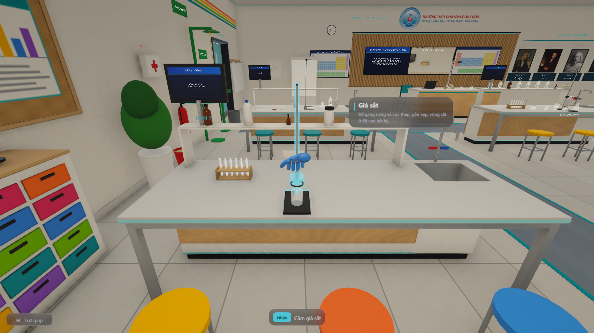 Lọc kết tủa |
| 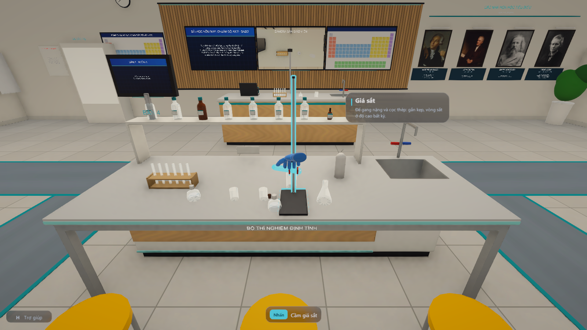 Hệ kín bật nút | 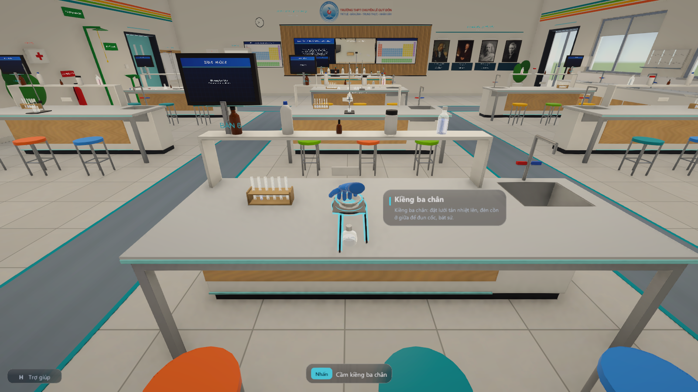 Cô cạn |

## Giới hạn (nói trước)

- **Chưa có hình ảnh dòng chảy.** Mực chất lỏng, kết tủa và thông báo thay đổi đúng, nhưng chưa có hiệu ứng giọt rơi, bọt khí trong ống, hơi trong sinh hàn. Phần này là giai đoạn C4.
- **Mức giáo dục:**
  - bỏ qua đẳng phí chính xác và tương tác giữa các chất hữu cơ;
  - áp suất hệ kín tính gộp cho cả bộ;
  - ống cao su không có giới hạn độ dài.
- **CO₂ dư:** khí thoát ra thay vì làm tan dần kết tủa thành Ca(HCO₃)₂. Thực tế sục rất lâu nước vôi mới trong lại.

---

# Giai đoạn C4: hình ảnh dòng chảy

Ở C3, mực chất lỏng, kết tủa và thông báo đã thay đổi đúng, nhưng chưa nhìn thấy chất đang chảy. C4 thêm các hiệu ứng nhìn thấy được, chạy theo đúng số liệu của mạng dòng chảy.

## Thành phần

`Assets/Scripts/Assembly/Flow/FlowFx.cs`:
- dùng chung một bể quả cầu nhỏ (260 hạt) và 12 dòng liền, không dùng hệ hạt, nên nhẹ máy;
- mạng dòng chảy gọi `Request(...)` mỗi khi có chất chảy, khí sục hay hơi thoát; một kênh không được gọi lại thì tự tắt sau 0,5 s;
- tự gắn vào cùng đối tượng với `FluidNetwork`, không cần thêm gì ở trình dựng cảnh.

| Hiện tượng | Hình ảnh | Nhanh / chậm theo |
|---|---|---|
| Đầu nhỏ giọt, đuôi phễu (chậm) | Giọt đọng lớn dần ở đầu ống rồi rơi xuống mặt chất lỏng bình hứng | Lưu lượng (1 giọt khoảng 0,05 ml, tối đa 10 giọt/s) |
| Đuôi phễu (nhanh, trên 1 ml/s) | Dòng chảy liền, to dần theo lưu lượng | Lưu lượng |
| Chất lỏng chảy ra ngoài | Giọt rơi tới mặt bàn | – |
| Màu giọt, dòng | Theo màu dung dịch đang chảy (nước: xanh nhạt cho dễ thấy) | – |
| Đầu ống dẫn khí ngập trong dung dịch | Bọt khí nổi từ đầu ống lên mặt chất lỏng | Lượng khí (mol/s) |
| Bình rửa khí | Bọt khí từ đáy bình lên | Lượng khí |
| Thu khí bằng đẩy nước | Bọt từ lỗ kệ dồn lên ống úp, tới mặt phân cách khí – nước; ống đầy thì bọt tràn ra mép miệng ống, nổi lên mặt chậu | Lượng khí |
| Mực nước trong ống úp | Cột nước trong ống úp hạ dần khi khí dồn vào (lúc đầu đầy nước) | Thể tích khí đã thu |
| Bình đang sôi | Bọt hơi nổi từ đáy bình | Tốc độ hóa hơi |
| Hơi thoát ra (cô cạn, sinh hàn thiếu nước, hệ kín bật nút) | Làn hơi trắng mờ bốc lên, nở dần | Tốc độ hóa hơi |
| Khí màu, khí độc thoát ra (NO₂, Cl₂, SO₂, NH₃, H₂S...) | Khói màu ở **đầu ống ra** (không còn bốc lên từ miệng bình đã đậy nút) | Lượng khí |
| Ống sinh hàn đang ngưng tụ | Giọt ngưng chảy dọc ống trong, từ đầu cao xuống đầu thấp | Lượng chất ngưng tụ |
| Nhiệt kế ở đầu nối chưng cất | Cột đỏ dâng theo nhiệt độ hơi (thang 0 – 250 °C) | Nhiệt độ hơi |

## Kiểm thử: bài `hieu_ung` (bản sao project ở ổ D)

**Cách chạy:**
- dựng lại 9 bộ của bài `dong_chay`;
- chụp cận cảnh bằng một camera riêng, đúng lúc từng hiện tượng xảy ra;
- ghi lại số hạt đang bay, cột nhiệt kế, mực nước ống úp và thời gian CPU.

| Kiểm tra | Kết quả |
|---|---|
| Cột nhiệt kế | 25 °C: đầu cột ngang vạch 0; khi chưng cất ở 87 °C, đầu cột lên 6,2 cm (thò khỏi khớp nối, đọc được) |
| Mực nước ống úp | Lúc đầu 96%; còn 65% khi đã thu 6 ml O₂; 0% khi ống đầy (19/20 ml) |
| Số hạt cùng lúc | Nhiều nhất khoảng 55 hạt, 9 kênh, khi 9 bộ cùng chạy |
| Thời gian CPU của hiệu ứng | 0,1 – 0,3 ms mỗi khung hình |
| Thời gian CPU của mạng dòng chảy | Ban đầu 6,5 – 9 ms mỗi nhịp (khung hình giật nhẹ 10 lần/giây). Phần tốn nhất là sôi và chảy, vì mỗi lần lấy ra hay đổ vào bình đều phải cân bằng hóa học lại. Sau tối ưu: **2,4 – 4,8 ms mỗi nhịp** (lần đo khi máy rảnh; một lần đo khi máy đang bận việc khác cao gấp 3 – 5 lần ở mọi phần, kể cả phần không đổi, nên không tính) |

**Cách tối ưu:**
- sôi và chảy chạy theo nhịp chậm 0,3 s, các bình được rải đều qua các nhịp;
- khí và đun khô vẫn chạy 10 lần mỗi giây;
- kết quả hóa học không đổi (đã chạy lại `dong_chay`).

Khi đổi nhịp, lộ ra một lỗi của đá vôi: axit đến từng đợt mà đá vôi tan nhanh hơn lượng axit sẵn có, phần dư kết tủa lại và giữ axit dưới dạng HCO₃⁻, nên không sủi CO₂. Đã sửa: mỗi bước chỉ tan theo lượng H⁺ tự do (CaCO₃ + 2H⁺). Kèm bài kiểm thử hóa học mới "nhỏ HCl từng đợt lên đá vôi" (56/56 đạt).

Thông báo bật nút giờ ghi "áp suất vượt 2 atm" thay cho con số tức thời, vì hơi dồn theo nhịp 0,3 s làm con số vọt cao hơn thực tế.

### Ảnh cận cảnh

| | |
|---|---|
| 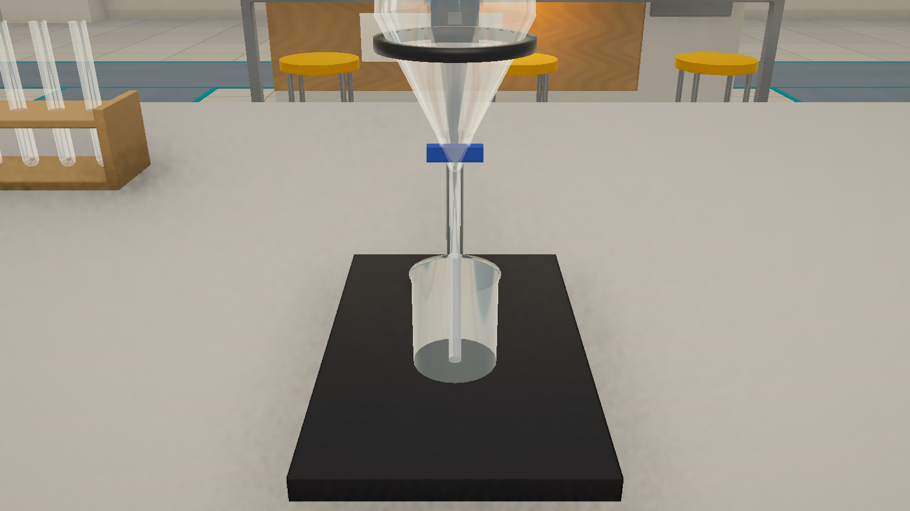 Phễu chiết mở khóa: dòng chảy liền xuống cốc | 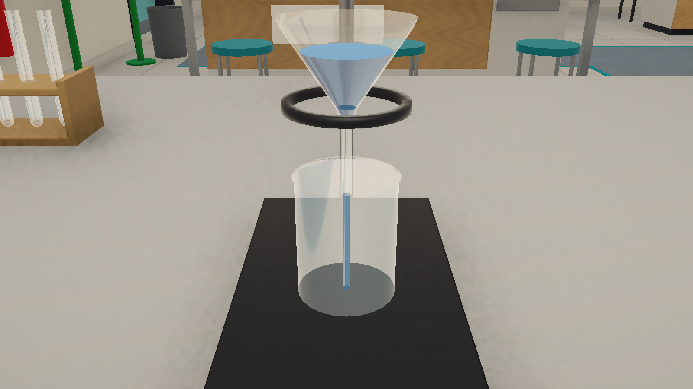 Nước lọc chảy xuống cốc |
| 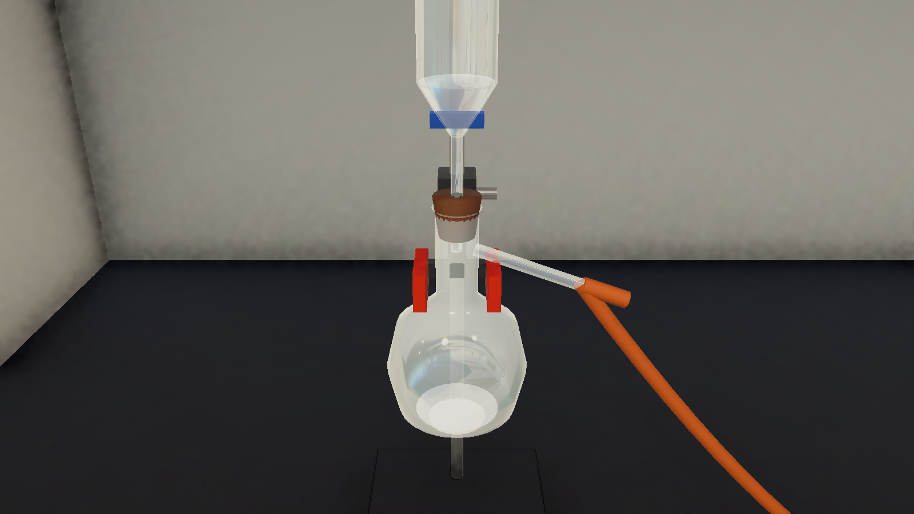 Phễu nhỏ giọt HCl xuống đá vôi | 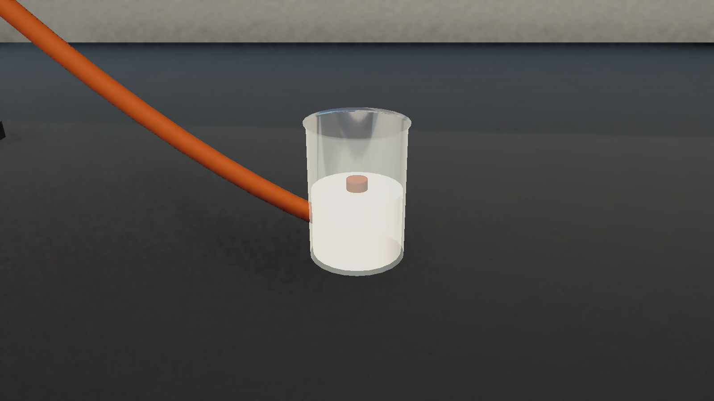 Sục CO₂: nước vôi trong hóa đục |
| 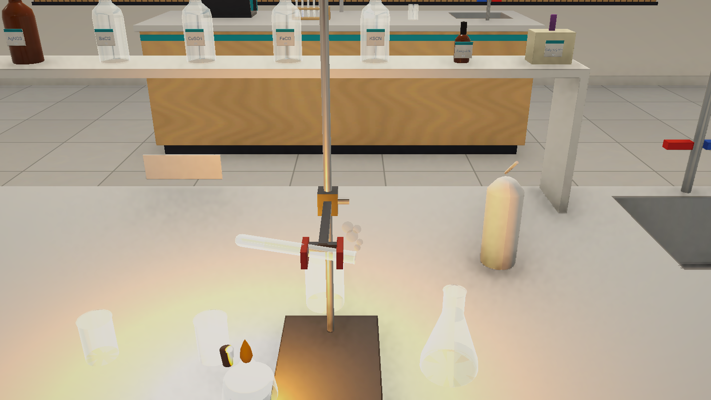 Nút bật ra, hơi thoát ra | 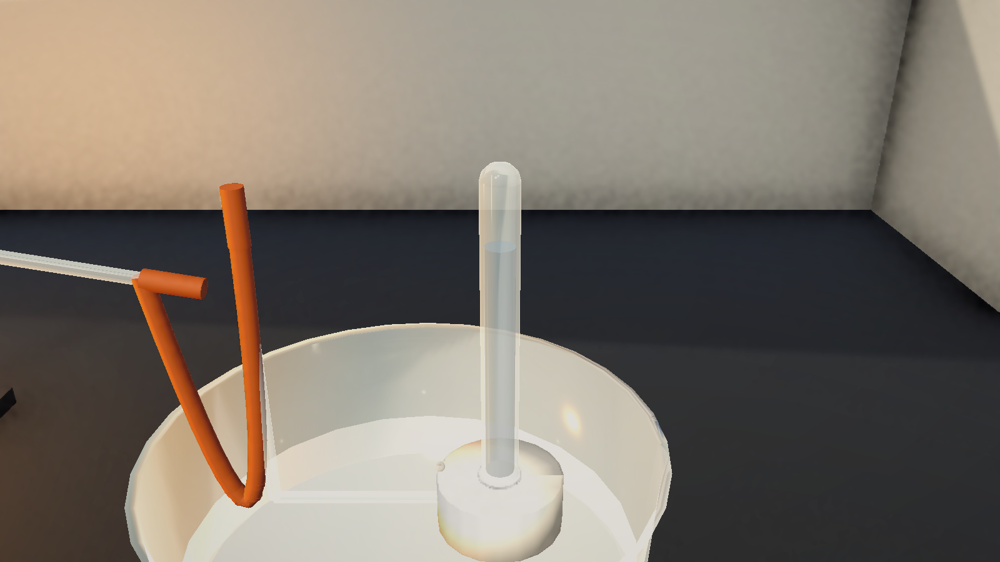 Thu O₂: bọt dồn lên ống úp, nước hạ dần |
| 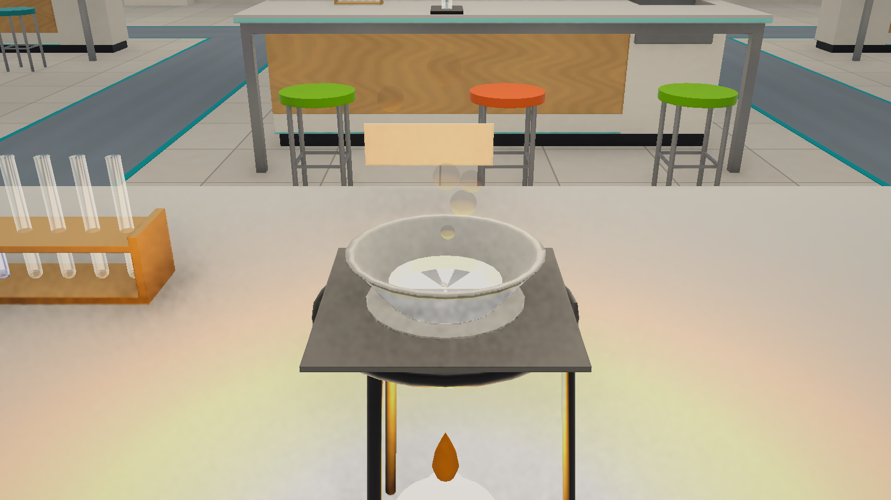 Cô cạn: hơi bốc lên | 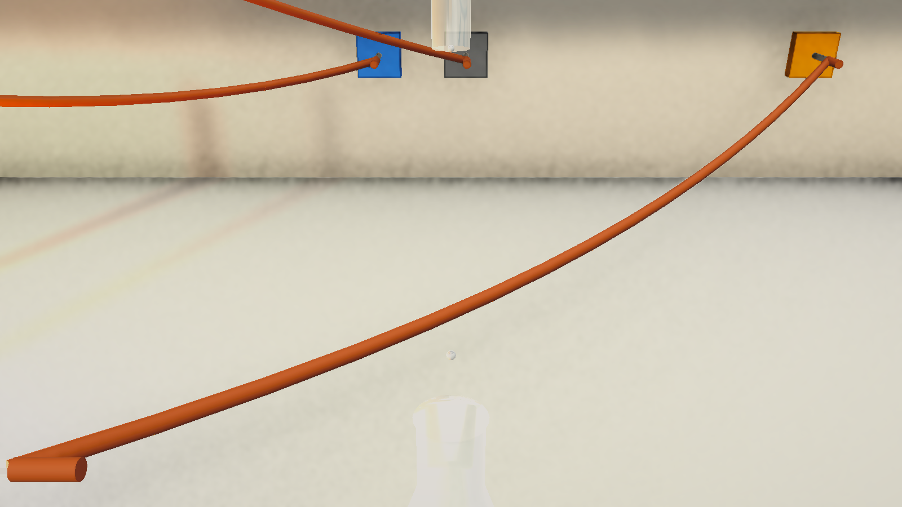 Chưng cất: giọt ở đầu nhỏ giọt |
| 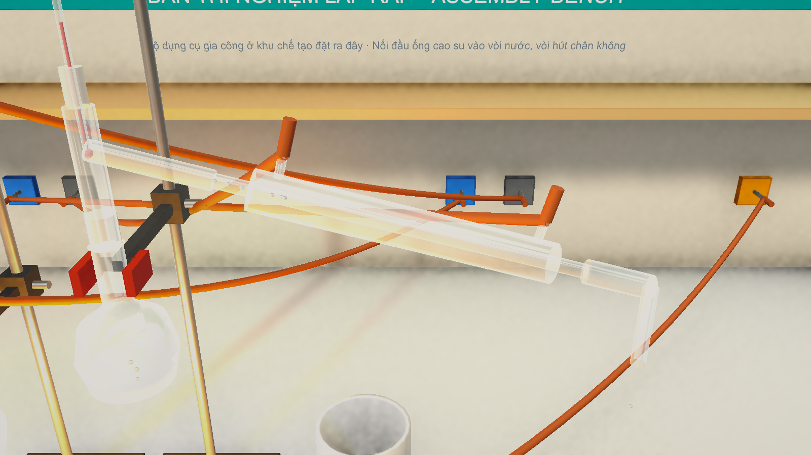 Giọt ngưng trong ống sinh hàn | 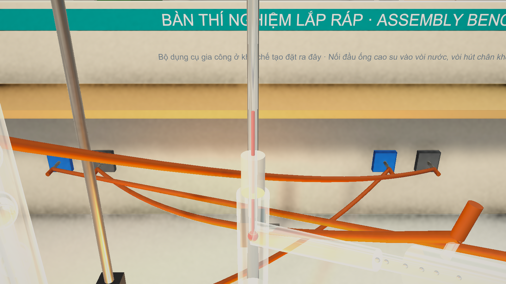 Cột nhiệt kế dâng tới 87 °C |
| 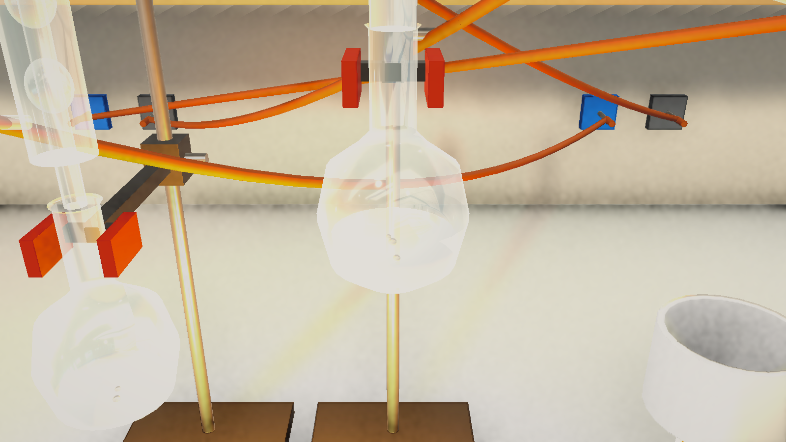 Bọt sôi trong bình cầu | 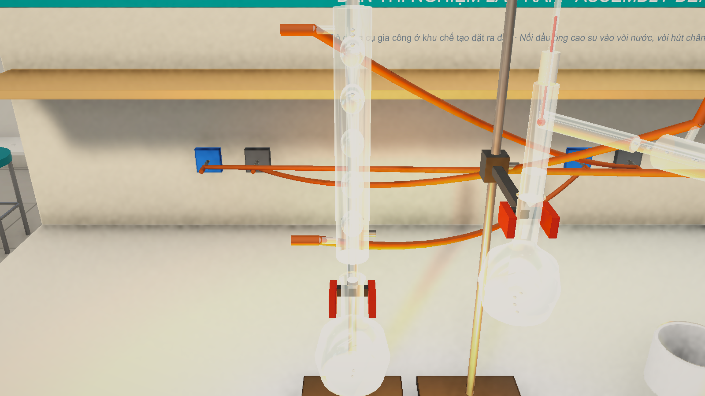 Đun hồi lưu |

### Giới hạn

- Giọt và bọt là quả cầu nhỏ, chưa có hiệu ứng bắn tóe hay gợn sóng mặt chất lỏng.
- Dung dịch đục (nước vôi đã có kết tủa, chất lỏng màu đậm) che mất bọt khí bên trong; ngoài đời cũng vậy.
- Đầu ống cao su dẫn khí chưa có thao tác "nhúng vào cốc" ngoài phòng; bài kiểm thử phải đặt đầu ống bằng code.
