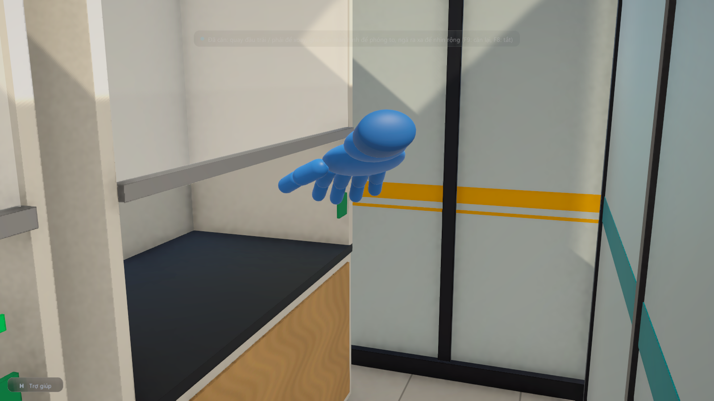
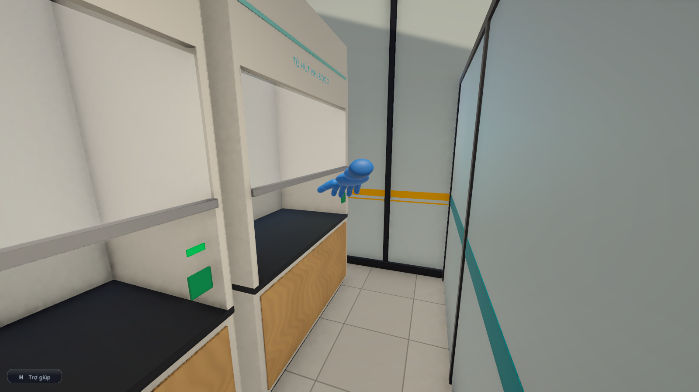

# Điều khiển góc nhìn bằng đầu qua webcam (thử nghiệm)

## Mục tiêu

Dùng webcam có sẵn của laptop để điều khiển góc nhìn trong phòng lab ảo, không cần dán marker:

- **quay đầu trái / phải**: góc nhìn xoay theo (kiểu lái);
- **ghé lại gần màn hình**: phóng to (nhìn kỹ); **ngả ra xa**: nhìn rộng ra.

Sau này phần này sẽ kết hợp với tay cầm (joystick → Mega → ESP32). Vì thế tín hiệu từ đầu được cộng vào đúng chỗ đang cộng chuột và tay cầm trong `DesktopViewer`, hai nguồn dùng song song được.

## Cách dùng

| Phím | Việc |
|---|---|
| **F8** | Bật / tắt điều khiển bằng đầu. Unity tự chạy chương trình nhận diện ở chế độ ngầm (đèn webcam sáng), tắt thì chương trình dừng theo |
| **F9** | Căn lại tư thế giữa |

Vừa bật (hoặc bấm F9): **nhìn thẳng vào màn hình khoảng 2 giây** để máy ghi nhớ tư thế giữa. Sau đó:

| Cử động | Kết quả |
|---|---|
| Quay đầu dưới khoảng 30° | Không xoay (vùng chết rộng: bạn thử thấy 12° nhiễu quá, đầu hơi động là góc nhìn trôi) |
| Quay đầu sang phải / trái 30° – 50° | Góc nhìn xoay liên tục sang phải / trái; quay càng nhiều xoay càng nhanh, tối đa 70°/giây từ 50° |
| Nhìn thẳng lại | Dừng xoay |
| Ghé lại gần webcam | Phóng to dần, tối đa ×2,5 |
| Ngả ra xa | Nhìn rộng ra, tới ×0,8 |
| Quay đi chỗ khác, che mặt | Dừng xoay ngay; zoom từ từ về bình thường |

Chuột, bàn phím, tay cầm vẫn dùng song song. Khi giao diện khu chế tạo đang mở thì điều khiển bằng đầu tạm không có tác dụng.

**Máy cần có:**
- Python và `opencv-python` bản 4.8 trở lên (máy hiện tại: Python 3.14, OpenCV 5.0);
- một webcam.

## Cách hoạt động

```
webcam ──► tools/head_tracker.py (Python + OpenCV) ──UDP 127.0.0.1:9051──► HeadTracking.cs ──► DesktopViewer
            nhận diện mặt YuNet, 5 điểm                 {"ok","yaw","pitch","e"}          căn giữa, vùng chết     xoay, zoom
```

1. **Nhận diện mặt:**
   - dùng YuNet (`cv2.FaceDetectorYN`, mô hình `tools/mo_hinh/face_detection_yunet_2023mar.onnx`, 232 KB, giấy phép MIT, nguồn ghi trong `tools/mo_hinh/NGUON.txt`);
   - ảnh webcam được thu về bề rộng 320 điểm ảnh cho nhanh;
   - mỗi mặt cho 5 điểm: 2 mắt, đầu mũi, 2 khóe miệng;
   - có nhiều mặt thì lấy mặt to nhất, tức người ngồi trước máy.
2. **Góc quay đầu:**
   - Mũi nhô ra trước đường hai mắt chừng 0,45 lần khoảng cách hai mắt.
   - Khi quay đầu một góc θ, mũi lệch khỏi giữa hai mắt một đoạn r = 0,45·tan θ (tính theo khoảng cách hai mắt), nên θ = atan(r / 0,45).
   - Đo trong hệ của khuôn mặt (đã trừ góc nghiêng đầu), nên nghiêng đầu không làm sai góc quay.
3. **Khoảng cách:**
   - e = khoảng cách hai mắt / bề rộng ảnh, đã bù góc quay (chia cho cos θ).
   - Đầu càng gần thì e càng lớn; e gấp 1,5 lần nghĩa là đầu gần hơn 1,5 lần.
4. **Lọc rung:** dùng bộ lọc One Euro (dùng chung với `tools/webcam_tracker.py`): đứng yên thì lọc mạnh, cử động nhanh thì ít trễ.
5. **Phía Unity (`Assets/Scripts/Input/HeadTracking.cs`):**
   - trừ tư thế giữa đã căn;
   - góc lệch nhỏ hơn vùng chết thì bỏ qua;
   - phần vượt vùng chết đổi ra tốc độ xoay (lũy thừa 1,5 để quay ít thì xoay chậm, dễ ngắm);
   - tỉ lệ e / e lúc căn đổi ra hệ số zoom, đổi mượt;
   - `DesktopViewer` cộng tốc độ xoay vào góc xoay, và chia góc nhìn camera (70°) cho hệ số zoom.
6. **An toàn tiến trình:**
   - Unity truyền mã tiến trình (pid) của mình cho chương trình Python;
   - Python tự thoát khi Unity tắt, kể cả khi Unity bị treo hay đóng đột ngột;
   - bấm F8 tắt thì Unity dừng hẳn tiến trình Python.

Chạy riêng chương trình nhận diện để xem webcam kèm khung mặt và số đo (cửa sổ, bấm Esc để thoát):

```
python tools/head_tracker.py --hien
```

## Kiểm thử

### Phần tính toán (`tests/test_head_tracker.py`, không cần webcam)

**Cách làm:** dựng khuôn mặt 3D giả (2 mắt, mũi, 2 khóe miệng), quay theo góc đã biết rồi chiếu qua webcam giả (tiêu cự 500 điểm ảnh, đặt cách 60 cm). Kết quả: **7/7 đạt.**

| Phép thử | Kết quả |
|---|---|
| Nhìn thẳng | Góc quay đo ra 0° |
| Quay −40° … +40° | Đúng chiều; góc đo tăng dần đều; sai trong khoảng 2° + 20%, do phối cảnh: quay 40° đo ra 47° (mắt gần webcam trông to hơn). Dùng để lái nên chỉ cần đúng chiều và tăng dần đều |
| Nghiêng đầu 15° khi đang quay 20° | Vẫn đo được góc quay |
| Lại gần từ 60 cm còn 40 cm | e tăng ×1,5 |
| Quay đầu 30° (cùng khoảng cách) | e gần như không đổi |
| Cúi / ngẩng | Số đo cúi / ngẩng đổi đúng chiều |
| Kiểm tra tiến trình cha | Đúng |

### Webcam thật (`--thu 6`, không lưu ảnh)

Trong 6,3 giây đọc được 160 khung (25 khung/giây), **thấy mặt ở cả 160/160 khung**.

### Trong Unity (bài `dau`, bản sao project ở ổ D)

| Phép thử | Kết quả |
|---|---|
| Gửi gói UDP giả 2,4 s nhìn thẳng | Căn xong, trạng thái "Đang điều khiển" |
| Quay đầu phải 40° trong 1 s | Góc nhìn xoay **+24,6°** |
| Quay đầu trái 40° trong 1 s | Góc nhìn xoay **−23,9°** |
| Quay đầu 20° (trong vùng chết 30°) | Xoay −0,6° (gần như đứng yên; phần nhỏ còn lại là dư âm của lần quay trái ngay trước đó) |
| Quay đầu 55° (hết mức) | Góc nhìn xoay +68,7° (gần tốc độ tối đa 70°/giây) |
| Ghé gần (e ×1,3) | Góc nhìn 70° → 37,6°, tức **phóng to ×1,86** |
| Ngả xa (e ×0,8) | Góc nhìn 78°, tức **nhìn rộng ×0,9** |
| Mất mặt khi đang quay | **Dừng xoay ngay**; zoom về 1,00 |
| Unity tự chạy `head_tracker.py` (webcam thật) | Tiến trình chạy, nhận 50 gói sau 7,4 s (khởi động Python và mở webcam mất vài giây), thấy mặt |
| Bấm F8 tắt | Trạng thái "Tắt", tiến trình Python đã dừng |

**Lỗi tìm ra khi kiểm thử, đã sửa:**
- mất mặt mà góc nhìn vẫn xoay thêm khoảng 0,4 s;
- sau khi tắt, gói còn đọng lại làm trạng thái báo nhầm "Đang điều khiển".

| | |
|---|---|
|  Ghé gần webcam: phóng to |  Ngả ra xa: nhìn rộng |

## Giới hạn và việc tiếp theo

- **Cần cài Python + OpenCV** trên máy chạy. Muốn phát cho học sinh thì có thể đóng gói `head_tracker.py` thành một file chạy riêng (ví dụ bằng PyInstaller), để máy học sinh không cần cài Python.
- **Bản .exe** tìm chương trình nhận diện ở thư mục `tools` cạnh file .exe (gồm `head_tracker.py`, `webcam_tracker.py`, `mo_hinh/`).
- **Góc quay chỉ gần đúng** (đo dư khoảng 15 – 20% ở 40° do phối cảnh), nên ngưỡng 30° / 50° tính theo số đo tương ứng với góc quay thật chừng 26° / 42°. Quay quá khoảng 45 – 50° hoặc che mặt thì mất dấu (máy thôi xoay); phòng quá tối nhận diện kém.
- **Lọc rung:** bộ lọc One Euro đã chỉnh mạnh hơn (tần số cắt 0,7 Hz, trước là 1,2 Hz) để góc quay đứng yên hơn khi đầu không cử động.
- **Chưa dùng cúi / ngẩng.** Số đo đã có sẵn (trường `pitch`), có thể thêm khi cần.
- **Khởi động mất khoảng 5 – 7 giây** (Python và webcam).
- **Ghép với tay cầm:** tay cầm điều khiển đi lại và thao tác, đầu điều khiển hướng nhìn và zoom. Hai nguồn đã được cộng chung, cần thử thực tế để chỉnh tốc độ cho hợp.
