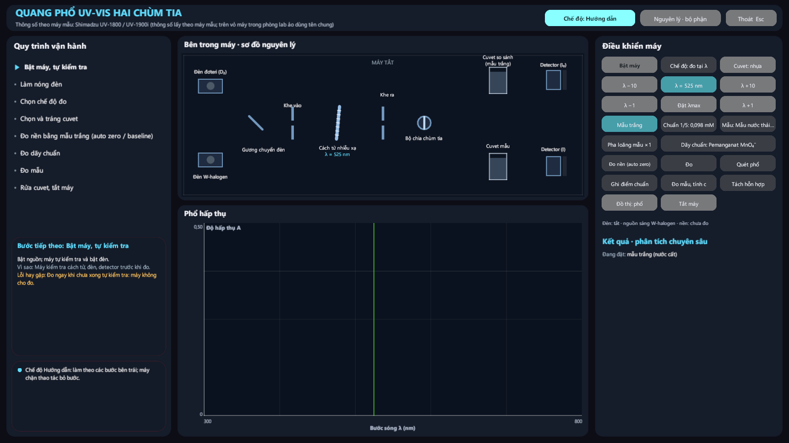
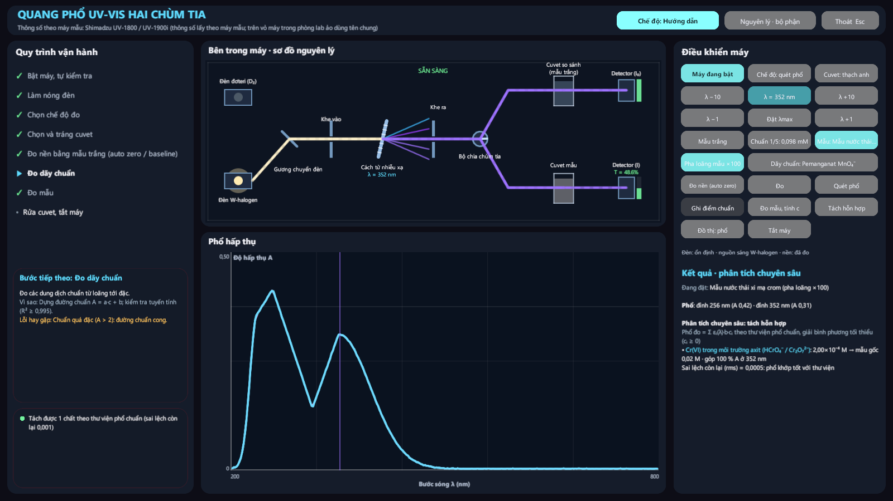
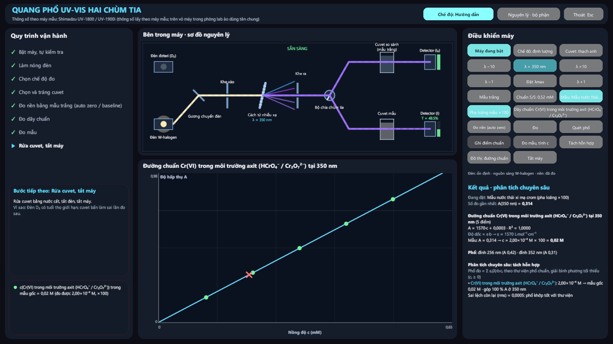
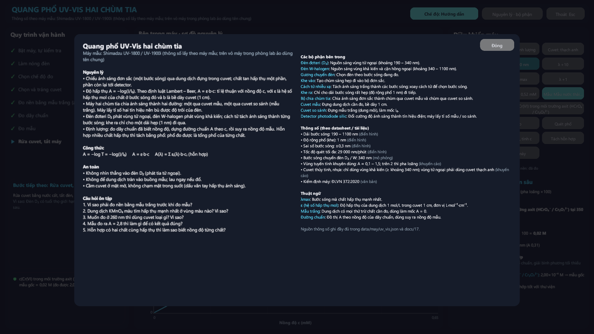
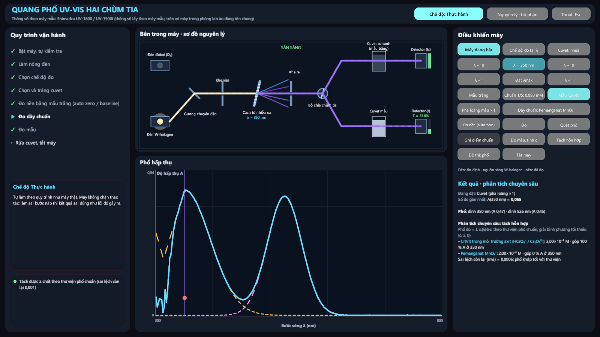
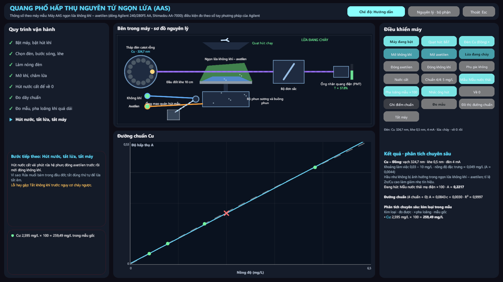
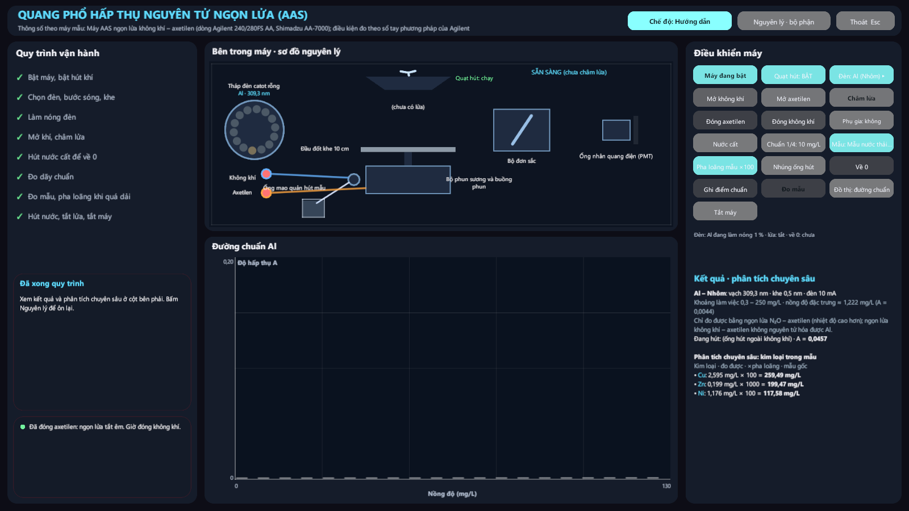

# Máy phân tích, đợt 1: màn hình vận hành UV-Vis và AAS

## Thay đổi

Trước đây, đặt ống mẫu lên máy rồi bấm là ra kết quả ngay. Không có bước khởi động, mẫu trắng, đường chuẩn hay pha loãng như máy thật.

Giờ bấm vào máy **UV-Vis** hoặc **AAS** sẽ mở **màn hình vận hành riêng**, giống phần mềm điều khiển máy thật. Camera phòng lab tạm tắt, nên nhẹ máy. Bố cục màn hình:

| Vùng | Nội dung |
|---|---|
| Thanh trên | Tên máy; máy mẫu lấy thông số; nút chuyển chế độ **Hướng dẫn / Thực hành**; nút **Nguyên lý · bộ phận** (nguyên lý, công thức, bộ phận, thông số có nguồn, thuật ngữ, an toàn, câu hỏi ôn tập); nút Thoát (Esc) |
| Trái | Các bước quy trình (✓ đã xong, ▶ đang làm); thẻ **Bước tiếp theo** kèm lý do và lỗi hay gặp; dòng thông báo / cảnh báo |
| Giữa trên | **Sơ đồ nguyên lý bên trong máy**, vẽ 2D có hoạt cảnh |
| Giữa dưới | Đồ thị: phổ, đường chuẩn, tín hiệu theo thời gian |
| Phải | Nút điều khiển như máy thật; **kết quả và phân tích chuyên sâu** |

**Hai chế độ:**

- **Hướng dẫn:** máy chặn thao tác bỏ bước, ví dụ đo mẫu khi chưa đo nền, hay mở axetilen trước không khí.
- **Thực hành:** máy không chặn. Làm sai thì kết quả sai đúng như lỗi đó gây ra trên máy thật, kèm cảnh báo.

**Người và robot dùng máy khác nhau:**

- Bấm vào máy: mở màn hình vận hành.
- Robot trợ lý: vẫn chạy nhanh như cũ, không bật màn hình lên giữa lúc người dùng đang làm việc khác.

Bốn máy còn lại (FTIR, GC-MS, HPLC, chuẩn độ điện thế) giữ cách cũ, sẽ làm lại ở đợt 2.

## Máy mẫu và nguồn số liệu

Trên vỏ máy chỉ ghi tên chung; nguồn ghi trong thẻ Nguyên lý và trong file dữ liệu.

| Máy | Máy mẫu | Nguồn chính |
|---|---|---|
| Quang phổ UV-Vis hai chùm tia | Shimadzu UV-1800 / UV-1900i | [Hướng dẫn UV-1800 – ĐH Trà Vinh](https://thietbi.tvu.edu.vn/ttthietbi/upload_file/2.Quang%20pho%20kha%20kieng.pdf); [Các vấn đề thường gặp – Viện Kiểm nghiệm ATVSTP Quốc gia](https://nifc.gov.vn/files/media/202407/Cac-van-de-thuong-gap-PGS.TS.Nguyen-Thi-Anh-Huong.pdf); [bảng thông số Shimadzu](https://ssi.shimadzu.com/products/uv-vis/uv-vis-nir-spectroscopy/uv-1900i/spec.html); ĐLVN 372:2020 |
| AAS ngọn lửa không khí – axetilen | Dòng Agilent 240/280FS AA, Shimadzu AA-7000 | [Agilent – Flame Atomic Absorption Spectrometry: Analytical Methods, bản 8, 11/2010](https://diverdi.colostate.edu/C433/experiments/iron%20analysis/references/aas%20methods%20-%20agilent.pdf); thứ tự mở / tắt khí theo [SOP GBC 902 – Fresno State](https://zimmer.fresnostate.edu/~davidz/Instruments/AAS/Part4/Part4.html) và SOP của RIT, ĐH Y Tabriz; TCVN 6496:2009, TCVN 13090:2020 |

### Thư viện phổ UV-Vis

File `data/may/tinh_chat/uv_vis.json`. Mọi λmax và ε đều có nguồn. Dạng dải (Gauss) là gần đúng và có ghi rõ trong file.

| Chất | Số liệu | Nguồn |
|---|---|---|
| MnO₄⁻ | λmax 525 nm, ε = 2,24×10³ L·mol⁻¹·cm⁻¹ | [Bài giảng Phân tích công cụ – ĐH Liên bang Sergipe](https://cesad.ufs.br/ORBI/public/uploadCatalago/18033016022012Metodos_Instrumentais_de_Analise_-_Aula_13.pdf) |
| Cr(VI) trong axit (HCrO₄⁻ / Cr₂O₇²⁻) | Độ hấp thụ chứng nhận ở 235 / 257 / 313 / 350 nm, đổi ra ε theo mol Cr: 1803 / 2098 / 707 / 1570 | [Chứng chỉ NIST SRM 935a](https://tsapps.nist.gov/srmext/certificates/archives/935a.pdf) |
| [Fe(SCN)]²⁺ | λmax 447 nm, ε = 4700 (các tài liệu khác cho 2800 – 7000) | Frank và Oswalt, dẫn trong [tài liệu thí nghiệm Missouri S&T](https://bpb-us-e2.wpmucdn.com/sites.mst.edu/dist/9/280/files/2023/08/Datasheet.pdf) |
| [Cu(NH₃)₄]²⁺ | λmax khoảng 610 nm; ε(640 nm) = 77 | [Analytica Chimica Acta 2002](https://www.sciencedirect.com/science/article/abs/pii/S0003267002001356); [giáo trình thí nghiệm ĐH Louisiana Monroe](https://www.ulm.edu/chemistry/courses/manuals/chem1010/experiment_07.pdf) |
| Phenolphtalein (dạng bazơ) | λmax 552 nm; A(1%, 1 cm) = 700 – 750, tức ε ≈ 2,3×10⁴ | [Thông số Merck](https://www.merckmillipore.com/IL/en/product/mm/107233) |

Chất có màu nhưng chưa tìm được ε có nguồn (Cu²⁺ trong nước, cromat ở pH > 6,5...) thì máy báo **"ngoài thư viện"**, không bịa số.

### Bảng nguyên tố AAS

File `data/may/tinh_chat/aas_nguyen_to.json`. Có 14 nguyên tố: Cu, Zn, Fe, Ni, Pb, Cr, Mn, Cd, Co, Mg, Na, K, Ca, Al.

Mỗi nguyên tố lấy theo sổ tay Agilent:
- vạch đo, khe, dòng đèn;
- loại ngọn lửa;
- khoảng làm việc tối ưu;
- ghi chú về ảnh hưởng nhiễu.

Hai nguyên tố cần chú ý:
- **Al** chỉ đo được với ngọn lửa N₂O – axetilen. Máy không khí – axetilen báo không đo được.
- **Ca** hãng khuyên dùng ngọn lửa N₂O. Nếu dùng không khí – axetilen thì phải thêm La hoặc Sr làm chất giải phóng.

## UV-Vis hai chùm tia

**Sơ đồ bên trong** (theo danh sách bộ phận trong `data/may/uv_vis.json`):
- đèn D₂ và đèn W-halogen; gương chuyển đèn ở 340 nm;
- khe vào; cách tử xoay theo λ, tách ánh sáng thành các màu; khe ra;
- bộ chia chùm tia;
- cuvet so sánh (mẫu trắng) và cuvet mẫu;
- hai detector.

Tia sáng có màu đúng bước sóng; sau cuvet mẫu thì tia mờ đi theo độ truyền qua T = 10⁻ᴬ.

**Quy trình:** bật máy, tự kiểm tra → làm nóng đèn → chọn chế độ (đo tại λ / quét phổ / định lượng) → chọn cuvet → **đo nền bằng mẫu trắng** → dãy chuẩn → đo mẫu → rửa cuvet, tắt máy.

**Số đo mô phỏng lỗi như máy thật:**

| Lỗi | Hậu quả trên máy |
|---|---|
| Quên đo nền | Số đo cộng thêm hấp thụ của dung môi và cuvet (khoảng 0,05 – 0,07) |
| Đo nền bằng dung dịch không phải mẫu trắng | Các số đo sau bị trừ sai |
| Đo khi đèn chưa ổn định | Đường nền trôi |
| Cuvet nhựa / thủy tinh dưới khoảng 340 nm | Thiếu sáng: phổ bị cắt, nhiễu, máy nhắc dùng cuvet thạch anh |
| Mẫu quá đặc | Do ánh sáng lạc, số đo bão hòa quanh 3,3; máy báo A > 2 và yêu cầu pha loãng |

**Phân tích chuyên sâu:**
- tìm các đỉnh phổ và λmax;
- đường chuẩn A = a·c + b kèm R²; độ dốc chính là ε·b;
- nồng độ mẫu, có nhân hệ số pha loãng;
- **tách hỗn hợp:** phổ đo = Σ εᵢ(λ)·b·cᵢ theo thư viện phổ chuẩn, giải bằng bình phương tối thiểu với cᵢ ≥ 0. Máy báo nồng độ từng chất, phần đóng góp vào A, và sai lệch còn lại (sai lệch lớn nghĩa là còn chất ngoài thư viện, chưa đo nền, hoặc mẫu đục).

## AAS ngọn lửa

**Sơ đồ bên trong:**
- tháp đèn catot rỗng: quay tới đèn đã chọn, đèn sáng dần khi làm nóng;
- ống mao quản hút mẫu từ cốc lên bộ phun sương, có giọt chạy theo; sương mù trong buồng phun bay lên ngọn lửa;
- ngọn lửa không khí – axetilen; khi hút dung dịch kim loại, lửa đổi màu như thí nghiệm thử màu ngọn lửa (Na vàng, Cu xanh lục, K tím);
- đường khí không khí và axetilen, van xanh (mở) / đỏ (đóng);
- quạt hút khí thải quay khi bật;
- bộ đơn sắc, ống nhân quang (PMT). Tia sáng qua ngọn lửa mờ đi theo độ hấp thụ.

**Quy trình:** bật máy và quạt hút → chọn đèn, bước sóng, khe → làm nóng đèn → mở không khí, mở axetilen, châm lửa → hút nước cất để về 0 → dãy chuẩn → đo mẫu, pha loãng khi quá dải → đóng axetilen trước, không khí sau.

**Tín hiệu mô phỏng:**
- độ hấp thụ dâng dần khi nhúng ống hút;
- nền ngọn lửa khoảng 0,01;
- đường chuẩn cong ở nồng độ cao (ở giới hạn trên của khoảng làm việc A ≈ 0,8, đúng định nghĩa của sổ tay);
- Na, K bị ion hóa; Ca bị ảnh hưởng hóa học khi không có chất phụ gia;
- mẫu có cặn thì tín hiệu dao động, thấp hơn thật, máy nhắc lọc mẫu.

**Phân tích chuyên sâu:**
- bảng mọi kim loại đã đo trong mẫu: đo được → × hệ số pha loãng → nồng độ mẫu gốc;
- ghi chú vượt dải / dưới khoảng làm việc / ảnh hưởng nhiễu;
- đường chuẩn kèm R²; nồng độ đặc trưng (A = 0,0044) suy từ khoảng làm việc.

## Kiểm thử

### Dữ liệu

`tests/test_du_lieu_may.py`: 5/5 đạt. Kiểm tra:
- mỗi máy đủ nguyên lý, bộ phận, quy trình, câu hỏi ôn tập;
- mọi thông số có link nguồn hoặc ghi rõ là mô phỏng;
- số liệu khớp nguồn: KMnO₄ 2240; Cr(VI) theo NIST; [Cu(NH₃)₄]²⁺ cho ε(640) = 77 ± 3; Cu 324,7 nm, khe 0,5, khoảng 0,03 – 10 mg/L;
- bản Unity giống bản gốc.

### Mô hình (C#, `tests/ChemEngineTests.cs`)

72/72 đạt, trong đó 14 phép thử mới:

| Phép thử | Kết quả |
|---|---|
| KMnO₄ theo định luật Beer | Độ dốc 2240, R² = 1,0000, λmax = 525 nm |
| Cr(VI) pH 3 | A(350 nm) đúng số NIST; ở pH 9 báo ngoài thư viện |
| Cu²⁺ | Báo ngoài thư viện |
| Tách hỗn hợp 3 chất (MnO₄⁻ + Cr(VI) + Fe(SCN)²⁺) từ phổ 360 – 700 nm | Đúng ±2%; chất không có cho ra 0 |
| Cuvet | Cuvet nhựa chặn tia tử ngoại, thạch anh thì không |
| Đường chuẩn AAS Cu | R² > 0,995; A ≈ 0,8 ở 10 mg/L |
| Nước thải mạ Cu 254 mg/L, pha loãng ×100 | Tìm lại đúng ±2%; không pha loãng thì sai rất xa |
| Đếm nguyên tử trong mã chất | Fe₄[Fe(CN)₆]₃ → 7 Fe |
| Cu trong kết tủa | Tách riêng để cảnh báo |
| Al trong ngọn lửa không khí | Gần như không có tín hiệu |

### Bài chạy tự động `may` (bản sao project ở ổ D)

**Bài làm như một học sinh:**
- đặt ống mẫu thật của phòng (nước thải xi mạ crom, nước thải mạ điện) vào ổ máy;
- bấm máy để mở màn hình vận hành;
- làm từng bước như bấm nút.

**UV-Vis, chế độ Hướng dẫn** (mẫu nước thải xi mạ crom, Cr(VI) 0,02 M):

| Kiểm tra | Kết quả |
|---|---|
| Mở màn hình | Camera phòng lab tắt; con trỏ thả ra; đóng màn hình thì bật lại |
| Bấm đo nền khi máy chưa bật / đèn chưa nóng | Máy chặn: "Chưa xong bước Làm nóng đèn…" |
| Quét mẫu chưa pha loãng | A tối đa 3,35, bão hòa do ánh sáng lạc. Máy báo "A vượt 2, phổ bị bão hòa… pha loãng" |
| Quét sau khi pha loãng ×100 (cuvet thạch anh) | Đỉnh 256 nm (A 0,42) và 350 – 352 nm (A 0,313). Số liệu NIST tính ra 0,420 và 0,314 |
| Tách hỗn hợp từ phổ | Cr(VI) 2,00×10⁻⁴ M, nhân 100 ra **0,0200 M** (thật 0,0200) |
| Đường chuẩn Cr(VI) ở 350 nm | 5 chuẩn, A = 1565·c + 0,0016, R² = 1,0000 |
| Định lượng mẫu | 0,01992 M, **sai −0,4%** |
| Quy trình | 7/8 bước đã xong (còn bước rửa cuvet, tắt máy) |

**UV-Vis, chế độ Thực hành** (cuvet có hỗn hợp KMnO₄ 2×10⁻⁴ M + Cr(VI) 3×10⁻⁴ M):

| Lỗi cố ý | Máy phản ứng |
|---|---|
| Quên đo nền, đo mẫu trắng ở 525 nm | A = 0,065 (lẽ ra 0) |
| Cuvet nhựa, quét từ 300 nm | Máy báo "Dưới khoảng 340 nm cuvet nhựa chặn tia tử ngoại: phổ bị cắt, nhiễu. Dùng cuvet thạch anh" |

Sau khi đo nền, **tách hỗn hợp ra đúng MnO₄⁻ 2,00×10⁻⁴ M và Cr(VI) 3,00×10⁻⁴ M** (sai lệch còn lại 0,0006).

**AAS, chế độ Hướng dẫn** (mẫu nước thải mạ điện: Cu 254, Zn 196, Ni 117 mg/L):

| Kiểm tra | Kết quả |
|---|---|
| Mở axetilen trước không khí | Máy chặn: "Phải mở không khí TRƯỚC rồi mới mở axetilen" |
| Đo Cu không pha loãng | A = 2,0 (bão hòa). Máy báo vượt chuẩn cao nhất, yêu cầu pha loãng ×10, ×100 |
| Cu, pha loãng ×100 | Đường chuẩn R² 0,9997; **259,5 mg/L** (thật 254,2; sai +2,1%) |
| Zn, pha loãng ×1000 (×100 vẫn vượt dãy chuẩn, máy báo "pha loãng thêm") | **199,3 mg/L** (thật 196,1; sai +1,6%) |
| Ni, pha loãng ×100 | **117,5 mg/L** (thật 117,4; sai +0,1%) |
| Chọn đèn Al | Máy báo cần ngọn lửa N₂O – axetilen, không đo được |
| Tắt: đóng không khí trước | Máy chặn: "đóng axetilen TRƯỚC, không khí sau" |
| Tắt đúng thứ tự | Đủ 8/8 bước quy trình |

**AAS, chế độ Thực hành:** mở axetilen trước không khí thì máy cảnh báo "NGUY HIỂM: … nguy cơ cháy ngược vào buồng phun!".

Sai số Cu, Zn khoảng +2% là do đường chuẩn của máy hơi cong mà phép khớp lại là đường thẳng. Mức này nằm trong sai số thường gặp của AAS ngọn lửa (khoảng 2 – 5%).

### Hồi quy

| Bài | Kết quả |
|---|---|
| Kiểm thử Python | 103/103 đạt |
| Bộ máy hóa học | 73/73 đạt |
| Bài đầy đủ | Chuẩn độ sai số 0,23%; robot vẫn chạy nhanh 6 máy (không mở màn hình vận hành) |
| Tải / gỡ khu | Đạt |

### Ảnh

| | |
|---|---|
|  UV-Vis lúc mở màn hình |  Quét phổ Cr(VI) sau pha loãng, tách hỗn hợp |
|  Đường chuẩn Cr(VI) ở 350 nm và mẫu (dấu ×) |  Bảng nguyên lý, bộ phận, thông số, câu hỏi ôn tập |
|  Hỗn hợp KMnO₄ + Cr(VI) tách bằng phổ |  AAS đo Cu: ngọn lửa xanh lục, đường chuẩn |
|  AAS: bảng kim loại trong mẫu, quy trình đủ 8 bước | |

## Giới hạn

- **Mức giáo dục:** phổ dựng từ dải Gauss quanh λmax (riêng Cr(VI) nội suy từ điểm NIST); sơ đồ máy vẽ 2D, đơn giản hơn máy thật.
- **Thời gian rút ngắn:** làm nóng đèn và tự kiểm tra trên máy thật mất 15 – 30 phút.
- **Thư viện UV-Vis mới có 5 chất có nguồn đáng tin.** Cu²⁺ trong nước, Ni²⁺, Co²⁺, I₃⁻ chưa có ε có nguồn nên máy báo "ngoài thư viện". Bổ sung khi tìm được nguồn.
- **Pha dung dịch:** dãy chuẩn và pha loãng làm ngay trên màn hình máy (bình định mức ảo), chưa phải tự pha ở bàn.
- **Ngọn lửa N₂O – axetilen** chưa có (Al, Ca chuẩn hơn cần loại này).

## Việc tiếp theo (đợt 2, chờ duyệt)

FTIR, GC-MS, HPLC, chuẩn độ điện thế: làm theo cùng khung (màn hình vận hành, sơ đồ bên trong, quy trình, dữ liệu có nguồn).
