# Máy phân tích đợt 2: FTIR, GC-MS, HPLC, chuẩn độ điện thế

Đợt 2 dùng đúng khung của đợt 1 ([docs/17](17-may-phan-tich-dot-1.md)). Học sinh đặt ống mẫu vào ổ trên nóc máy rồi bấm vào máy. Màn hình vận hành riêng hiện lên giống phần mềm của máy thật, và camera phòng lab tạm tắt.

Màn hình có:

- **Bên trái:** quy trình vận hành, ở chế độ Hướng dẫn hoặc Thực hành.
- **Ở giữa:** sơ đồ bên trong máy có hoạt cảnh, và đồ thị.
- **Bên phải:** các nút như máy thật, kết quả và phân tích chuyên sâu.
- **Nút "Nguyên lý · bộ phận":** nguyên lý, bộ phận, thông số có nguồn, câu hỏi ôn tập.

Cả 6 máy của phòng phân tích đều đã mở màn hình vận hành khi bấm. Robot trợ lý vẫn dùng cách chạy nhanh cũ: đặt mẫu, máy tự ra kết quả, không mở màn hình.

## Mẫu thật trong phòng

Bàn chuẩn bị mẫu có thêm 2 ống:

| Mẫu | Thành phần | Dùng cho |
|---|---|---|
| Mẫu rượu nghi pha metanol | Etanol 5,2 M (30,4% thể tích) + metanol 0,05 M (1602 mg/L) | GC-MS: định lượng metanol, so với quy chuẩn |
| Mẫu nước ngọt có ga | Saccarozơ 0,3 M, axit xitric 0,01 M, natri benzoat 1,2 mM, CO₂ hòa tan | HPLC: chất bảo quản axit benzoic |

Các mẫu cũ cũng dùng được: giấm ăn, nước cam, dầu chuối, rượu, nước giếng…

## Dữ liệu và nguồn

| Tệp | Nội dung | Nguồn |
|---|---|---|
| `data/may/ftir.json` | Hồ sơ máy FTIR: nguyên lý, 8 bộ phận, thông số, 8 bước, câu hỏi | Shimadzu IRSpirit, phụ kiện QATR-S; bảng tần số nhóm chức (UMass) |
| `data/may/gc_ms.json` | Hồ sơ GC-MS, 9 bộ phận | Shimadzu GCMS-QP2020 NX; giới hạn metanol theo QCVN 6-3:2010/BYT |
| `data/may/hplc.json` | Hồ sơ HPLC, 9 bộ phận, 3 phương pháp | Bơm Shimadzu LC-20AD (40 MPa); phương pháp đường của Supelco (cột NH₂); axit hữu cơ của Agilent; axit benzoic (C18, metanol – đệm photphat) |
| `data/may/chuan_do_dien_the.json` | Hồ sơ chuẩn độ điện thế, 7 bộ phận | Metrohm 916 Ti-Touch, 800 Dosino 20 mL; phương trình Nernst |
| `data/may/tinh_chat/gc_ms.json` | 7 chất. Mỗi chất có phổ khối EI 70 eV (các mảnh ≥ 1%) và chỉ số lưu RI trên cột 5% phenyl (trung vị các giá trị chương trình nhiệt) | NIST Chemistry WebBook |
| `data/may/tinh_chat/ftir.json` | 17 chất / ion, dải hấp thụ ATR, bảng nhóm chức | Vị trí dải theo bảng tần số nhóm chức; cường độ là mô phỏng |
| `data/may/tinh_chat/hplc.json` | 3 phương pháp, 16 chất | Thứ tự ra theo tài liệu; hệ số giữ là mô phỏng |

Mỗi thông số ghi rõ là số có nguồn (kèm đường dẫn) hay mô phỏng (`"mo_phong": true`). Thư viện GC-MS lấy nguyên số của NIST:

| Chất | RI (NIST) | Pic cơ bản | Ion phân tử |
|---|---|---|---|
| Metanol | 360 | 31 | 32 |
| Etanol | 445 | 31 | 46 |
| Axeton | 496 | 43 | 58 |
| Etyl axetat | 613 | 43 | 88 |
| Axit axetic | 622 | 43 | 60 |
| Ancol isoamylic | 736 | 55 | không thấy |
| Isoamyl axetat | 876 | 43 | 130 (rất yếu) |

## Mô hình bên trong từng máy

Phần tính toán nằm trong `Assets/Scripts/Simulation/Chem/`, là C# thuần nên kiểm thử được ngoài Unity.

### FTIR (`Infrared.cs`)

- **Phổ mẫu:** tổng phổ từng chất. Chất lỏng tính theo phần thể tích, chất tan theo mol/L; nước chiếm phần còn lại.
- **Axit yếu đổi dạng theo pH mẫu:**
  - ở pH thấp: axit axetic có dải C=O ở 1710 cm⁻¹;
  - ở pH cao: ion axetat có dải COO⁻ ở 1550 cm⁻¹.
- **Giao thoa đồ:** tính bằng tổng cosin của phổ đơn chùm (nguồn sáng × truyền qua). Màn hình hiện giao thoa đồ lúc máy quét, rồi hiện phổ khi xong.
- **Độ phân giải:** chọn độ phân giải thô thì dải bị doãng ra. Nhiễu giảm theo 1/√(số lần quét).
- **Phân tích chuyên sâu:**
  - trừ phổ nước (khớp hệ số theo dải tổ hợp 1900 – 2290 cm⁻¹, nơi chỉ có nước hấp thụ);
  - gán dải theo nhóm chức;
  - tách hỗn hợp bằng bình phương tối thiểu không âm;
  - tra thư viện theo chỉ số khớp HQI;
  - định lượng etanol theo chiều cao dải C-O 1045 cm⁻¹, dùng dãy chuẩn 5 – 40%.

### GC-MS (`GasChromatography.cs`)

- **Thời gian lưu:** ln k = (RI/100)·(546/T − 0,690) + 100/T − 7,49.
  - Công thức tuyến tính theo RI nên đúng với định nghĩa chỉ số Kovats. Ứng với ΔH của một nhóm CH₂ khoảng 4,5 kJ/mol (mô phỏng).
  - Máy tích phân quãng đường chất đi trong cột khi lò tăng nhiệt.
  - Với chương trình 40 °C giữ 2 phút, tăng 10 °C/phút: n-C10 ra ở khoảng 8,8 phút, n-C16 ở khoảng 17,9 phút, đúng cỡ máy thật.
- **Chỉ số lưu tính ngược:**
  - theo dãy n-ankan chạy cùng chương trình (van den Dool – Kratz);
  - chất ra trước n-C5 thì ngoại suy theo ln k.
- **Độ rộng pic:** tính theo số đĩa lý thuyết (100 000 đĩa cho cột 30 m).
  - Lượng chất vào cột quá 500 ng thì cột quá tải: pic doãng phía trước.
  - Pic quá cao thì detector bão hòa: đỉnh bị cắt, diện tích đo được thấp hơn thật.
- **Phổ khối:** ở mỗi thời điểm là tổng phổ NIST của các chất đang ra khỏi cột.
  - Quét từ m/z 10 thì có thêm nền nước (18) và không khí (28, 32).
  - Tra thư viện theo độ khớp kiểu NIST (0 – 999).

### HPLC (`LiquidChromatography.cs`)

- **Thời gian lưu:** t₀ = thể tích pha động trong cột / lưu lượng. Cột 250 × 4,6 mm có t₀ = 2,70 phút ở 1 mL/phút.
- **Hệ số giữ:** log k = log k_w − S·φ.
  - Axit yếu chỉ được giữ ở dạng phân tử, nên phụ thuộc pH pha động và pKa.
  - Cột NH₂ chạy chế độ HILIC: S âm, tăng axetonitril thì chất bị giữ mạnh hơn.
- **Áp suất:** theo định luật Darcy, tỉ lệ với độ nhớt × lưu lượng. Độ nhớt hỗn hợp nước – metanol có cực đại ở khoảng 40%.
- **Detector:**
  - UV: diện tích pic tỉ lệ với ε·c, nên chất không hấp thụ UV (đường) không có pic.
  - RID: diện tích tỉ lệ với nồng độ khối lượng.

### Chuẩn độ điện thế (`Titration.cs`)

- **pH trong cốc:** sau mỗi lần thêm dung dịch chuẩn, pH tính bằng chính bộ máy hóa học của lab (`ChemEngine.SolveH`), nên mẫu nào cũng chuẩn độ được.
- **Điện cực:** E = E_lệch − s·59,16·(pH − 7).
  - Điện cực trong lab có độ dốc 96,5% và thế lệch +12 mV, nên phải hiệu chuẩn bằng 3 đệm.
  - NaOH ghi nhãn 0,1 M nhưng thật 0,0982 M, nên phải xác định hệ số chuẩn bằng KHP. KHP tính bằng cân bằng điện tích (pKa₁ 2,95; pKa₂ 5,41).
- **Chế độ DET:** lượng thêm mỗi lần tự chỉnh để thế đổi khoảng 8 mV.
- **Điểm tương đương:** cực đại dE/dV, nội suy parabol. Kiểm tra lại bằng đồ thị Gran.

## Lỗi thao tác máy mô phỏng

| Máy | Làm sai | Máy phản ứng như máy thật |
|---|---|---|
| FTIR | Không đo nền / nền cũ | Dải CO₂ ở 2350 cm⁻¹, răng cưa hơi nước |
| FTIR | Không lau tinh thể | Phổ lẫn dải của mẫu trước; đo nền khi còn cặn rồi mới lau thì có dải âm |
| FTIR | Quét 1 – 4 lần | Phổ nhiễu |
| FTIR | Đọc phổ dung dịch nước mà chưa trừ nước | Máy nhắc: dải O-H của nước dễ bị nhầm là ancol |
| GC-MS | Bật MS khi chưa có khí mang | Máy chặn: hỏng cột, cháy dây tóc |
| GC-MS | Lò bắt đầu ở 80 °C | Metanol và etanol ra dồn vào nhau; cả hai pic đều tra ra "etanol" |
| GC-MS | Trễ dung môi 1,5 phút | Mất pic metanol, etanol (ra ở khoảng 1,4 – 1,5 phút) |
| GC-MS | Rượu không pha loãng, chia dòng 10:1 | Pic quá tải, detector bão hòa |
| GC-MS | Quét từ m/z 10 | Nền nước, không khí rất lớn |
| GC-MS | Chưa tune | m/z lệch, độ khớp thư viện thấp |
| HPLC | Không đuổi khí | Đường nền răng cưa, gai nhọn |
| HPLC | Chưa cân bằng cột | Thời gian lưu trôi, đường nền dốc |
| HPLC | Mẫu có cặn không lọc | Cột tắc dần, áp suất tăng, có thể vượt 400 bar thì bơm dừng |
| HPLC | Pha động pH 7 khi đo axit hữu cơ | Axit ion hóa, ra sát t₀, không tách |
| HPLC | Đo đường bằng detector UV | Không thấy pic; máy chỉ sang phương pháp RID |
| Chuẩn độ | Không hiệu chuẩn điện cực | pH hiển thị lệch; điểm tương đương vẫn đúng |
| Chuẩn độ | Không xác định hệ số NaOH | Kết quả cao hơn thật khoảng 1,8% |
| Chuẩn độ | Không khuấy | pH đo trễ, răng cưa, điểm tương đương lệch về sau |
| Chuẩn độ | Còn bọt khí trong bộ định lượng | Thể tích thêm thiếu 1,5% |

## Kiểm thử

### Kiểm thử bộ máy hóa học (C#, `tests/ChemEngineTests.cs`)

Kết quả: **105/105 đạt**, trong đó 32 bài mới cho đợt 2.

- **FTIR:**
  - rượu 5,2 M đúng 30,4% thể tích etanol;
  - C=O 1710 / COO⁻ 1550 cm⁻¹ đổi theo pH;
  - tách dầu chuối ra isoamyl axetat + etanol đúng ±3%;
  - tra thư viện ra isoamyl axetat.
- **GC-MS:**
  - thứ tự metanol < etanol < isoamyl axetat;
  - n-ankan ra ở thời gian hợp lý;
  - RI tính ngược đúng ±6 (cả chất ra trước n-C5);
  - lò nóng làm pic dồn lại;
  - rượu không pha loãng thì quá tải;
  - tra phổ ra metanol (độ khớp > 800);
  - định lượng metanol đúng ±2%.
- **HPLC:**
  - áp suất 100 – 150 bar;
  - đường không có pic UV;
  - pH 7 làm axit ra sát t₀;
  - thứ tự fructozơ < glucozơ < saccarozơ như Supelco, tách hoàn toàn;
  - saccarozơ đúng ±1%;
  - axit benzoic ra sớm hơn khi tăng metanol.
- **Chuẩn độ:**
  - hiệu chuẩn tìm lại độ dốc, thế lệch;
  - KHP cho hệ số 0,982;
  - giấm đúng ±0,05 mL;
  - pH ở ½V_tđ ≈ pKa;
  - Gran đúng ±1%;
  - H₃PO₄ có 2 điểm tương đương ở 10 và 20 mL.

### Kiểm thử dữ liệu (Python, `tests/test_du_lieu_may.py`)

- Pic cơ bản và ion phân tử khớp phổ NIST.
- Thứ tự RI đúng.
- Dải hồng ngoại nằm đúng vùng nhóm chức.
- Thứ tự đường trên cột NH₂ đúng.
- Bản trong Unity giống hệt bản gốc.

### Bài chạy tự động `may2` (Unity, bản sao project ở ổ D)

Bài làm như học sinh: đặt ống mẫu thật vào ổ máy, bấm máy, làm từng bước.

**Chuẩn độ điện thế, mẫu giấm ăn:**

| Kiểm tra | Kết quả |
|---|---|
| Bấm chuẩn độ khi chưa hiệu chuẩn (Hướng dẫn) | Máy chặn: "Chưa xong bước Hiệu chuẩn điện cực…" |
| Hiệu chuẩn 3 đệm | Độ dốc 96,5%, thế lệch +12,1 mV: đạt |
| Chuẩn độ KHP | V_tđ 10,182 mL → c(NaOH) = 0,0982 M, t = 0,9820 (đúng nồng độ thật) |
| Giấm 2 mL | V_tđ **16,905 mL** (lý thuyết 16,904); C = **0,8301 mol/L** (thật 0,8300, sai +0,01%) = 49,85 g/L axit axetic; Gran 16,970 mL; pH tại ½V_tđ = 4,74 ≈ pKa |
| Thực hành: không hiệu chuẩn, không khuấy, không xác định hệ số | 0,8597 mol/L (sai +3,6%); máy cảnh báo pH đo trễ |

**GC-MS, mẫu rượu nghi pha metanol:**

| Kiểm tra | Kết quả |
|---|---|
| Bật MS khi chưa có khí mang | Máy chặn, cảnh báo cháy dây tóc |
| Lò đầu 80 °C | Hai pic dồn sát (1,394 / 1,416 phút), cả hai tra ra etanol; máy nhắc hạ nhiệt độ lò |
| Lò 40 °C, pha loãng ×10 | Pic 1: **1,42 phút, RI 361 → metanol** (khớp 996/999; NIST 360). Pic 2: **1,49 phút, RI 445 → etanol** (khớp 999; NIST 445) |
| Định lượng (5 chuẩn hỗn hợp) | Metanol **1602 mg/L** (thật 1602); etanol **30,4%** (thật 30,4%) |
| Quy về cồn 100° | **5276 mg/L cồn 100°**, gấp 53 lần giới hạn 100 mg/L: máy kết luận rượu không an toàn |
| Thực hành: ×1, chia dòng 10:1, trễ 1,5 phút, quét m/z 10 | Mất cả hai pic (ra trước khi hết trễ dung môi), quá tải, nền nước – không khí lớn: máy báo từng lỗi |

**HPLC:**

| Mẫu, phương pháp | Kết quả |
|---|---|
| Bật bơm, nước 1 mL/phút | 115 bar |
| Nước cam, axit hữu cơ (C18, pH 2,5, UV 210 nm), ×10 | Một pic axit xitric ở 6,61 phút; **5764 mg/L** (thật 5764). Máy báo glucozơ, saccarozơ không hấp thụ UV |
| Cùng mẫu, pha động pH 7 | Axit xitric ra ở 2,81 phút, sát t₀ 2,70 phút |
| Nước cam, đường (NH₂, RID), ×10 | Glucozơ 7,29 phút, saccarozơ 9,72 phút (tách hoàn toàn); saccarozơ **34,2 g/L** (thật 34,2) |
| Nước ngọt có ga, axit benzoic (C18, metanol 40%, UV 228 nm) | Axit xitric 2,83 phút, axit benzoic 8,27 phút; **147 mg/L** (thật 147) |
| Metanol 40%, 2 mL/phút | 379 bar, sát giới hạn 400 bar |

**FTIR:**

| Kiểm tra | Kết quả |
|---|---|
| Nhỏ mẫu khi chưa lau tinh thể, chưa đo nền (Hướng dẫn) | Máy chặn: "Chưa xong bước Lau sạch tinh thể ATR…" |
| Dầu chuối: trừ phổ nước, tách hỗn hợp | Isoamyl axetat 5,82% (thật 5,94%), etanol 2,78% (thật 2,92%). Thư viện: isoamyl axetat HQI 93 |
| Gán dải | 2960 C-H no · 1736 C=O este · 1236 C-O este · 1052 C-O ancol |
| Rượu: dãy chuẩn etanol 5 – 40%, dải 1045 cm⁻¹ | Etanol **30,3%** (thật 30,4%), R² 0,9999 |
| Thực hành: không đo nền, quét 1 lần | Dải CO₂, phổ nhiễu: máy báo cả hai |

**Chung:** mở màn hình thì camera phòng lab tắt; đóng màn hình thì camera và con trỏ trở lại.

### Hồi quy

| Bài | Kết quả |
|---|---|
| Kiểm thử Python | 105/105 đạt |
| Bộ máy hóa học (C#) | 105/105 đạt |
| Máy đợt 1 (`may`) | UV-Vis Cr(VI) sai −0,4%, tách hỗn hợp KMnO₄ + Cr(VI) đúng; AAS Cu +1,9% |
| Bài đầy đủ | Chuẩn độ sai 0,37%; robot vẫn chạy nhanh 6 máy (không mở màn hình) |
| Tải / gỡ khu | Đạt |

### Ảnh

| | |
|---|---|
| 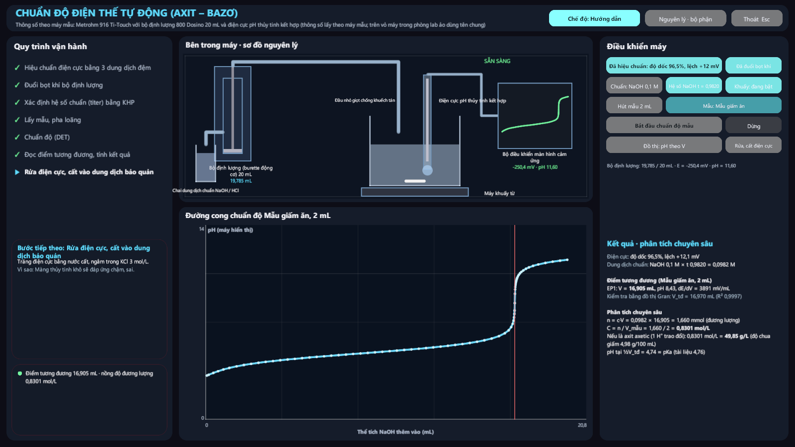 Chuẩn độ giấm: đường cong pH, kết quả | 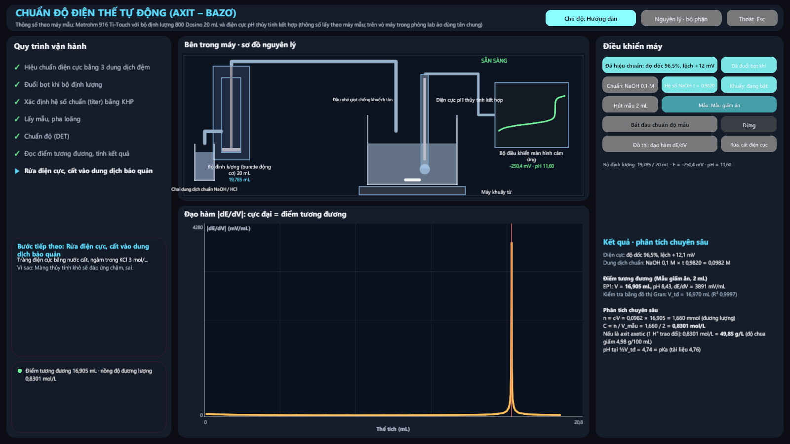 Đạo hàm dE/dV: cực đại là điểm tương đương |
| 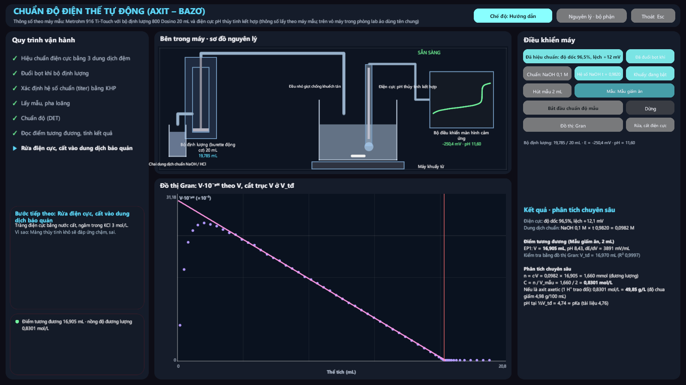 Đồ thị Gran | 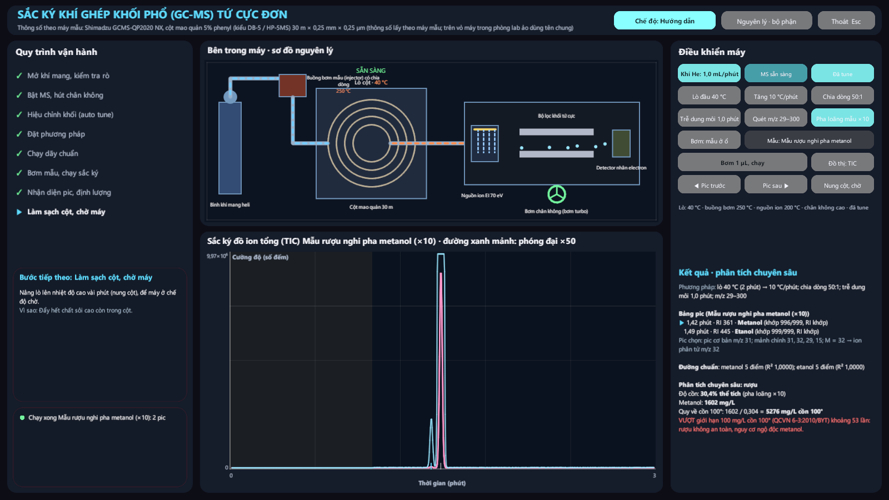 GC-MS: sắc ký đồ TIC rượu nghi pha metanol, kết luận vượt quy chuẩn |
| 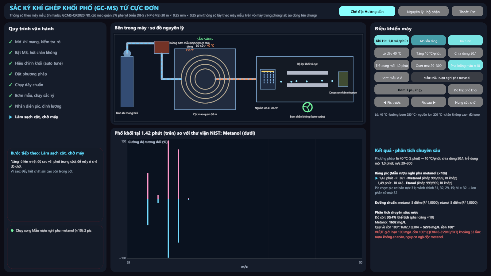 Phổ khối pic 1 (trên) so với NIST metanol (dưới) | 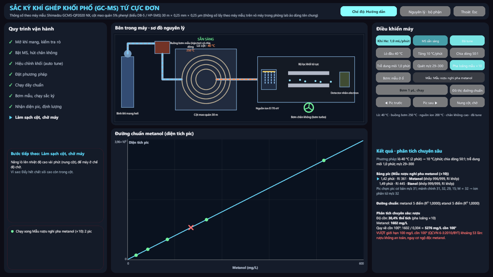 Đường chuẩn metanol |
| 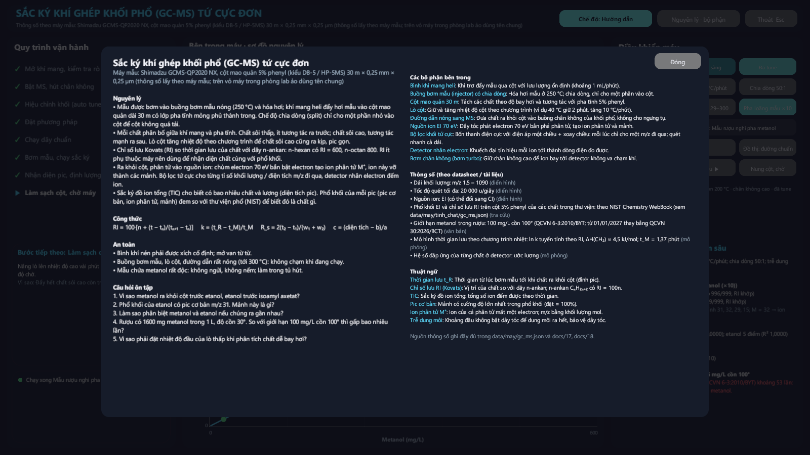 Bảng nguyên lý GC-MS | 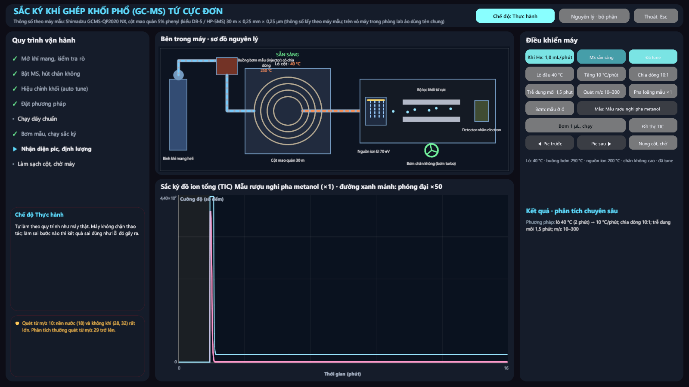 GC-MS làm sai: nền lớn, mất pic |
| 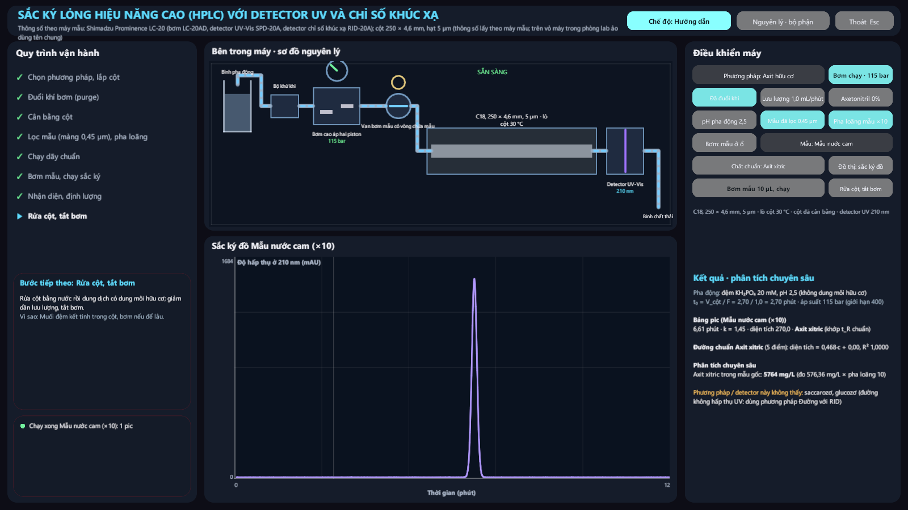 HPLC nước cam: axit xitric (UV 210 nm) | 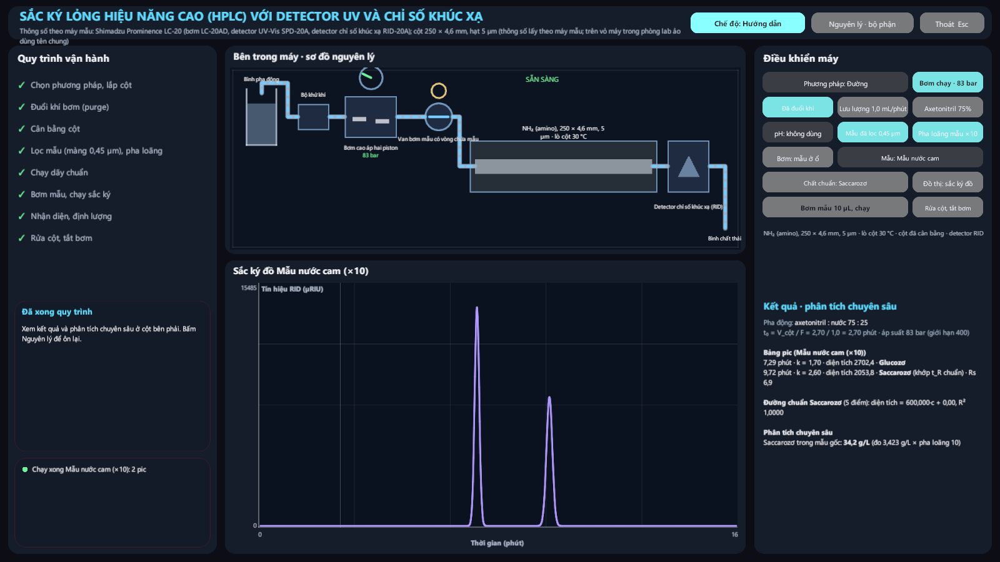 HPLC nước cam: glucozơ, saccarozơ (RID) |
| 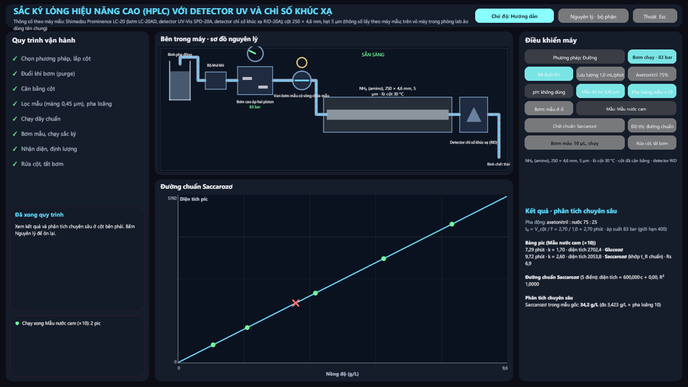 Đường chuẩn saccarozơ | 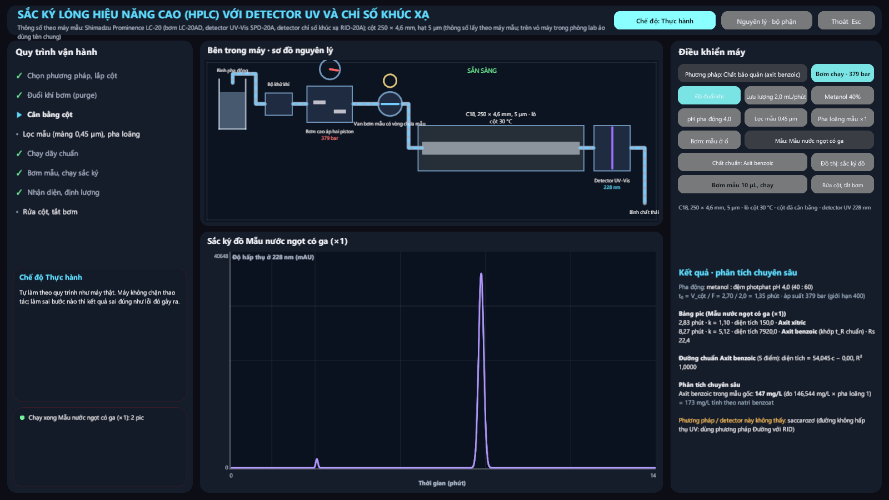 HPLC nước ngọt: axit benzoic |
| 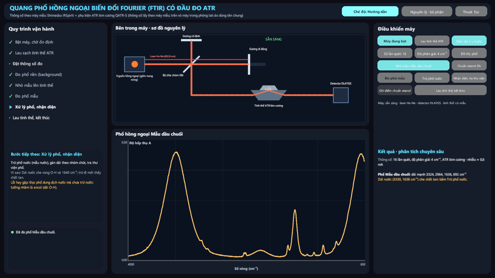 FTIR dầu chuối: phổ thô (nước chiếm ưu thế) | 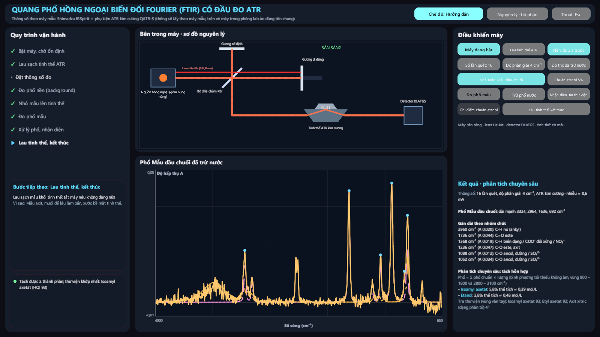 Đã trừ nước: gán dải, tách hỗn hợp |
| 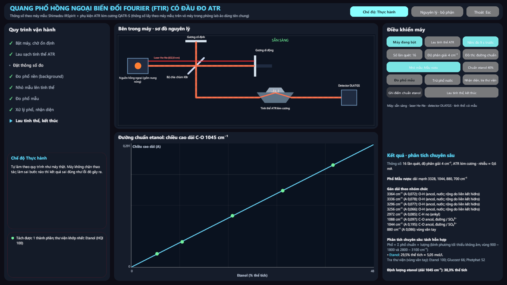 Đường chuẩn etanol ở 1045 cm⁻¹ | 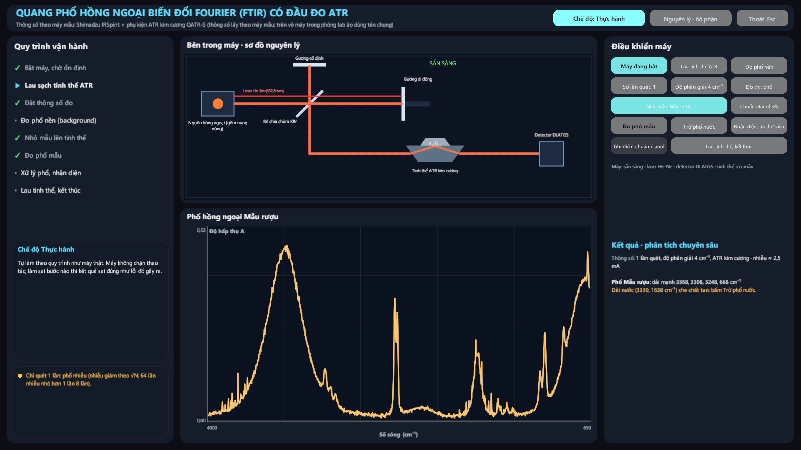 Không đo nền: dải CO₂, nhiễu |

## Giới hạn

- **Cường độ dải hồng ngoại và hệ số giữ HPLC là mô phỏng.** Vị trí dải, thứ tự ra là theo tài liệu. Phổ khối và RI của GC-MS là số thật của NIST.
- **Thư viện còn nhỏ:** GC-MS 7 chất, FTIR 17 chất / ion, HPLC 16 chất trong 3 phương pháp. Chất ngoài thư viện thì máy báo "ngoài thư viện", không bịa phổ / pic. Bổ sung khi có số liệu có nguồn.
- **Chuẩn độ điện thế mới có axit – bazơ** (chưa có chuẩn độ oxi hóa khử, kết tủa).
- **Thời gian rút ngắn:** một lần chạy GC 16 phút diễn ra trong 7 giây; HPLC trong 6 giây.
- **Dung dịch chuẩn pha sẵn trên màn hình máy**, chưa tự pha ở bàn.

## Việc tiếp theo (đợt 3, chờ duyệt)

SEM, XRD, NMR để bàn, bom nhiệt lượng: làm theo cùng khung.
