# Máy phân tích đợt 3 và đợt 4

Hai đợt cuối của kế hoạch máy phân tích, cùng khung với [docs/17](17-may-phan-tich-dot-1.md) và [docs/18](18-may-phan-tich-dot-2.md):
- bấm vào máy thì mở màn hình vận hành riêng;
- quy trình có chế độ Hướng dẫn / Thực hành;
- có sơ đồ bên trong máy, đồ thị, phân tích chuyên sâu;
- số liệu có nguồn.

Phòng máy phân tích nay có **14 máy**, máy nào cũng vận hành được:

| Đợt | Máy |
|---|---|
| 1 | UV-Vis, AAS |
| 2 | FTIR, GC-MS, HPLC, chuẩn độ điện thế |
| 3 | XRD, SEM-EDS, ¹H-NMR, bom nhiệt lượng |
| 4 | Tủ sấy, lò nung, máy cất nước hai lần, nồi hấp tiệt trùng |

Đợt 4 còn có:
- **AI trợ lý và robot đọc quy trình máy:** câu hỏi nhắc tới máy nào thì máy chủ đưa tóm tắt quy trình, lỗi hay gặp, an toàn của máy đó vào ngữ cảnh gửi mô hình.
- **Trang "Hướng dẫn máy"** trên web quản lý.

Ngoài máy phân tích:
- **Bàn chế tạo đổi sang màu tối:** mặt bàn ở ngăn chế tạo, và bàn lắp ráp ảo cùng lưới, thân bàn, vách sau.
- **Bộ ảnh phòng lab chụp lại toàn bộ:** 27 ảnh, gồm cả mặt bằng nhìn từ trên.

## Mẫu mới trong phòng

| Ống mẫu | Thành phần | Dùng cho |
|---|---|---|
| Mẫu nước muối | NaCl 1 M | Cô cạn → tinh thể NaCl (XRD, SEM) |
| Mẫu kết tủa trắng | Ba²⁺ + SO₄²⁻ → BaSO₄ kết tủa, NaCl tan | Lọc lấy kết tủa (XRD, SEM-EDS) |
| Mẫu cặn ấm đun nước | CaCO₃ | XRD (canxit) |

XRD, SEM, bom nhiệt lượng còn có **mẫu rắn chuẩn trong hộp mẫu của máy**: halit, muối ăn giảm natri (NaCl + KCl), đá vôi, cát, thạch cao, viên axit benzoic chuẩn, glucozơ, saccarozơ…

Chất rắn lấy từ ống mẫu theo hai cách (`SolidResidue`, `SolidState.cs`):
- **lọc lấy kết tủa;**
- **cô cạn:**
  - muối tan kết tinh theo cặp ion, ví dụ Na⁺ + Cl⁻ → NaCl, Ca²⁺ + CO₃²⁻ → CaCO₃, Na⁺ + benzoat → natri benzoat;
  - đường, axit hữu cơ còn lại dạng vô định hình;
  - etanol, axit axetic bay hơi.

## Dữ liệu và nguồn

| Tệp | Nội dung | Nguồn |
|---|---|---|
| `data/may/xrd.json` | Hồ sơ XRD: 7 bộ phận, 7 bước, an toàn tia X | Rigaku MiniFlex 600 (Cu, 40 kV, 15 mA, goniomet 150 mm) |
| `data/may/sem.json` | Hồ sơ SEM-EDS, 8 bộ phận, 8 bước | Hitachi TM4000Plus II (5 – 20 kV, 10× – 100 000×) |
| `data/may/nmr.json` | Hồ sơ ¹H-NMR, 7 bộ phận, 7 bước | Magritek Spinsolve 60 (60 MHz, vạch < 0,5 Hz) |
| `data/may/nhiet_luong.json` | Hồ sơ bom nhiệt lượng, 7 bộ phận, 7 bước | IKA C 200 (oxy 30 bar, tối đa 40 kJ, nhiệt kế 0,0001 K) |
| `data/may/tu_say.json`, `lo_nung.json` | Phương pháp khối lượng: độ ẩm, tro, nung vôi | TCVN 13887-3:2023 (105 ± 2 °C), TCVN 4048:2011 (làm nguội trong bình hút ẩm), TCVN 7038:2002 (tro 550 ± 25 °C, chênh ≤ 0,5 mg), TCVN 5105:1990 (tro còn đen) |
| `data/may/may_cat_nuoc.json` | Cất nước hai lần, xếp loại nước | TCVN 4851:1989 (ISO 3696): loại 1 ≤ 0,1; loại 2 ≤ 1,0; loại 3 ≤ 5,0 µS/cm |
| `data/may/noi_hap.json` | Nồi hấp tiệt trùng | IAPWS-IF97 (áp suất hơi bão hòa); chỉ thị G. stearothermophilus D₁₂₁ = 1,5 – 2,0 phút (Merck) |
| `data/may/tinh_chat/xrd.json` | 7 thẻ chuẩn nhiễu xạ bột: 7 vạch mạnh nhất (d, cường độ), ô mạng | Handbook of Mineralogy (MSA), chép đúng mục X-ray Powder Pattern |
| `data/may/tinh_chat/eds.json` | Năng lượng vạch tia X Kα / Lα / Mα của 23 nguyên tố | X-Ray Data Booklet (LBNL), bảng 1-2 |
| `data/may/tinh_chat/nmr.json` | Độ dịch chuyển ¹H trong D₂O, số H, kiểu tách vạch | Fulmer và cộng sự, Organometallics 2010, 29, 2176 (bảng S1); đường, isoamyl axetat, axit xitric ghi là giá trị điển hình |
| `data/may/tinh_chat/nhiet_dot_chay.json` | ΔcH° của axit benzoic, glucozơ, saccarozơ, axit xitric, etanol; giá trị chứng nhận SRM 39j | NIST Chemistry WebBook; chứng chỉ NIST SRM 39j (26 434 J/g) |

Một số số liệu ghi rõ là mô phỏng (`"mo_phong": true`):
- cỡ hạt, hình dạng tinh thể;
- độ nhạy EDS;
- nhiệt dung thật của bom;
- tốc độ khô, tốc độ cháy;
- hiệu suất cất nước;
- lượng không khí còn lại trong nồi hấp.

## Mô hình bên trong máy

C# thuần trong `Assets/Scripts/Simulation/Chem/`, kiểm thử được ngoài Unity.

### XRD (`XrdLibrary`)
- Góc pic theo định luật Bragg, 2θ = 2·arcsin(λ/2d) với Cu Kα₁ λ = 1,5406 Å; cường độ theo thẻ chuẩn × phần khối lượng pha.
- **Độ rộng pic:** độ rộng của máy (0,08°) ⊕ mở rộng Scherrer theo kích thước tinh thể. BaSO₄ kết tủa mới có tinh thể khoảng 35 nm nên pic rộng.
- **Lỗi khi chuẩn bị mẫu:**
  - mặt mẫu cao hơn giá làm pic dời góc: Δ2θ = −2s·cosθ/R;
  - không nghiền thì định hướng ưu tiên làm sai tỉ lệ cường độ.
- **Chất vô định hình** (đường, keo hiđroxit) chỉ cho bướu rộng quanh 22°.
- **Tìm pha:**
  - so vị trí các vạch ≥ 8% của mỗi thẻ;
  - vạch 100% bắt buộc phải có pic;
  - pic được tìm trên phổ đã làm trơn; nền tính hai bên, pic rộng quá 1,5° (bướu) bị loại.

### SEM-EDS (`EdsLibrary`, `SemProgram`)
- **Ảnh vẽ theo pha của chất rắn:**

  | Pha | Hình dạng |
  |---|---|
  | NaCl, KCl | Lập phương |
  | Canxit | Khối mặt thoi |
  | Thạch cao | Tấm / lăng trụ |
  | BaSO₄, AgCl | Hạt rất mịn kết đám |
  | Thạch anh | Mảnh vỡ |
  | Đường | Khối vô định hình |

- **Hiển thị ảnh:**
  - cỡ hạt theo thanh tỉ lệ;
  - ở chế độ BSE, độ sáng theo nguyên tử khối trung bình;
  - chưa lấy nét thì mờ;
  - mẫu không phủ vàng ở 10 kV trở lên thì có vệt tích điện;
  - quét nhanh thì nhiễu.
- **Phổ EDS:**
  - pic Gauss ở năng lượng vạch, độ rộng khoảng 120 eV ở 5,9 keV;
  - cường độ theo hệ số quá áp (U − 1)^1,67: 5 kV không kích thích được Cu Kα 8 keV;
  - nền bức xạ hãm;
  - có pic Au của lớp phủ và pic C của băng dính.
- **Định lượng:** khớp cả phổ (nền + mọi pic) bằng bình phương tối thiểu không âm, nên tách được các pic chồng nhau như Au Mα 2,12 / S Kα 2,31 keV.

### ¹H-NMR (`NmrLibrary`)
- **Vạch:** mỗi tín hiệu tách theo quy tắc n + 1 với cường độ theo tam giác Pascal, cách nhau J/60 ppm (máy 60 MHz).
- **Nước và H trao đổi:** H của OH, COOH nhập vào tín hiệu nước. Nước có thể triệt (presaturation).
- **Từ FID ra phổ:** FID là tổng dao động tắt dần; máy biến đổi Fourier rời rạc thật (2048 điểm) ra phổ.
  - Sai pha thì vạch méo.
  - Chưa shim thì vạch rộng 6 Hz, mất phần tách vạch.
- **Tích phân bằng khớp đường vạch** (deconvolution), vì vạch đơn metanol 3,34 ppm sát vạch bốn CH₂ của etanol (3,48 – 3,83 ppm).
- **qNMR:** chuẩn nội DSS (9 H, 0,00 ppm) cho nồng độ từng chất.

### Bom nhiệt lượng (`CalorimetryLibrary`)
- **Nhiệt đốt cháy ở thể tích không đổi:** ΔcU = ΔcH − Δn(khí)·RT, với Δn = n CO₂ − n O₂.
  - Glucozơ có Δn = 0 nên ΔcU = ΔcH.
  - Axit benzoic dùng giá trị chứng nhận.
- **Đường nhiệt độ:** trao đổi nhiệt với vỏ (isoperibol), nhiệt khuấy, nhiệt tỏa theo hàm mũ sau khi đốt.
- **ΔT hiệu chỉnh** theo Regnault – Pfaundler (độ trôi tiền kỳ, hậu kỳ, tích phân qua chính kỳ).
- **Hiệu chuẩn:** C = (m·26 434 + Q sợi mồi) / ΔT.

### Máy phụ trợ (`Auxiliary.cs`)
- **Hơi nước bão hòa** theo phương trình miền 4 của IAPWS-IF97: 100 °C → 1,0142 bar; 121 °C → 2,050 bar. Hàm ngược tìm nhiệt độ sôi.
- **Diệt bào tử:** lg(N₀/N) = Σ Δt / D(T), D(T) = D₁₂₁·10^((121 − T)/z).
- **Nồi hấp có bộ điều khiển áp suất đồng hồ:** nhiệt độ thật là nghiệm của p_hơi(T) + p_không khí(T) = p đặt.
  - Không đuổi khí: đồng hồ vẫn 1,05 bar nhưng chỉ khoảng 94 °C.
- **Sấy, nung:**
  - nước bay hơi theo hàm mũ;
  - ở 550 °C chất hữu cơ cháy hết; natri benzoat để lại Na₂CO₃; hiđrat mất nước;
  - CaCO₃ bền ở 550 °C, phân hủy thành CaO ở 900 °C (mất 43,97%);
  - cân lúc nóng thì thiếu khoảng 1,5 mg; nguội ngoài không khí thì mẫu hút ẩm (CaO hút cả CO₂).
- **Máy cất nước:**
  - mỗi lần cất còn khoảng 0,5% ion bị cuốn theo;
  - phần nước đầu bẩn;
  - để hở thì CO₂ tan vào, độ dẫn tăng tới khoảng 1 µS/cm.

## Lỗi thao tác mô phỏng

| Máy | Làm sai | Máy phản ứng |
|---|---|---|
| XRD | Quét khi cửa mở | Khóa liên động không cho phát tia X |
| XRD | Không nghiền / không ép phẳng | Tỉ lệ cường độ sai; pic dời khoảng 0,2° |
| XRD | Quét nhanh | Nhiễu, pic yếu lẫn vào nền |
| SEM | Không phủ vàng | Ảnh tích điện (vệt sáng); gợi ý phủ vàng hoặc hạ 5 kV |
| SEM | 5 kV | Không thấy vạch K của nguyên tố nặng |
| SEM | Tính cả Au, C | Máy nhắc đó là lớp phủ / băng dính |
| NMR | Không shim | Vạch rộng 6 Hz, mất tách vạch |
| NMR | Không triệt nước | Tín hiệu nước che chất tan |
| NMR | Không chỉnh pha | Vạch méo, tích phân sai |
| Bom | Không hiệu chuẩn | Dùng C ghi trên máy 10 000 J/K (thật 10 050) |
| Bom | Mẫu ướt | Không bắt lửa |
| Bom | Quá 40 kJ | Không cho đốt |
| Bom | Oxy thiếu | Cháy không hết, muội than |
| Tủ sấy | Cân lúc nóng; nguội ngoài không khí; 150 °C với đường; dưới 100 °C | Số cân sai đúng chiều; đường caramen hóa; chưa khô |
| Lò nung | Không than hóa | Mẫu bắn ra khỏi chén |
| Lò nung | Tro còn đen; CaO nguội ngoài không khí | Máy nhắc nung thêm; CaO hút ẩm, CO₂ nên số cân tăng |
| Máy cất nước | Đun khi chưa có nước cấp | Rơ-le nhiệt ngắt |
| Máy cất nước | Không có nước làm mát | Hơi thoát, không có nước cất |
| Máy cất nước | Không bỏ phần đầu; để hở | Độ dẫn cao |
| Nồi hấp | Không đuổi khí | Nhiệt độ thấp, chỉ thị không đạt |
| Nồi hấp | Mở nắp khi còn áp | Khóa liên động chặn (Hướng dẫn) / báo nguy hiểm (Thực hành) |

## Kiểm thử

### Bộ máy hóa học (C#)

Kết quả: **140/140 đạt**, trong đó đợt 3 + 4 có 35 bài. Một số bài:
- **Chất rắn từ mẫu:**
  - cô cạn 10 mL NaCl 1 M ra 584 mg NaCl;
  - nước giếng ra cặn CaCO₃ 100 mg/L;
  - lọc kết tủa chỉ còn BaSO₄.
- **XRD:**
  - halit 2θ = 31,69°;
  - NaCl + KCl ra đúng 2 pha;
  - BaSO₄ không bị nhận nhầm thạch anh;
  - chất khô nước cam (vô định hình) không ra pha nào;
  - Scherrer ra khoảng 35 nm.
- **EDS:**
  - BaSO₄ ra Ba : S ≈ 1 : 1;
  - có pic Au khi phủ vàng;
  - 5 kV không kích thích được Cu Kα.
- **NMR:**
  - CH₃ etanol là vạch ba 1 : 2 : 1 cách 7 Hz;
  - CH₂ : CH₃ = 2 : 3;
  - qNMR metanol / etanol đúng ±8%;
  - sai pha thì có phần âm.
- **Bom:**
  - axit benzoic 26 434 J/g;
  - ΔcU etanol = ΔcH − Δn·RT;
  - ΔT hiệu chỉnh đúng ±0,3%;
  - hiệu chuẩn tìm lại C.
- **Máy phụ trợ:**
  - IAPWS 100 °C / 121 °C đúng;
  - còn 0,5 bar không khí thì chỉ 112,7 °C;
  - 121 °C 15 phút giảm 8,3 bậc bào tử;
  - CaCO₃ ở 900 °C còn 56%;
  - natri benzoat để lại Na₂CO₃;
  - cất 1 / 2 lần đạt loại 3 / 2.

### Python

- `tests/test_du_lieu_may.py`:
  - đúng số của Handbook of Mineralogy, X-Ray Data Booklet, Fulmer 2010, NIST;
  - tổng số H khớp công thức;
  - khối lượng mol khớp CₓHᵧO_z.
- `tests/test_ai_server.py`:
  - `/may`, `/may/{ma}`;
  - trợ lý nhận quy trình nồi hấp khi được hỏi;
  - câu hỏi không nhắc máy thì không thêm quy trình.

### Bài chạy tự động `may3` (học sinh làm với ống mẫu thật)

| Máy, mẫu | Kết quả |
|---|---|
| XRD, kết tủa trắng (lọc) | Barit, độ khớp 100%; Scherrer 31 nm (mô phỏng 35 nm); không còn nhận nhầm thạch anh |
| XRD, muối ăn giảm natri | Halit ≈ 60%, sylvit ≈ 40% (thật 60 / 40) |
| XRD, đá vôi không nghiền / ép | Pic mạnh nhất ở 29,22° (thẻ chuẩn 29,41°); máy báo định hướng ưu tiên, mặt mẫu lệch |
| XRD, nước cam cô cạn | "Không có pic nhọn…: mẫu chủ yếu vô định hình" |
| SEM, nước muối cô cạn, phủ vàng | Tinh thể lập phương; EDS Na 49,9%, Cl 50,1% |
| SEM, kết tủa trắng ×10 000 | EDS O 66,7%, S 16,7%, Ba 16,6% (đúng BaSO₄) |
| NMR, rượu nghi pha metanol | 3,65 ppm vạch bốn **2,00 H**, 1,17 ppm vạch ba **3,00 H** (etanol), 3,34 ppm vạch đơn **3,00 H** (metanol); qNMR metanol 1598 mg/L = 5307 mg/L cồn 100° (vượt 100 mg/L), khớp GC-MS ở đợt 2 |
| Bom, axit benzoic chuẩn | C = 10 044 J/K (thật 10 050, −0,06%) |
| Bom, glucozơ | 15 571 J/g (NIST 15 569, +0,01%) |
| Bom, nước cam | Chưa sấy: không bắt lửa. Sấy khô 10 mL: 13 248 J → **31,7 kcal/100 mL** (lý thuyết 31,7) |

### Bài chạy tự động `may4`

| Máy, mẫu | Kết quả |
|---|---|
| Tủ sấy, 10 mL nước cam | 5 lần cân tới khối lượng không đổi (chênh 0,6 mg); độ ẩm **91,71%** (thật 91,71%) |
| Tủ sấy, thực hành 150 °C, cân khi nóng | Máy báo cân lúc nóng làm số cân nhỏ hơn thật |
| Lò nung, đá vôi 900 °C | Còn **56,0%** khối lượng (CaO, lý thuyết 56,0%) |
| Lò nung, chất khô nước ngọt 550 °C | Tro Na₂CO₃ khoảng 0,7 mg (lý thuyết 0,64 mg) |
| Lò nung, CaO nguội ngoài không khí | Còn 57,2% (lớn hơn thật); máy báo hút ẩm, CO₂ |
| Máy cất nước | Chưa có nước cấp: rơ-le nhiệt ngắt. Cất hai lần, bỏ khoảng 480 mL đầu: **0,45 µS/cm, loại 2**. Để hở 6 giờ: 1,3 µS/cm, loại 3. Cất một lần: 2,1 µS/cm, loại 3 |
| Nồi hấp, đúng quy trình | Hướng dẫn chặn đóng van khi chưa đuổi khí. Đạt 120,8 °C, giữ 15 phút, giảm 8,7 bậc; mở nắp sớm bị khóa liên động chặn; chỉ thị **ĐẠT** |
| Nồi hấp, không đuổi khí | Đồng hồ 1,05 bar nhưng chỉ **94 °C**, giảm 0 bậc; chỉ thị **KHÔNG ĐẠT**; mở nắp khi còn áp: báo NGUY HIỂM |

### Hồi quy

Chạy lại toàn bộ sau khi thêm đợt 3 – 4. Tất cả đều đạt (Unity thoát mã 0, không lỗi).

| Bài | Kết quả |
|---|---|
| Python (`unittest`) | OK |
| Bộ máy hóa học (C#) | 140 đạt, 0 sai |
| `may4` (78 s) | Tủ sấy: 5 lần cân, đạt khối lượng không đổi. Lò nung đá vôi: còn 56,0 % (lý thuyết 56,0 %). Nồi hấp đúng quy trình: 120,8 °C, giảm 8,5 bậc log. Nồi hấp không đuổi khí: chỉ 94 °C, giảm 0 bậc |
| `may3` (88 s) | XRD: barit 100 %, Scherrer 31 nm (mô phỏng 35 nm). EDS BaSO₄: O 66,7 / S 16,7 / Ba 16,6 %. Bom glucozơ: 15570 J/g (NIST 15569) |
| `may2` (131 s) | Chuẩn độ giấm: C = 0,8301 mol/L (thật 0,8300). GC-MS: metanol 1602 mg/L (thật 1602) |
| `may` (110 s) | UV-Vis tách hỗn hợp KMnO₄ + Cr(VI) đúng. AAS Cu: 259,6 mg/L (thật 254,2, +2,1 %); cảnh báo khi không pha loãng |
| Đầy đủ (301 s) | Chuẩn độ sai số 0,34 %; đủ 14 máy phân tích trong cảnh |
| `khu` (184 s) | Robot lấy HCl ở kho trong lúc kho được tải; lọ về đúng tay |

### Ảnh màn hình

| | |
|---|---|
| 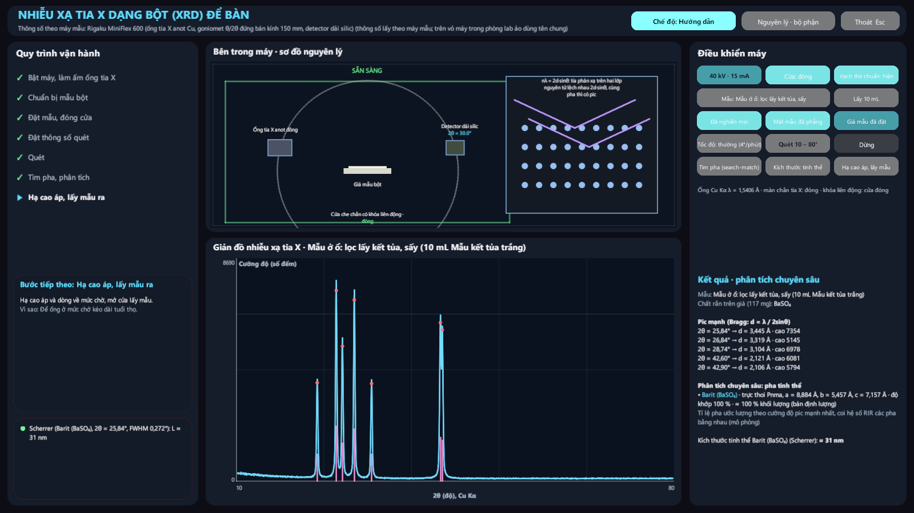 XRD kết tủa trắng: barit | 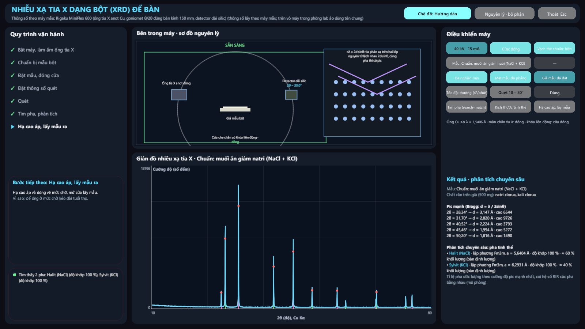 Muối giảm natri: halit + sylvit, vạch thẻ chuẩn |
| 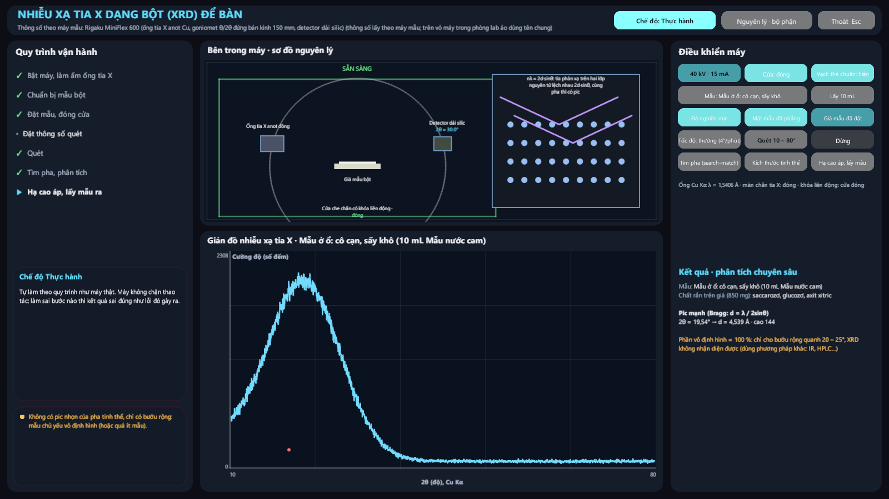 Nước cam cô cạn: vô định hình | 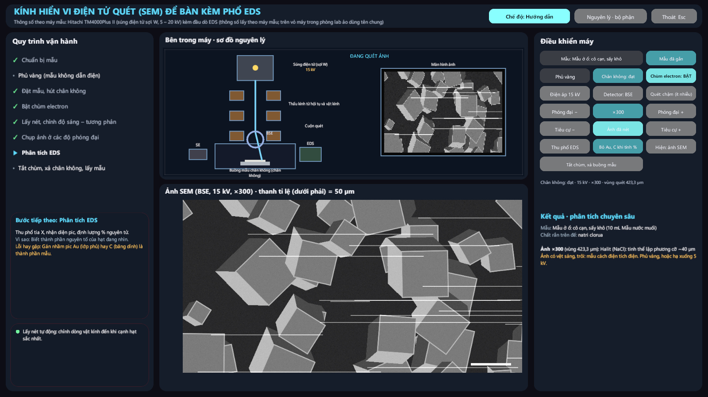 SEM không phủ vàng: tích điện |
| 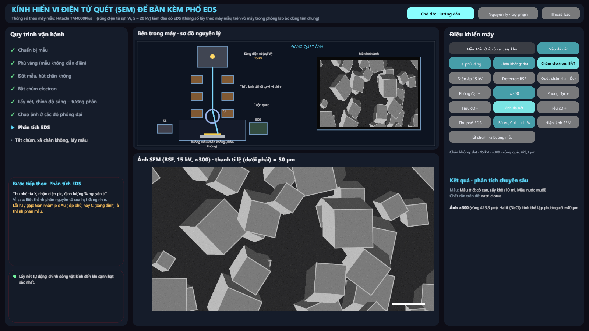 SEM tinh thể NaCl lập phương | 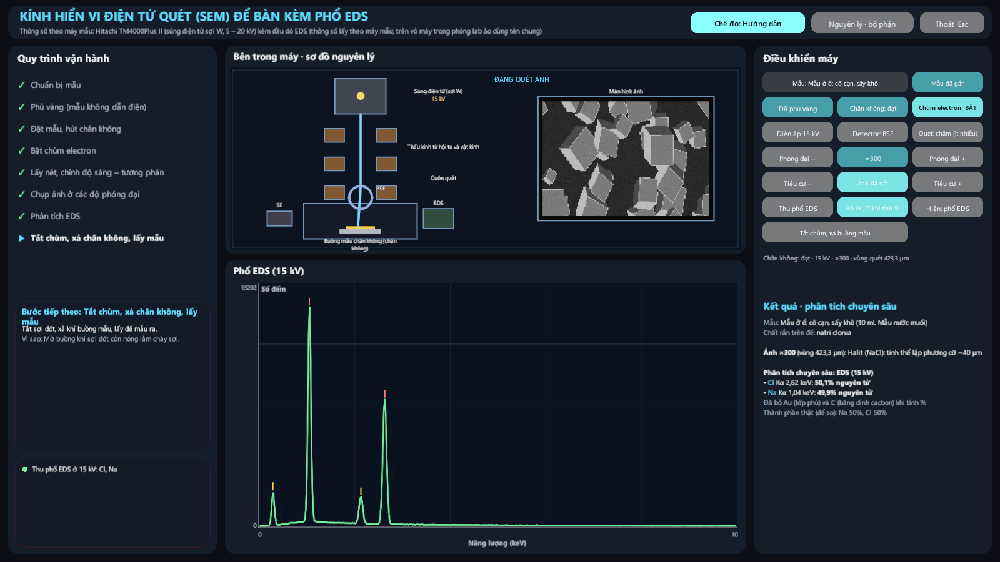 Phổ EDS NaCl |
| 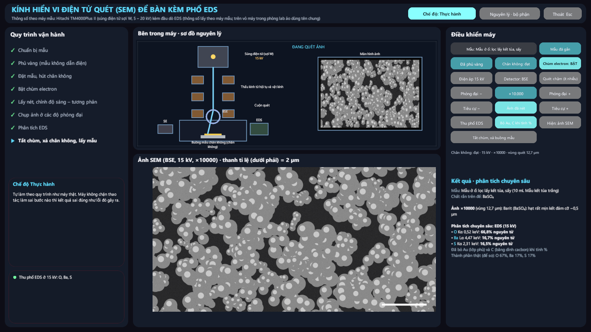 BaSO₄ hạt mịn ×10 000 | 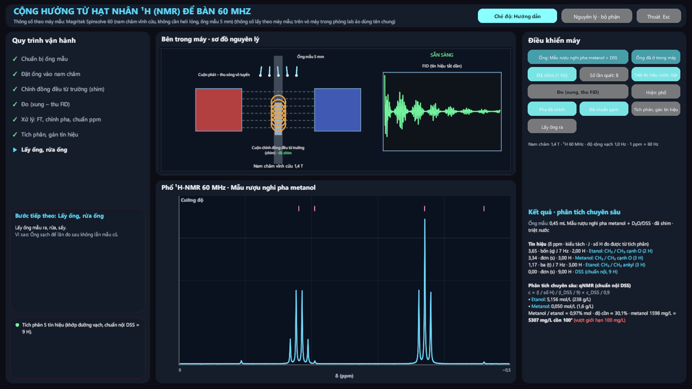 ¹H-NMR rượu nghi pha metanol, qNMR |
| 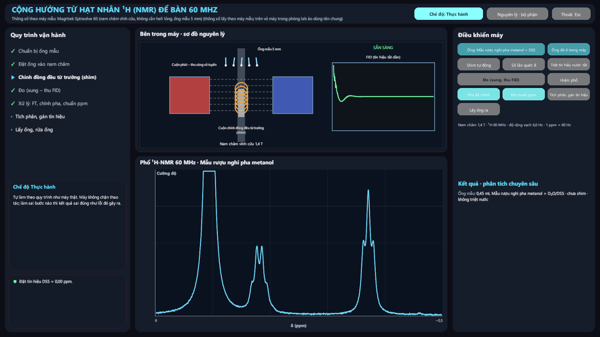 NMR không shim, không triệt nước | 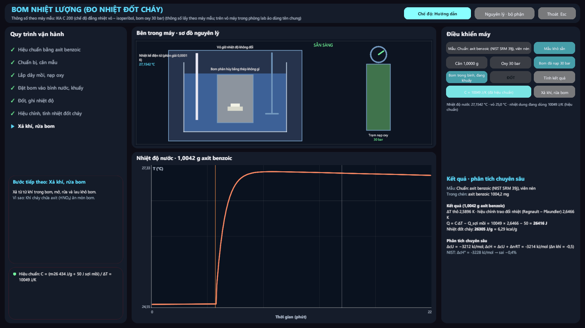 Bom: hiệu chuẩn axit benzoic |
| 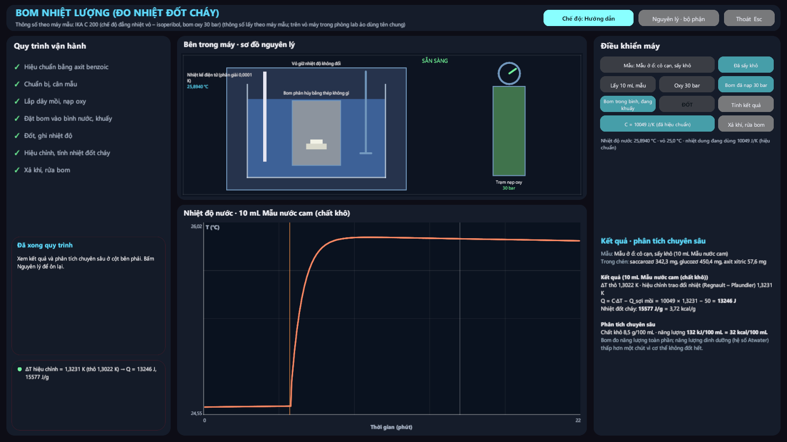 Bom: năng lượng nước cam | 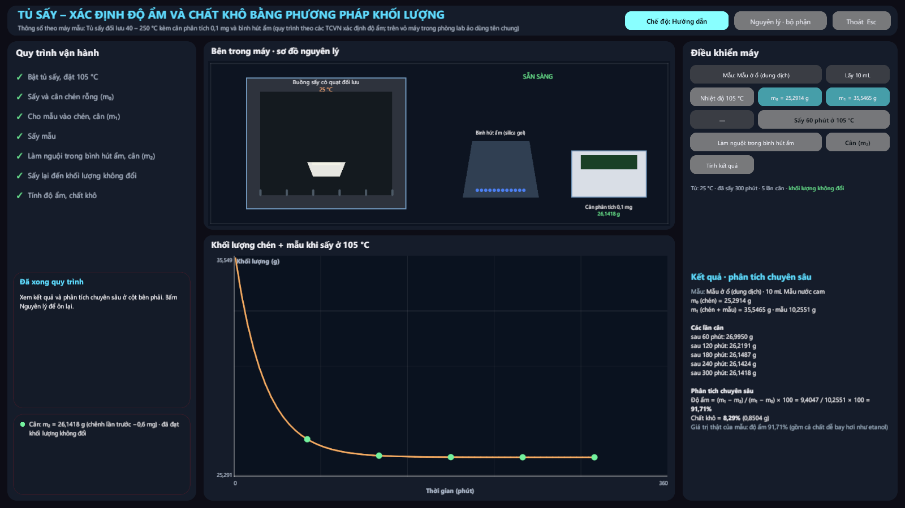 Tủ sấy: độ ẩm nước cam |
| 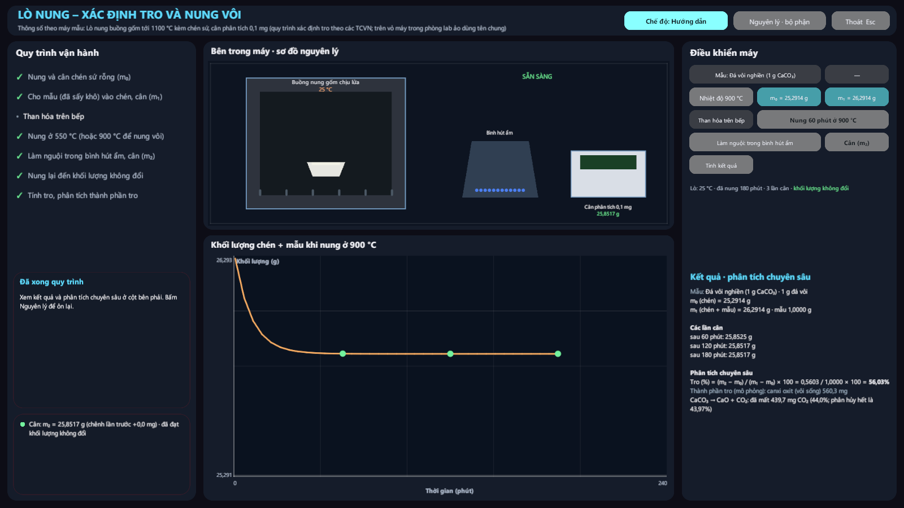 Lò nung: nung vôi | 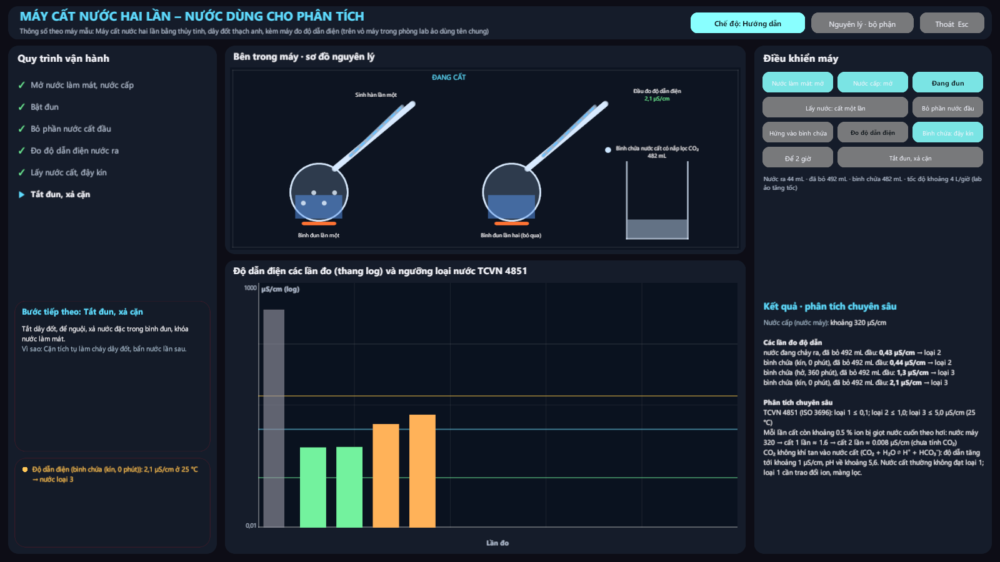 Máy cất nước: độ dẫn, loại nước |
| 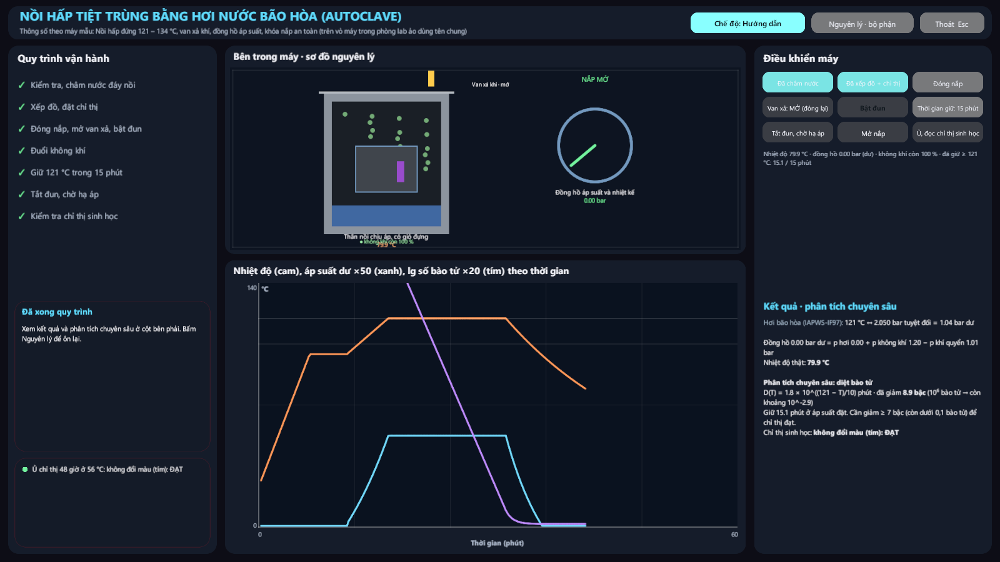 Nồi hấp đúng quy trình: đạt | 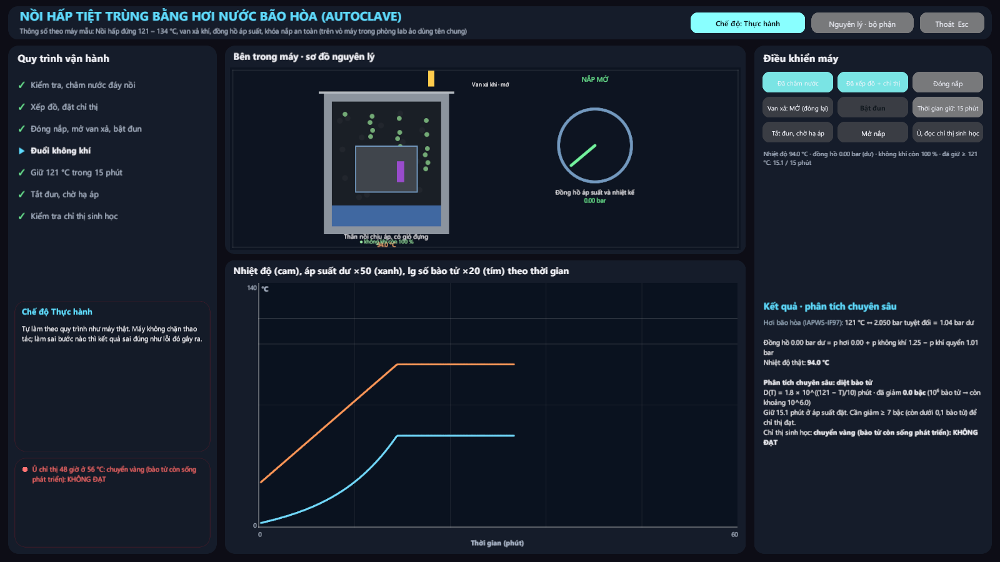 Không đuổi khí: 94 °C, không đạt |

Ảnh phòng lab (27 ảnh, chụp lại toàn bộ sau khi thiết kế lại): [docs/anh-phong-lab/](anh-phong-lab/). Ảnh mặt bằng: [27_mat_bang_tang_1.png](anh-phong-lab/27_mat_bang_tang_1.png).

## Giới hạn

- **XRD:** thư viện mới có 7 pha. Muối ngậm nước (CuSO₄·5H₂O...) chưa có thẻ nên máy báo "pha ngoài thư viện". Tỉ lệ pha là bán định lượng (coi RIR bằng nhau).
- **NMR:** chỉ tách vạch bậc một (bỏ qua hiệu ứng bậc hai ở 60 MHz). Đường, axit xitric dùng độ dịch chuyển điển hình.
- **SEM:** ảnh là hình vẽ theo hình dạng điển hình của từng pha, không phải ảnh chụp thật.
- **Tốc độ rút ngắn:** sấy 60 phút trong 1,2 giây; nồi hấp 1 giây = 2 phút.
