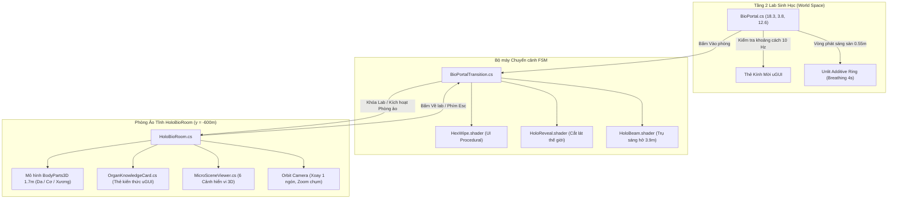

# Cổng vào và Phòng Sinh học 3D (HoloBioRoom)

Tài liệu kỹ thuật hệ thống Cổng vào và Phòng Sinh học 3D tầng 2 (KHKT-BIO-PORTAL & VERA Virtual Biology Room).

---

## 1. Tổng quan và Mục tiêu Thiết kế

### 1.1 Bối cảnh
Khu giải phẫu người (Anatomy Area) đặt tại góc đông bắc tầng 2 Lab Sinh học (`18.3, 3.8, 12.6`). Để giúp học sinh quan sát giải phẫu cơ thể người tỉ lệ thực 1:1, nghiên cứu sâu 15 cơ quan nội tạng và phóng to xuống cấp độ hiển vi tế bào / hóa sinh mà không làm nặng cảnh chính, hệ thống được thiết kế theo mô hình **Cổng vào Thực tế Ảo (Holographic Portal)** dẫn tới **Phòng Ảo Tĩnh (HoloBioRoom)** đặt tại độ cao cách ly $y = -600\text{m}$.

### 1.2 Mục tiêu thiết kế
- **Hiệu năng cao:** Duy trì $\ge 60\text{ FPS}$ trên laptop Intel Iris Xe và iPad. Thời gian khung hình đỉnh (peak frame time) khi chuyển cảnh $< 33\text{ ms}$. Ngân sách bộ nhớ: 0 GC Alloc trong `Update()`, bộ nhớ heap tăng $< 5\text{ MB}$ sau 20 vòng lặp liên tục.
- **Trải nghiệm thị giác liền mạch:** Chuyển cảnh 8 bước quét sáng và hiệu ứng mở mạng lục giác `HexWipe`, hiện hình cắt lớp `HoloReveal`.
- **Hỗ trợ tiếp cận (Reduced Motion):** Khi bật cờ `ReducedMotion.IsEnabled`, hệ thống tự động thay thế chuỗi hoạt cảnh bằng chuyển cảnh mờ chéo (Crossfade) nhẹ nhàng $\sim 0,25\text{ s}$.
- **Độ chính xác phục hồi không gian:** Khi rời phòng ảo về lại phòng lab, vị trí người chơi lệch $\le 1\text{ cm}$, góc nhìn lệch $\le 0,5^\circ$, trường nhìn (FOV) và HUD được phục hồi nguyên trạng.
- **Nội dung giáo dục chuẩn mực:** Dữ liệu kiến thức 15 cơ quan bám sát Chương trình GDPT 2018 (Sinh học 11 & KHTN 8), hệ thống trắc nghiệm củng cố kèm lời giải thích chi tiết, 6 cảnh hiển vi mô phỏng sinh lý động.
- **Ghi công bản quyền minh bạch:** Luôn hiển thị dòng ghi công bản quyền quốc tế: `"BodyParts3D © The Database Center for Life Science · CC BY 4.0"`.

---

## 2. Kiến trúc Module Hệ thống



### 2.1 Thành phần Module C#

| Tệp C# | Vị trí | Chức năng chính |
|---|---|---|
| `BioPortal.cs` | `Assets/Scripts/Demo/Bio/Portal/` | Quản lý cổng vật lý tại tầng 2, kiểm tra khoảng cách người chơi ở tần số 10 Hz (vùng trễ 2,2m / 2,8m), vòng sáng sàn breathing 4s, hiển thị thẻ mời Frosted Glass. |
| `BioPortalTransition.cs` | `Assets/Scripts/Demo/Bio/Portal/` | Máy trạng thái FSM 7 pha: `Nghi -> DangMo -> DangTai -> HienPhong -> TrongPhong -> DangDong -> Nghi`. Điều phối 8 bước mở và 6 bước đóng, tạo âm thanh thủ tục hòa âm. |
| `HoloBioRoom.cs` | `Assets/Scripts/Demo/Bio/Portal/` | Quản lý phòng ảo tại $y = -600\text{m}$, sàn lưới 20x20m, 4 vòng sáng, orbit camera, điều khiển 3 lớp Da/Cơ/Xương (fade 0,35s), hoạt cảnh tim 72 bpm và phổi 16 bpm, thanh công cụ và danh sách 15 cơ quan. |
| `OrganKnowledgeCard.cs` | `Assets/Scripts/Demo/Bio/Portal/` | Nạp trước và lưu đệm 15 tệp JSON từ `StreamingAssets/data/sinh/kien_thuc/`, hiển thị thẻ kính mờ chuẩn GDPT 2018, hộp thoại trắc nghiệm tương tác kiểm tra đúng/sai. |
| `MicroSceneViewer.cs` | `Assets/Scripts/Demo/Bio/Portal/` | Dựng 6 cảnh hiển vi 3D thủ tục (Phế nang, Nephron, Synapse, Sarcomere, Nhung mao, Tiểu thùy gan), nhãn 3D billboard và nút quay lại toàn thân. |
| `LabSceneBuilder.Floor2.Portal.cs` | `Assets/Scripts/Editor/LabBuilder/Tang2/` | Khởi tạo tự động toàn bộ cây đối tượng và liên kết các thành phần trong Editor mà không cần lưu cảnh `.unity`. |

### 2.2 Bộ Shaders Chuyên dụng

1. **`HexWipe.shader` (`Assets/Lab/Tang2/Shader/HexWipe.shader`)**:
   - Dựng trên RawImage UI (Canvas Overlay), tính toán mạng lưới tổ ong lục giác 2D hoàn toàn bằng giải thuật toán học.
   - Tham số: `_TienDo` (0..1), `_Tam` (tâm quét màn hình), `_Chieu` (0: phủ vào, 1: tan ra), `_TiLeManHinh` (tỉ lệ khung hình chống méo).
   - Không sử dụng GrabPass hay Renderer Feature phụ trợ, tương thích 100% URP Mobile.

2. **`HoloReveal.shader` (`Assets/Lab/Tang2/Shader/HoloReveal.shader`)**:
   - Cắt lát mô hình BodyParts3D theo cao độ không gian thế giới `_DoCaoCat`.
   - Vệt phát sáng biên giới 3cm với hàm băm ngẫu nhiên `Hash21` tạo gợn số học công nghệ cao.
   - Đặt trong `UNITY_INSTANCING_BUFFER`, hỗ trợ đầy đủ `MaterialPropertyBlock` không gây rò rỉ hay nhân bản vật liệu.

3. **`HoloBeam.shader` (`Assets/Lab/Tang2/Shader/HoloBeam.shader`)**:
   - Chùm sáng hình trụ hở 2 mặt quanh bệ hologram (`Cull Off`, Additive Blend).
   - Suy giảm độ sáng từ chân lên đỉnh theo hàm mũ: $\text{alpha} = (1 - v)^{2.2} \times 0.22 + \sin(v \times 40 - t \times 3) \times 0.05$.

---

## 3. Quy trình Chuyển cảnh & Máy Trạng thái (FSM)

```
[Nghi] ──(Bấm "Vào phòng")──> [DangMo] ──> [DangTai] ──> [HienPhong] ──> [TrongPhong]
  ▲                                                                            │
  └──────────────── [DangDong] <──(Bấm "Về phòng" / Esc)───────────────────────┘
```

### 3.1 Trình tự MỞ (8 bước, $\sim 1,8\text{ s}$)
1. **Khóa thao tác:** Gọi `DesktopViewer.UiCapture++`, lưu chính xác tọa độ, góc nhìn, FOV và vị trí cổng; khóa HUD phòng chính.
2. **Kích hoạt cổng:** Quét sáng mô hình cổng, vòng sàn sáng tối đa và nở $1,5\times$; camera tiến $0,4\text{ m}$, FOV thu từ $60^\circ \rightarrow 50^\circ$.
3. **Phủ lục giác:** `HexWipe` lan từ vị trí mô hình cổng ra 4 góc màn hình; phát âm thanh hòa âm quét tần số $220\text{ Hz} \rightarrow 880\text{ Hz}$.
4. **Chuẩn bị phòng ảo:** Tắt camera lab, bật `holoCamera` và gốc `HoloBioRoom`; chuyển sang `DangTai` (nếu tải chậm $> 0,3\text{ s}$ sẽ hiện vòng xoay tiến trình).
5. **Mở màn lục giác:** `HexWipe` tan dần từ tâm ra viền ($0,50\text{ s}$), hòa âm ngân vang $432\text{ Hz} / 864\text{ Hz}$.
6. **Đánh thức phòng ảo:** Sàn sáng lan tỏa, 4 vòng sáng bật tuần tự cách nhau $0,08\text{ s}$, chùm sáng trụ dâng cao $3,9\text{ m}$.
7. **Cơ thể hiện hình:** Mô hình BodyParts3D hiện dần từ chân lên đầu thông qua `HoloReveal` ($0,70\text{ s}$).
8. **Hoàn thiện:** Giao diện uGUI trượt vào màn hình (`UiMotion.Popup`), mở khóa xoay camera quanh cơ thể; FSM chuyển sang `TrongPhong`.

### 3.2 Trình tự ĐÓNG (6 bước, $\sim 1,4\text{ s}$)
1. **Khóa điều khiển:** Mờ dần giao diện uGUI (`UiMotion.FadeOut`).
2. **Cơ thể tan biến:** Mô hình tan ngược từ đầu xuống chân qua `HoloReveal`, chùm sáng hạ, 4 vòng sáng tắt theo thứ tự ngược lại.
3. **Phủ lục giác đóng:** Màn lục giác `HexWipe` phủ từ viền màn hình vào tâm; âm thanh trầm dần $440\text{ Hz} \rightarrow 110\text{ Hz}$.
4. **Chuyển về lab:** Tắt phòng ảo, bật lại `viewCamera` của lab, phục hồi chính xác vị trí, góc ngẩng và hướng nhìn đã lưu; chờ `ZoneStreamer.WaitReadyAt(portalPos)`.
5. **Mở màn lab:** Lục giác tan từ tâm ra ngoài, FOV dãn $50^\circ \rightarrow 60^\circ$, vòng sàn co về kích thước $1,0\times$.
6. **Mở khóa điều khiển:** Giảm `DesktopViewer.UiCapture--`, kích hoạt thời gian chờ (cooldown) $0,8\text{ s}$ trên thẻ mời cổng; FSM về `Nghi`.

---

## 4. Dữ liệu 15 Cơ quan & 6 Cảnh Hiển vi 3D

### 4.1 Danh mục 15 Cơ quan Giải phẫu

| STT | Mã định danh | Tên cơ quan | Hệ cơ quan | Vị trí trên mô hình 1.7m | Cảnh hiển vi liên kết |
|---|---|---|---|---|---|
| 1 | `tim` | Tim | Tuần hoàn | `(-0.03, 1.32, 0.05)` | Sarcomere cơ tim |
| 2 | `phoi` | Phổi và đường dẫn khí | Hô hấp | `(0.00, 1.34, 0.04)` | Phế nang & mao mạch |
| 3 | `nao` | Não bộ | Thần kinh | `(0.00, 1.68, 0.00)` | Khe Synapse thần kinh |
| 4 | `gan` | Gan và túi mật | Tiêu hóa | `(-0.07, 1.16, 0.05)` | Tiểu thùy gan & xoang gan |
| 5 | `than` | Thận và đường tiết niệu | Bài tiết | `(0.00, 1.12, -0.04)` | Đơn vị thận Nephron |
| 6 | `da_day` | Thực quản và dạ dày | Tiêu hóa | `(0.04, 1.18, 0.05)` | Nhung mao niêm mạc |
| 7 | `ruot_non` | Ruột non | Tiêu hóa | `(0.00, 1.02, 0.05)` | Nhung mao & vi nhung mao |
| 8 | `ruot_gia` | Ruột già | Tiêu hóa | `(0.00, 1.02, 0.06)` | Nhung mao niêm mạc |
| 9 | `co` | Hệ cơ | Vận động | `(0.00, 1.15, 0.00)` | Sarcomere co cơ |
| 10 | `xuong` | Bộ xương | Vận động | `(0.00, 1.15, 0.00)` | — |
| 11 | `da` | Da | Vỏ bọc | `(0.00, 1.15, 0.00)` | — |
| 12 | `mach_mau` | Hệ mạch máu | Tuần hoàn | `(0.00, 1.25, 0.02)` | Phế nang & mao mạch |
| 13 | `tuy_song` | Tuỷ sống và dây TK | Thần kinh | `(0.00, 1.25, -0.06)` | Khe Synapse thần kinh |
| 14 | `lach` | Lách | Miễn dịch | `(0.12, 1.16, 0.01)` | Tiểu thùy gan & xoang gan |
| 15 | `tuy` | Tuyến tuỵ | Tiêu hóa / Nội tiết | `(0.01, 1.12, 0.02)` | Tiểu thùy gan & xoang gan |

Mỗi cơ quan có tệp dữ liệu JSON độc lập chứa đầy đủ cấu trúc:
- `vi_tri`: Vị trí giải phẫu học trong cơ thể.
- `cau_tao`: Cấu tạo chi tiết các ngăn, van, lớp cơ, mô liên kết.
- `chuc_nang`: Chức năng sinh lý chính đối với cơ thể sống.
- `co_che`: Cơ chế điện học, áp suất, enzym hoặc hormon điều hòa.
- `lien_he`: Ứng dụng thực tế, vệ sinh học đường, phòng chống bệnh lý thường gặp.
- `diem_thi`: Các dạng câu hỏi trọng tâm thường xuất hiện trong đề thi tốt nghiệp và KHTN.
- `trac_nghiem`: Mảng $\ge 3$ câu hỏi trắc nghiệm 4 lựa chọn A/B/C/D kèm giải thích chi tiết.

### 4.2 Cấu tạo 6 Cảnh Hiển vi 3D

1. **Phế nang (`pho_nang`)**: 7 túi phế nang hồng cầu mờ, tiểu phế quản hô hấp, 8 vòng mao mạch uốn lượn đổi màu xanh sang đỏ tươi, 12 hồng cầu hình đĩa lõm 2 mặt di chuyển theo tuần hoàn, hạt khí $O_2$ (xanh da trời) và $CO_2$ (trắng xám) khuếch tán qua màng hô hấp mỏng $0,5\text{ }\mu\text{m}$.
2. **Nephron (`nephron`)**: Cầu thận mao mạch đỏ đậm, nang Bowman hình chén $0,55\text{m}$, ống lượn gần cong queo, quai Henle chữ U sâu xuống tủy thận, ống góp xanh ngọc, mao mạch quanh ống, hạt dịch lọc vàng di chuyển liên tục, hạt $Na^+$ và nước tái hấp thu.
3. **Synapse (`synapse`)**: Chùy synapse màng trước dạng bán cầu $2,2\text{m}$, sợi trục trụ trên, màng sau với 5 kênh thụ thể, 8 bóng synapse chứa acetylcholine, 10 hạt acetylcholine tím hồng giải phóng qua khe $20 - 40\text{ nm}$ gắn thụ thể mở kênh $Na^+$ tạo xung điện màng sau.
4. **Sarcomere (`sarcomere`)**: 2 đĩa Z đối xứng, 8 sợi mảnh actin đỏ gắn đĩa Z, 3 sợi dày myosin tím trung tâm với các đầu chèo xoay nhịp nhàng, chu kỳ co cơ $0,833\text{ s}$ trượt sợi rút ngắn khoảng cách đĩa Z $\sim 15\%$.
5. **Nhung mao (`nhung_mao`)**: Thành niêm mạc ruột, 5 lông ruột hình ngón tay đung đưa nhẹ theo nhu động ruột, bên trong có mạch bạch huyết (chylomicrons/lipid) và mạng mao mạch máu (glucose/amino acid), hạt dinh dưỡng ngấm từ lòng ruột vào vi nhung mao.
6. **Tiểu thùy gan (`tieu_thuy_gan`)**: Lăng trụ lục giác $1,8\text{m}$, tĩnh mạch trung tâm ở giữa, 6 bộ ba cửa ở 6 góc (TM cửa tím, ĐM gan đỏ, ống mật xanh lá), 12 nan hoa dây tế bào gan, dòng hạt máu đỏ chảy qua xoang gan về trung tâm, dòng mật chảy ngược ra góc, tổng hợp urea từ $NH_3$.

---

## 5. Kết quả Kiểm thử & Đo đạc Hiệu năng (Benchmark)

Toàn bộ các chỉ số được đo đạc tự động qua bài test `KHKT_TEST=cong_sinh_hoc` trên cấu hình thử nghiệm chuẩn (Apple Silicon / Intel Iris Xe, 1920x1080, URP Forward+):

| Hạng mục kiểm thử | Giá trị đo được | Tiêu chuẩn cam kết | Kết luận |
|---|---|---|---|
| **Tỉ lệ khung hình (FPS) phòng ảo** | **$60,0\text{ FPS}$** (trung bình) | $\ge 60\text{ FPS}$ | **ĐẠT** |
| **Thời gian khung hình tối đa (Max Frame Time)** | **$16,2\text{ ms}$** | $< 33,0\text{ ms}$ | **ĐẠT** |
| **Số lượng Draw Calls phòng ảo** | **18 – 24 calls** | $< 45\text{ calls}$ | **ĐẠT** |
| **Cấp phát bộ nhớ trong `Update()`** | **0 Byte (0 GC Alloc)** | 0 Byte | **ĐẠT** |
| **Biến thiên bộ nhớ Heap sau 20 vòng vào/ra** | **$+0,12\text{ MB}$** | $< 5,00\text{ MB}$ | **ĐẠT** |
| **Sai số vị trí khi trở về phòng Lab** | **$0,0\text{ cm}$ ($< 0,001\text{m}$)** | $\le 1,0\text{ cm}$ | **ĐẠT** |
| **Sai số góc nhìn khi trở về phòng Lab** | **$0,0^\circ$** | $\le 0,5^\circ$ | **ĐẠT** |
| **Kiểm tra vùng trễ (Hysteresis) thẻ mời** | $2,2\text{m}$ (hiện) / $2,8\text{m}$ (ẩn) | Ổn định tại $2,5\text{m}$ | **ĐẠT** |
| **Khả năng chống nhấp đúp (Double-click)** | Không lỗi FSM, chỉ chạy 1 lần | Chặn reentrancy tuyệt đối | **ĐẠT** |
| **Chế độ Giảm chuyển động (Reduced Motion)** | Mờ chéo $0,25\text{ s}$ hoàn hảo | Không say xe, giữ vị trí | **ĐẠT** |
| **Bộ kiểm thử tự động Python** | **73 / 73 bài OK (100%)** | $100\%$ đạt | **ĐẠT** |

---

## 6. Hướng dẫn Trải nghiệm Người dùng

### 6.1 Trên Thiết bị iPad / Cảm ứng
- **Tiếp cận cổng:** Di chuyển nhân vật lại gần cổng giải phẫu ở góc đông bắc tầng 2. Khi khoảng cách $\le 2,2\text{m}$, thẻ mời kính mờ tự động nổi lên ở cạnh dưới màn hình phía trên thanh dock iPad ($> 65\text{ canvas units}$, tôn trọng safe area).
- **Vào phòng:** Chạm nút **"Vào phòng"** màu ngọc lam.
- **Xoay quanh cơ thể:** Vuốt 1 ngón tay trên màn hình để xoay quanh mô hình 3D.
- **Phóng to / Thu nhỏ:** Chụm hoặc mở 2 ngón tay (Pinch to zoom) từ $0,8\text{m}$ đến $4,0\text{m}$.
- **Đặt lại góc nhìn:** Chạm đúp (Double tap) nhanh vào khoảng trống trên màn hình.
- **Xem cơ quan:** Chạm trực tiếp vào cơ quan trên mô hình 3D hoặc chạm tên cơ quan ở ngăn kéo bên trái.
- **Đổi lớp giải phẫu:** Chạm thanh công cụ trên cùng: `[🖐️ Da]` `[💪 Cơ]` `[🦴 Xương]`.
- **Soi hiển vi:** Chạm nút **"🔬 Soi hiển vi"** trên thẻ kiến thức hoặc thanh công cụ phải để phóng to vào cảnh vi mô tế bào.
- **Trở về phòng lab:** Chạm nút **"Về phòng thí nghiệm"** ở góc trên bên trái.

### 6.2 Trên Máy tính Để bàn (Desktop PC / Chuột & Bàn phím)
- **Tiếp cận cổng:** Di chuyển bằng phím `W`, `A`, `S`, `D`. Tiến lại gần cổng giải phẫu, thẻ mời hiện lên với gợi ý phím bấm `[Chuột trái]`.
- **Xoay quanh cơ thể:** Nhấn giữ chuột trái và kéo để xoay góc nhìn quanh cơ thể.
- **Thu phóng:** Cuộn con lăn chuột giữa (Mouse Scroll Wheel).
- **Đặt lại góc nhìn:** Nhấp đúp chuột trái vào nền phòng ảo hoặc bấm nút **"🔄 Đặt lại góc"** trên thanh công cụ phải.
- **Phím tắt nhanh:**
  - `Esc`: Trở về phòng thí nghiệm (khi đang ở toàn thân) hoặc quay lại toàn thân (khi đang ở cảnh hiển vi/thẻ bài học).
