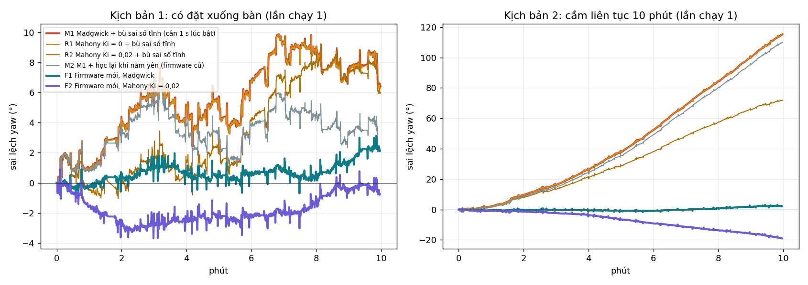

# Firmware tay cầm VERA: ESP32 + BMI160 + 4 miếng chạm (joystick dự phòng)

Firmware ở `firmware/tay_cam_vera/`. Thiết kế, sơ đồ chân và tương tác ở [Tay_cam_ESP32_tich_hop.pdf](tay-cam-tich-hop/Tay_cam_ESP32_tich_hop.pdf). Đây là giai đoạn G1 của lộ trình trong PDF. **Firmware mới qua bước kiểm tra biên dịch, chưa chạy trên mạch thật.**

## 1. Đấu nối

| Linh kiện | Chân linh kiện | Chân ESP32 |
| --- | --- | --- |
| Joystick KY-023 (dự phòng từ v3.1) | VRx, VRy | GPIO34, GPIO35 |
| | SW | bỏ từ v3.1 (trước là GPIO27, `CHAN_JOY_NUT = -1`) |
| | +5V, GND | **3V3**, GND (không cấp 5V) |
| BMI160 | SDA, SCL, INT1 | **GPIO25, GPIO26** (đổi từ 21, 22 ngày 18/11/2026), INT1 chưa nối (`CHAN_INT1 = -1`, lấy mẫu theo đồng hồ 200 Hz) |
| | VIN, GND | 3V3, GND |
| **Miếng chạm TIẾN** (ngón trỏ; nút B cũ) | vật dẫn cỡ đầu ngón tay, 1 dây | **GPIO27 (T7)** |
| **Miếng chạm LÙI** (ngón cái; nút A cũ) | vật dẫn cỡ đầu ngón tay, 1 dây | **GPIO13 (T4)** |
| **Miếng chạm TRÁI** (ngón giữa) | vật dẫn cỡ đầu ngón tay, 1 dây | **GPIO32 (T9)** |
| **Miếng chạm PHẢI** (ngón áp út) | vật dẫn cỡ đầu ngón tay, 1 dây | **GPIO33 (T8)** |
| Chân bỏ không dùng từ v3.2 | | GPIO4, GPIO15 (v3.1 dùng cho TRÁI, PHẢI): gỡ dây; GPIO14 (dây chập GND): gỡ dây |
| Tụ | 100 nF ×2, 470 µF + 100 nF | VRx, VRy xuống GND; sát chân 3V3–GND |

Không nối dây INT1 thì sửa `CHAN_INT1` thành `-1`. Firmware cũng tự chuyển sang đồng hồ 200 Hz nếu không thấy ngắt.

## 2. Nạp

1. Arduino IDE, gói **esp32 by Espressif Systems** bản 3.x (máy này đang có 3.3.12). Board **ESP32 Dev Module**.
2. Mở `firmware/tay_cam_vera/tay_cam_vera.ino`. Sửa `cau_hinh.h`:
   - `WIFI_TEN`, `WIFI_MAT_KHAU`: Wi-Fi 2,4 GHz. Để nguyên `TEN_WIFI` thì tay cầm chỉ chạy qua USB.
   - `IP_MAY_TINH`: nên điền khi đi thi. Gửi thẳng tới máy tính thì ít trễ và ít mất gói hơn phát quảng bá.
3. Đặt tay cầm **yên trên bàn**, rồi bấm Upload. Mở Serial Monitor ở **921600** baud (`TOC_DO_BAUD`).
4. Lúc khởi động, tay cầm cân trong 2 giây: đo độ lệch con quay, mức nền 2 nút cảm ứng và tâm joystick. Trong lúc đó không chạm vào tay cầm.

Không cần thư viện ngoài. Chỉ dùng `WiFi`, `Wire` và `Preferences` có sẵn trong gói ESP32.

## 3. Đèn LED trên board

| Đèn | Nghĩa |
| --- | --- |
| Nháy nhanh | Đang hiệu chuẩn |
| 3 chớp rồi nghỉ | Không thấy BMI160 (joystick và cảm ứng vẫn chạy) |
| Nháy chậm 1 Hz | Đang nối Wi-Fi |
| Chớp ngắn mỗi giây | Có Wi-Fi, chờ game hoặc công cụ xem trả lời |
| Sáng đứng | Game đang đọc tay cầm, hoặc chỉ chạy qua USB |

## 4. Hiệu chuẩn một lần (lưu vào bộ nhớ trong, giữ qua các lần tắt nguồn)

Gõ lệnh trong Serial Monitor. Lệnh 1 chữ không cần Enter.

| Lệnh | Việc cần làm | Thời gian |
| --- | --- | --- |
| `k` | Hiệu chuẩn đầy đủ, gồm 3 bước dưới | khoảng 15 giây |
| `j` | Xoay cần sát mép 2 vòng | 8 giây |
| `a`, `b` | Đặt ngón tay lên nút A (rồi B) và giữ yên | mỗi nút 3 giây |
| `g` | Đặt tay cầm nằm ngang trên bàn và đánh dấu hướng. Xoay đúng 5 vòng cùng chiều, đặt về đúng dấu rồi để yên | dưới 90 giây |
| `n` | Để tay cầm yên trên bàn trong lúc mạch nóng lên. Tốt nhất là làm ngay sau khi bật lại một tay cầm đã tắt lâu | 3–15 phút |

Không có máy tính thì giữ nhấn cần joystick lúc cắm điện để chạy `k`. Hai bước `g` và `n` có lợi nhiều nhất cho việc chống trôi yaw (mục 7).

Các lệnh khác:

| Lệnh | Tác dụng |
| --- | --- |
| `z` | Đặt yaw về 0. Cách khác: giữ cả 2 nút cảm ứng 1 giây |
| `c` | Cân lại con quay (để yên 2 giây) |
| `J` | Lấy vị trí hiện tại làm tâm joystick |
| `h` | Học hướng joystick: đẩy cần lên rồi sang phải, lưu flash |
| `H0,1,0` | Ghi thẳng hướng joystick (đổi XY, đảo X, đảo Y) vào flash. `tools/canh_joystick.py` gửi lệnh này |
| `B1569,1462,1379,1486` | Ghi thẳng biên joystick (âm X, Y, dương X, Y, mV tính từ tâm) vào flash |
| `t50,35,15` | Đặt ngưỡng chạm, nhả, lơ lửng (%) |
| `p` | In thông tin: độ lệch, hệ số nhiệt, tỉ lệ, số đo cảm ứng, Wi-Fi |
| `x` | Xoá hiệu chuẩn đã lưu |
| `s0`, `s1`, `s2` | Đổi kiểu in ra USB: im lặng; dòng `Q,...` cho `tools/xem_bmi160.py`; số liệu dễ đọc |
| `r1`, `r2`, `r0` | Phát dữ liệu thô 200 Hz qua Wi-Fi / USB / tắt. `tools/ghi_tay_cam.py` tự gửi lệnh này |

## 5. Kiểm tra từng bộ phận qua USB (lệnh `s2`)

Mỗi dòng in ra có dạng: `J +0.00 -0.00 - | A   0   (812/815) | B   3   (790/791) | YPR ... | 31.2C yen`.

- **Joystick:**
  - buông cần: hai số về `0.00`;
  - gạt hết 4 hướng: đạt `±1.00`;
  - nhấn cần: hiện `N`.
- **Cảm ứng:**
  - mức 0–255 tăng khi ngón tay tới gần;
  - chạm chắc: lên trên 128 và hiện `*`;
  - trong ngoặc là số đo thô / mức nền.
  - Chưa chạy `a`, `b` thì nút có thể kém nhạy.
- **Hướng (YPR):**
  - đặt nằm ngang: pitch, roll gần 0;
  - để yên: hiện `yen` và góc đứng hẳn.
- Xem khối 3D: chọn `s1` rồi chạy `python tools/xem_bmi160.py COM8`.

Qua Wi-Fi: chạy `python tools/xem_tay_cam_v3.py`. Công cụ này hiện tần số gói, tỉ lệ mất gói, góc, mức cảm ứng và các bit trạng thái. Bấm `d` để đo độ trôi yaw. Tắt game trước, vì game cũng nghe cổng 4210.

## 6. Gói dữ liệu và game hiện tại

Gói gửi đi được chọn bằng `KIEU_GOI` trong `cau_hinh.h`. Mặc định là `2`, tức gửi cả hai gói dưới.

- **Gói v3 (37 byte, mã đồng bộ `A5 5C`)**, xem PDF trang 7. Gồm:
  - hướng tính sẵn (quaternion ×16384);
  - vận tốc góc (×32,8) và gia tốc (×4096);
  - joystick (−32767..32767);
  - mức cảm ứng A, B (0–255);
  - byte bit: 0 chạm A, 1 chạm B, 2 nhấn cần, 3 đang yên, 4 vừa căn lại, 5 đang hiệu chuẩn, 7 lỗi IMU;
  - nhiệt độ (+40) và CRC-8.
- **Gói cũ 29 byte (`A5 5A`, docs/02)**, để game hiện tại chạy được ngay:

  | Đầu vào tay cầm | Nút trong game |
  | --- | --- |
  | Chạm B | Cò (cầm/thả) |
  | Chạm A | Nhấn joystick 1 |
  | Nhấn cần | Nhấn joystick 2 |
  | Giữ A + B | Căn lại |

  Bit "1 cần" luôn bật, nên game dùng 2 chế độ ĐI / TAY. Game tự tính hướng từ con quay đã trừ độ lệch, nên chưa hưởng hết phần chống trôi trong firmware. Để hưởng hết, Unity cần đọc gói v3 (G2).

Lệnh game gửi tới (`H`, `I`, `C`, `J`, `R`, `P`, `L`) vẫn được nhận như các bản trước. Tay cầm không có rung, đèn nên bỏ qua `R`, `P`, `L`.

## 7. Nghiên cứu chống trôi yaw

BMI160 không có la bàn. Gia tốc kế giữ đúng roll và pitch, còn yaw chỉ là tích phân vận tốc góc quanh trục đứng, nên mọi sai số của con quay dồn thành trôi yaw. Các thuật toán được thử bằng mô phỏng 3D `tools/mo_phong_troi_yaw.py` (thông số theo datasheet BMI160, kịch bản ở đầu tệp). Lệnh `TROI_LY_TUONG=1` kiểm tra chính bộ mô phỏng: cho con quay hoàn hảo thì sai lệch phải gần 0.

Kết quả mô phỏng: sai lệch yaw trung bình sau 10 phút, 24 lần chạy mỗi kịch bản (`docs/tay-cam-tich-hop/mo_phong_troi_yaw.txt`).

| Mã | Cấu hình | KB1: có đặt xuống bàn | KB2: cầm liên tục |
| --- | --- | --- | --- |
| M0 | Madgwick, không bù sai số tĩnh | 85,2° | 88,8° |
| M1 | Madgwick + bù sai số tĩnh (cân 1 s lúc bật) | 39,9° | 46,4° |
| R1 | Mahony Ki = 0 + bù sai số tĩnh | 39,9° | 46,4° |
| R2 | Mahony Ki = 0,02 + bù sai số tĩnh | 34,3° (−14%) | 36,2° (−22%) |
| M2 | M1 + học lại khi nằm yên (firmware cũ `tay_cam_bmi160`) | 7,9° | 45,4° |
| **F1** | **Firmware mới, Madgwick** | **1,7° (−96%)** | **4,5° (−90%)** |
| F2 | Firmware mới nhưng dùng Mahony Ki = 0,02 | 9,6° (−76%) | 11,1° (−76%) |

Phần trăm trong ngoặc tính so với M1, tức Madgwick hoặc Mahony chỉ có bù sai số tĩnh. So với firmware cũ M2, firmware mới giảm 78% ở kịch bản 1 và 90% ở kịch bản 2.

F1 giả định đã chạy lệnh `n` (hệ số nhiệt sai khoảng 10%) và lệnh `g` (tỉ lệ còn sai khoảng 0,2%). Chưa chạy hai lệnh này thì kết quả gần với M2 hơn. Đây là số mô phỏng; phải đo trên mạch thật mới đưa vào báo cáo.



**Các kỹ thuật trong firmware** (`huong.h`):

1. Bù sai số tĩnh: cân 2 giây lúc bật.
2. Học lại độ lệch mỗi khi nằm yên trên bàn quá 0,5 giây. Lúc đó ngừng cộng dồn con quay nên góc đứng hẳn.
3. Bù nhiệt: đo hệ số °/s mỗi °C bằng lệnh `n`, rồi tinh chỉnh thêm giữa các lần nằm yên. ESP32 bật Wi-Fi làm mạch nóng lên vài độ.
4. Vùng chết mềm cho vận tốc quanh trục đứng: dưới 0,5 °/s thì bỏ, từ 0,5 đến 1 °/s thì giảm dần.
5. Hiệu chuẩn tỉ lệ con quay trục Z bằng lệnh `g`.
6. Lấy mẫu đều theo ngắt INT1, dt đo bằng `micros()`.
7. Giữ A + B 1 giây để đặt yaw về 0.

**Đã thử và bỏ:**
- **Mahony có Ki** (tự ước lượng độ lệch từ gia tốc kế): đứng riêng thì giúp được một ít, nhưng ghép với các bước trên thì kém hơn, vì Ki học nhầm gia tốc của tay. Mahony với Ki = 0 cho kết quả như Madgwick. Vẫn để tuỳ chọn `BO_LOC_MAHONY` trong `cau_hinh.h` để so sánh trên mạch thật.
- **ZARU** (học độ lệch lúc cầm tay gần yên): học nhầm lắc lư của tay thành độ lệch, làm trôi nặng hơn. Xem `tools/mo_phong_troi_yaw_1truc.py`.

**Đo trên mạch thật** (cần làm để có số cho báo cáo): dùng `tools/ghi_tay_cam.py`, xem mục 8. Một lần ghi đã so được mọi thuật toán, không cần nạp lại firmware cũ.

## 8. Ghi số liệu và xem hiệu quả thuật toán (`tools/ghi_tay_cam.py`)

Tay cầm phát **dữ liệu thô 200 Hz**: mọi mẫu con quay và gia tốc chưa trừ độ lệch, kèm nhiệt độ, số đo cảm ứng, mức nền, joystick và hướng tính trên mạch. Gói 105 byte, mã đồng bộ `A5 5D`, 4 mẫu mỗi gói. Máy tính ghi lại, rồi **chạy lại cùng một chuỗi số đo qua nhiều thuật toán**. Như vậy các thuật toán được so trên đúng một lần thao tác của người dùng.

**Cách đo trôi yaw** (dùng cáp USB để không mất mẫu):

1. Dán băng dính làm dấu trên bàn. Đặt tay cầm áp sát dấu, đúng hướng.
2. Chạy lệnh dưới (thay `COM8` bằng cổng của bạn). Mở cổng làm ESP32 khởi động lại và cân 2 giây, nên để yên tay cầm.
   ```bash
   python tools/ghi_tay_cam.py ghi --com COM8
   ```
3. Đợi khoảng 5 giây rồi bấm `m`: đây là mốc 0.
4. Cầm lên dùng như thật: quay người, nghiêng, rót, ngắm.
5. Cứ 1–2 phút, đặt lại tay cầm **đúng dấu**, chờ 2 giây rồi bấm `m`. Trên màn hình phải hiện `yen`.
6. Sau 10–15 phút (khoảng 6–10 mốc) bấm `q` để lưu. Tệp nằm trong `du_lieu/tay_cam/`, không đưa lên kho.
7. Phân tích. Có thể chạy cả khi đang ghi, vì tệp được lưu mỗi giây:
   ```bash
   python tools/ghi_tay_cam.py phan_tich du_lieu/tay_cam/phien_....vera
   ```

Ở mọi mốc, hướng thật giống hệt mốc 0. Vì vậy chênh lệch yaw ở mốc là **sai số trôi thật**, không cần thiết bị đo chuẩn. Trong lúc đo không gõ `z`, `c` và không giữ A + B, vì các thao tác đó đặt lại hướng giữa chừng. Qua Wi-Fi thì dùng `ghi --wifi` và tắt game trước. Nếu Wi-Fi làm mất mẫu, chương trình báo số mẫu mất.

**Kết quả ra** (cạnh tệp ghi):
- **`_troi_yaw.png`:**
  - yaw của mọi thuật toán theo thời gian;
  - sai số thật ở từng mốc;
  - cột trung bình |sai số| kèm % so với M1.
- **`_ben_trong.png`:** nhiệt độ mạch, độ lệch con quay được học lại mỗi lần nằm yên (vùng xanh), con quay Z trước và sau khi trừ độ lệch, vùng chết.
- **`_cam_ung_joystick.png`:**
  - nút cảm ứng: số đo, mức nền thích nghi, ngưỡng chạm, mức 0–255 và trạng thái có trễ;
  - joystick: điện áp thô và giá trị ra.
- **`_moc.csv`:** sai số ở từng mốc, để đưa vào báo cáo.

**Các thuật toán được so:**

| Mã | Thuật toán |
| --- | --- |
| M1 | Madgwick + bù sai số tĩnh |
| R1 | Mahony Ki = 0 + bù sai số tĩnh |
| R2 | Mahony Ki = 0,02 + bù sai số tĩnh |
| C0 | Firmware cũ `tay_cam_bmi160` (β 0,08, ±500 °/s) |
| F1 | Firmware mới, chạy lại trên máy tính |
| F-n | F1 bỏ bù nhiệt |
| F-v | F1 bỏ vùng chết |
| F-g | F1 bỏ tỉ lệ Z |
| FW | Hướng firmware tính trên mạch |

Ba dòng F-n, F-v, F-g cho biết từng kỹ thuật đóng góp bao nhiêu. Bù sai số tĩnh của mọi thuật toán dùng 2 giây đầu của tệp ghi. Hệ số nhiệt và tỉ lệ Z lấy từ dòng `p` mà chương trình ghi tự hỏi lúc bắt đầu, nên hãy chạy `n` và `g` trước buổi đo.

**Đã thử bằng tệp ghi giả lập** (đúng định dạng gói, 8 phút, 6 mốc):
- Con quay hoàn hảo: mọi thuật toán sai dưới 1°, trừ Mahony Ki (Ki học nhầm gia tốc tay). Kết quả này cho thấy phần đọc, chạy lại và tính mốc đúng.
- Có sai số BMI160 theo datasheet: M1 sai 40,4°, firmware cũ 8,9°, F1 2,3° (giảm 94% so với M1). Bỏ bù nhiệt thì F1 sai 8,4°.

Chưa thử với tay cầm thật. Phân tích mất khoảng 2–3 phút cho 10 phút ghi.

## 9. Chưa làm, cần kiểm

- Chưa chạy trên mạch thật. Cần kiểm theo thứ tự:
  1. hướng các trục `IMU_*` trong `cau_hinh.h`;
  2. số đo cảm ứng giảm hay tăng khi chạm (bước `a`, `b` tự nhận ra);
  3. INT1 có xung không (lệnh `p` hiện cách đang lấy mẫu);
  4. tần số gói gần 100 Hz và mất gói dưới 1%.
- Unity chưa đọc gói v3 (G2): tia trỏ theo vận tốc góc, One Euro, mức lơ lửng, nhấp, nhấp đúp, giữ.
- Bảng chỉ tiêu nghiệm thu ở PDF trang 8 chưa đo.


## Tốc độ gói USB: 100 gói/s, 921600 baud (18/11/2026)

- **Firmware:**
  - `THO_SO_MAU = 2`: mỗi gói thô mang 2 mẫu, 100 gói/s (trước là 4 mẫu, 50 gói/s);
  - gói vẫn dài 105 byte, hai ô mẫu thừa chép lại 2 mẫu mới nhất;
  - bên nhận đọc số mẫu ở byte 3, nên không tính trùng;
  - cổng USB chạy `TOC_DO_BAUD = 921600`.
- **Máy tính:**
  - phòng thử, `ghi_tay_cam.py`, `xem_bmi160.py`, `do_mat_goi_usb.py` mở cổng ở 921600;
  - Unity (`SerialControllerSource`) thử 115200 trước, không thấy tay cầm thì thử `veraBaudRate = 921600`, nên tay cầm cũ vẫn chạy.
- **Đo trong 10 giây:** 93 gói/s, không mất gói. Khoảng cách giữa hai gói: trung vị 8,3 ms, lớn nhất 49 ms (bản 50 gói/s: 17 ms và 64 ms).
- **Hồi phục I2C:** giữ như bản gốc theo yêu cầu. Bản thử hồi phục theo bậc và tác vụ riêng (bị chê giật) lưu ở `firmware/tay_cam_vera_ban_sua_18_11/`.

## Hướng trôi sau khi BMI160 rớt I2C (24/11/2026)

- **Hiện tượng:** mở phòng thử lên thì tay cầm đúng hướng, cầm lên di chuyển thì lúc ngược trục này, lúc ngược trục khác.
- **Đo trên COM8:**
  - lúc mở cổng, firmware báo `imu=LOI`;
  - bộ đếm `hoiphuc` (lệnh `p`) tăng từ 4 lên 23 trong khoảng 1 phút: BMI160 rớt I2C vài giây một lần;
  - hướng firmware tính ra vẫn đúng chiều con quay (tương quan +0,95 / +0,99 / +0,78), nên trục `IMU_*` không sai.
- **Nguyên nhân:**
  - Bước cân yên lúc bật chỉ đặt nghiêng theo trọng lực khi đọc được IMU.
  - IMU lỗi lúc bật thì hướng bắt đầu từ 0, rồi Madgwick (beta 0,033) kéo về đúng chậm, vài độ mỗi giây.
  - Mỗi lần hồi phục (khoảng 0,3 giây), chuyển động trong lúc đó bị mất.
  - Hướng đang tự trôi cộng với chuyển động của tay nên trông như bị ngược.
- **Sửa firmware:**
  - đặt roll, pitch ngay theo trọng lực, giữ nguyên yaw (`huong::datNghiengGiuYaw`), khi hướng chưa từng được đặt hoặc vừa mất mẫu quá `MAT_MAU_DAT_LAI_MS` (200 ms);
  - chỉ đặt khi |a| trong khoảng 0,85–1,15 g (không lắc mạnh), rồi in `#HUONG ...`;
  - đọc lại một lần trước khi khởi động lại cảm biến;
  - I2C hạ từ 400 xuống 100 kHz (`I2C_TAN_SO` trong `cau_hinh.h`);
  - IMU mất hẳn thì thử lại sau 2 giây thay vì 5 giây.
- **Giữ nguyên:** cách hồi phục I2C của bản gốc. Bản hồi phục theo bậc 18/11 bị chê giật nên không dùng.
- **Chưa kiểm:**
  - Máy có chính sách Application Control chặn `xtensa-esp-elf-g++`, nên chưa kiểm biên dịch. Chỉ soát tay và thử phần toán bằng Python (2000 hướng ngẫu nhiên).
  - Chưa nạp lên mạch.
  - Mỗi lần đặt lại, độ nghiêng nhảy ngay về đúng: nếu thấy giật, tăng `MAT_MAU_DAT_LAI_MS`.
- **Phần cứng vẫn là gốc của lỗi:** hàn lại hoặc làm ngắn dây SDA (GPIO25), SCL (GPIO26), 3V3, GND tới BMI160. Ấn hoặc lắc dây mà `hoiphuc` tăng hoặc báo `LOI_IMU` thì đó là mối nối kém.

## Căn joystick bằng `tools/canh_joystick.py` (24/11/2026)

- **Cách chạy:** `python tools/canh_joystick.py COM8`. Giữ cần ở 6 tư thế: giữa, tiến, lùi, trái, phải, nhấn. Các bước tiến, lùi, trái, phải tự ghi khi cần lệch hơn 500 mV và giữ yên 1 giây.
- **Kết quả:** lưu ở `du_lieu/tay_cam/joystick_<giờ>.json`, gồm số đo từng bước, hướng suy ra và biên. Phím **A** gửi lệnh `H` và `B` để ghi vào flash tay cầm. `--ap` ghi tệp mới nhất mà không làm lại các bước.
- **Đo trên tay cầm (tệp `joystick_20261124_164714.json`):**
  - tâm X 1741, Y 1634 mV;
  - tiến: Y lên 3150 mV; lùi: Y xuống 142 mV;
  - phải: X xuống 142 mV; trái: X lên 3150 mV;
  - suy ra `doi_xy=0`, `dao_x=1`, `dao_y=0`; biên âm 1569/1462, dương 1379/1486 mV.
  - `cau_hinh.h` đã đổi `JOY_DAO_X` thành 1.
- **Còn lỗi:**
  - Nút nhấn cần (SW, GPIO27) không ăn ở cả 2 lần đo: kiểm tra dây SW và GND của module joystick.
  - Hướng và biên đã lưu trong flash (`joyh`, `cd`) được ưu tiên hơn `cau_hinh.h`. Biên đang lưu (2864/2739/2947/3008) là học sai lúc GND chập chờn. Sau khi nạp bản này, chạy `--ap` để ghi số đúng.
- **Lần đo đầu (`joystick_20261124_164456.json`):** trục X đứng yên 1741 mV và bị đánh dấu LỖI. Phần JSON không ghi lý do; người dùng cho biết đã di chuyển sai.

## Bản 3.1: miếng chạm hướng thay cần gạt (26/11/2026)

**Vì sao làm:** đo qua USB ngày 25–26/11 thấy module joystick hỏng dây:

- GPIO34 (X) bỏ trống. Chân trôi 150–300 mV và chỉ nhích theo trục Y bên cạnh.
- GPIO35 (Y) lúc đúng (tâm 1601 mV, gạt đủ 142–3150 mV), lúc kẹt 3150 mV (mất GND), lúc kẹt 142 mV (mất 3V3).
- Nút SW nhận chập chờn.
- GPIO14 (chạm B) chập GND, giá trị thô bằng 1, nên game tưởng luôn đang cầm vật.

**Đổi gì:**

| Phần | Bản 3.0 | Bản 3.1 |
| --- | --- | --- |
| Đi lại | Cần gạt KY-023 | 4 miếng chạm: GPIO32 tiến, 33 lùi, 4 trái, 15 phải. Chạm hai miếng kề nhau là đi chéo. Joystick vẫn dùng được nếu còn tốt |
| Chạm B | GPIO14 | GPIO27 |
| Nút nhấn cần | GPIO27 | bỏ |
| Trục joystick hỏng | Vẫn dùng, nên nhân vật tự đi | Trục chỉ được tin sau khi thấy cần nằm gần tâm (900–2400 mV) 0,5 giây. Bỏ trục khi chân nhảy kiểu dây hở, khi cả 2 trục cùng vọt từ tâm ra mép trong 10 ms (mất nguồn), hoặc khi 20 giây liền không về tâm. Trục bị bỏ ra 0 và báo game 1650 mV |
| Tâm học lúc bật | Nhận mọi giá trị (đã từng học 147/142 và 3150/3150 mV) | Chỉ nhận tâm trong 900–2400 mV |

- **Game không cần sửa.** Miếng chạm gửi ra như joystick, gồm cả điện áp giả 1650 ± 1500 mV theo đúng chiều của cần thật: tiến là Y tăng, phải là X giảm. Có đường dốc 0,125 giây để bộ lọc nhảy loạn của game không bỏ nhầm trục.
- **Không phải dùng lá đồng.** Đầu dây tuốt vỏ cuộn tròn, giấy bạc, con vít hay băng keo đồng đều dùng được. Miếng càng to bằng đầu ngón tay càng nhận chắc. Dây nối về ESP32 nên ngắn và không đi sát dây GND.
- **Độ nhạy:** chỉnh `CHAM_HUONG_TY_LE` trong `cau_hinh.h` (mặc định 0,25). Chạm nhận chậm thì giảm về 0,15. Chưa chạm đã nhận thì tăng lên 0,40.
- **Kiểm tra sau khi nạp:**
  - Lệnh `p` in dòng `JOYTOT` (trục nào đang dùng) và `HUONG_CHAM T=…/… L=… t=… p=…` (số đo, mức nền, `*` là đang chạm).
  - Lệnh `s2` in `J x y - TL.. (mV X,Y)` mỗi 0,1 giây.
- **Đã kiểm:** biên dịch với g++ và thư viện Arduino giả, `-Wall -Wextra` không lỗi, không cảnh báo. Mô phỏng 17 trường hợp theo số đo thật đều đạt: kẹt 0 V, kẹt 3,3 V, chân trôi, giữ tiến 10 giây, gạt chéo, mất GND/3V3 lúc đang chạy, gạt nhanh, chạm/buông miếng hướng, tay để gần. **Chưa biên dịch bằng gói ESP32 thật và chưa chạy trên mạch.**
- **Lưu ý nạp:** trên máy này Smart App Control chặn trình biên dịch `xtensa-esp-elf-g++`, nên Arduino IDE có thể báo lỗi lúc Compile. Nạp từ một máy khác thì không bị.


## Bản 3.2: bốn miếng chạm, A và B làm nút di chuyển, chức năng bằng tổ hợp (27/11/2026)

Đổi vai trò: hai nút A, B cũ trở thành 2 trong 4 nút di chuyển; cầm / dùng / nói với AI do **tổ hợp** thực hiện. Mã nằm ở `pad4.h`; game không cần sửa vì firmware vẫn gửi cờ chạm A, B và điện áp joystick giả như cũ.

**Bảng đấu nối (ESP32 DevKit V1):**

| Miếng | Ngón | Chân ESP32 | Việc |
| --- | --- | --- | --- |
| TIẾN | trỏ | GPIO27 (T7) | đi tới |
| LÙI | cái | GPIO13 (T4) | đi lùi |
| TRÁI | giữa | GPIO32 (T9) | quay trái |
| PHẢI | áp út | GPIO33 (T8) | quay phải |
| BMI160 | | SDA GPIO25, SCL GPIO26, VIN 3V3, GND | hướng trỏ |

**Thao tác:**

| Thao tác | Kết quả trong game |
| --- | --- |
| Chạm một miếng | đi tới / lùi, quay trái / phải |
| Chạm hai miếng khác cặp (TIẾN + TRÁI...) | vừa đi vừa quay (chéo) |
| **Bóp TIẾN + LÙI** (trỏ + cái) | nút **B**: giữ = cầm vật đang trỏ, buông = đặt vào chỗ đang trỏ |
| **Chạm TRÁI + PHẢI** (giữa + áp út) | nút **A**: dùng (bấm thiết bị, nhỏ giọt; rót khi đang cầm) |
| TIẾN + LÙI + TRÁI (hoặc PHẢI) | cầm và quay trái (phải) |
| Cả bốn miếng | cầm + dùng (rót, chế độ tinh) |
| **Giữ TRÁI + PHẢI 3 giây** lúc tay rảnh, không trỏ vào dụng cụ nào | nói với trợ lý AI: nói tiếp, thả để gửi |
| Nắm tay trái trước webcam | cầm (như bóp), xòe tay trái = thả |

- **Cặp đối nhau triệt tiêu chuyển động** (tiến trừ lùi bằng 0), nên bóp hay chạm đôi không làm nhân vật nhích.
- **Chống giật:**
  - Một miếng phải chạm đủ 90 ms (`PAD_TRE_DI_CHUYEN_MS`) mới tính là đi.
  - Hễ cặp đối nhau cùng chạm thì không miếng nào được đi.
  - Nhả một cặp lệch nhau thì miếng còn lại bị bỏ qua 150 ms (`PAD_GIAN_CACH_MS`), nên buông cầm không bị "lùi một cái".
- **Độ nhạy:** `CHAM_HUONG_TY_LE` trong `cau_hinh.h` (0,25) dùng chung cho cả bốn miếng. Nhận chậm thì giảm xuống 0,15; chưa chạm đã nhận thì tăng lên 0,40. Lệnh hiệu chuẩn `a`, `b` vẫn chạy nhưng không còn ảnh hưởng độ nhạy lúc chơi.
- **Căn hướng:** bỏ cách "giữ A + B 1 giây". Dùng lệnh `z` qua USB, hoặc nút căn lại trong trang Tay cầm của game.
- **Gỡ lỗi qua USB:** gõ `s2`, dòng số liệu hiện `TLtp` (chữ hoa/chữ thường: miếng nào đang chạm); gõ `p`, dòng `HUONG_CHAM` hiện số đo hai miếng TRÁI, PHẢI. Số đo hai miếng LÙI, TIẾN hiện ở dòng `CHAM A` (= LÙI) và `B` (= TIẾN).
- **Đã kiểm (g++ với thư viện Arduino giả):** toàn bộ firmware biên dịch không lỗi, không cảnh báo (`-Wall -Wextra`). Mô phỏng 16 thao tác đều đạt: đi / quay từng hướng, chéo, bóp, chạm đôi, bóp lệch 40 và 120 ms, nhả lệch, cầm + quay, cả bốn, chạm ngắn 30 ms, chuỗi đi tới → cầm → quay → đặt. **Chưa biên dịch bằng gói ESP32 thật và chưa chạy trên mạch.**
