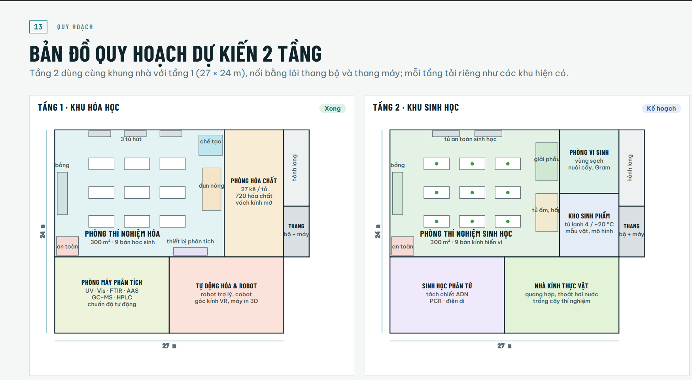
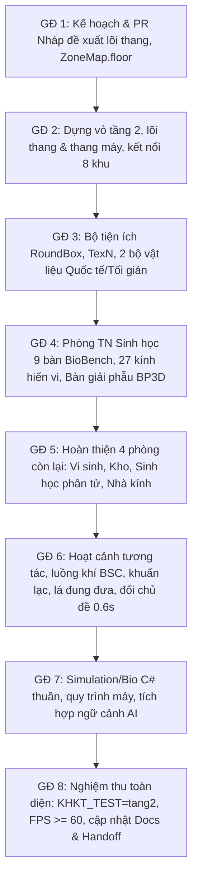

# ĐỀ XUẤT THIẾT KẾ & KẾ HOẠCH DỰNG TẦNG 2 – KHU SINH HỌC (VERA LAB / KHKT2027)

> **Tài liệu đề xuất theo `contracts.md` mục 3 & 10 (Giai đoạn 1)**  
> **Nhánh thực hiện:** `tang2/phong-sinh`  
> **Phiên bản:** 1.0 – 30/10/2026  
> **Dự án:** VERA Lab (Unity 6000.6.7f1, URP 17.6.0, Input System 1.20.1)

---

## 1. Bản đồ mặt bằng quy hoạch

Bố cục tầng 2 bám sát bản đồ quy hoạch trang 13 của dự án (`phong_sinh/mat_bang_tang2.png`) với tỉ lệ đo thực tế $21,4\text{ px} = 1\text{ m}$. Toàn bộ thông số toạ độ đã được lập bảng tại `phong_sinh/bo_cuc_tang2.json`.



### Sơ đồ bình đồ tầng 2 (Hệ toạ độ mét: x đông, z bắc, y lên; sàn tầng 2 ở y = 3,8 m)

```
 z=15 ┌──────────────── PHÒNG TN SINH HỌC (0..20 × 0..15) ───────────┬── PHÒNG VI SINH ──┬─ HÀNH ─┐
      │  [BSC 6.6]        [BSC 11.6]      [rửa 14.2–16.6]            │ BSC  BSC          │  LANG  │
      │ B                                              ┌giải phẫu┐   │ đảo nhuộm Gram    │  ĐÔNG  │
      │ Ả   ▪bàn7  ▪bàn8  ▪bàn9   (z 12.4)             │17.2–19.9│   │ tủ ấm      ┌đệm┐ ←cửa  │
      │ N   ▪bàn4  ▪bàn5  ▪bàn6   (z 7.5)   pass-box→  └z 9–13.5─┘   │            └───┘   │ 27..30 │
 z=7.5│ G                                              ┌tủ ấm,hấp┐   ├─── KHO SINH PHẨM ─┼────────┤
      │     ▪bàn1  ▪bàn2  ▪bàn3   (z 2.6)              │ z 3–7.5 │   │ tủ 4°C  tủ −20°C  │ THANG  │
      │ [an toàn]                      cửa→kho         └─────────┘   │ kệ mẫu, mô hình ←cửa│ bộ+máy │
 z=0  └─cửa 1.6–3.2──────────── HÀNH LANG TẦNG 2 (z −2.2..0) ───────┴───────────────────┤ 27..30 │
z=−2.2├──── SINH HỌC PHÂN TỬ (0..13.5) ─cửa 5.9–7.5┬──── NHÀ KÍNH THỰC VẬT (13.5..27) cửa 19–20.6 ─┘
      │ tiền PCR │ tách chiết ADN │ PCR · điện di │ mái kính · bàn trồng cây · thủy canh · quang hợp
z=−9  └──────────┴────────────────┴───────────────┴──────────────────────────────────────────────
      x=0                                         x=13.5                                       x=27
```

---

## 2. Đề xuất vị trí lõi thang (thang bộ + thang máy)

Theo quy định bắt buộc trong `contracts.md` (mục 3): *"cầu thang và lỗ sàn: đề xuất vị trí trước khi sửa cảnh tầng 1"*.

### Vị trí đề xuất:
- **Phạm vi toạ độ:** $x \in [27,0; 30,0]$, $z \in [-2,2; 6,0]$.
- **Lý do lựa chọn tối ưu:**
  1. **Không khoét lỗ sàn trong tầng 1:** Lõi thang nằm hoàn toàn ở dải phía đông, phía ngoài khung chịu lực chính của tầng 1 ($x \in [0; 27]$). Do đó không phải khoét lỗ trần/sàn trong phòng thí nghiệm hóa học hoặc phòng kho hóa chất tầng 1.
  2. **Giao thông thuận tiện, liền mạch:**
     - Tầng 1: Đi từ hành lang chính dãy nam thông qua cửa tự động mới tại `Tường đông dãy nam` ($x = 27,0$, $z \in [-1,9; -0,3]$) để bước vào sảnh lõi thang.
     - Tầng 2: Cửa tự động tại $x = 27,0$, $z \in [-1,9; -0,3]$ nối thẳng vào sảnh hành lang tầng 2.
     - Đồng thời, lối đi tầng 2 ($x \in [27,2; 28,4]$, $z \in [3,0; 4,4]$) có cửa tự động dẫn thẳng vào Kho sinh phẩm tầng 2, và kéo dài lên phía bắc ($z \ge 6,0$) thành Hành lang đông tầng 2 dẫn vào buồng đệm phòng vi sinh.
  3. **Tầng 1 bên dưới khoảng trống:** Vùng $x \in [27,2; 28,4], z \in [0; 6,0]$ ở tầng 1 là khoảng sân có mái che cao 3,6 m, bố trí ghế băng và chậu cây; vùng $x \in [27; 30], z \in [6; 15]$ bên dưới để trống hoàn toàn (chỉ có cột $x \in \{27,2; 29,8\} \times z \in \{6,2; 10,5; 14,8\}$), đảm bảo quạt hút tường đông của phòng hóa chất tầng 1 ($z \in [12,8; 13,4]$) vẫn thông thoáng ra ngoài trời.

### Cấu tạo chi tiết lõi thang:
1. **Thang bộ:**
   - Đặt ở nửa phía đông của lõi: $x \in [28,6; 29,8]$, chạy dọc trục $z$ từ $z = 0,06\text{ m}$ lên đỉnh tại $z = 6,0\text{ m}$.
   - 22 bậc, chiều cao mỗi bậc $17,27\text{ cm}$, bề rộng mặt bậc $27\text{ cm}$.
   - **Cơ chế di chuyển mượt cho `CharacterController`:** Bậc thang được sinh hình học để hiển thị thị giác; phủ lên trên là một dốc va chạm tàng hình (`BoxCollider` nghiêng góc $32,6^\circ$, layer phẳng) giúp người chơi bước lên/xuống êm ái, không bị khựng góc cạnh.
   - Lan can kính cường lực cao $1,1\text{ m}$ dọc $x = 28,5\text{ m}$ và tay vịn gỗ sồi hai bên vế thang.
2. **Thang máy:**
   - Giếng thang đặt tại $x \in [28,4; 29,8]$, $z \in [-2,2; -0,8]$.
   - Cửa thang quay về hướng $-x$ (mặt $x = 28,4\text{ m}$, cửa $z \in [-1,9; -1,1]$).
   - Cơ chế hoạt động lúc chơi (`ElevatorController.cs`):
     - Người chơi bước vào cabin $\to$ cửa tự động đóng trong $0,8\text{ s}$ kèm âm thanh "ting".
     - Màn hình chuyển mờ dần trong $0,35\text{ s}$.
     - Vị trí người chơi được dịch chuyển theo trục $y$ ($\pm 3,8\text{ m}$).
     - Đèn LED số tầng trên cửa đổi số (T1 $\leftrightarrow$ T2).
     - Màn hình sáng lại và cửa thang trượt mở trong $0,8\text{ s}$.

---

## 3. Danh sách các file tầng 1 sẽ sửa đổi (tối thiểu và bảo toàn 100% tầng 1)

Tuân thủ nghiêm ngặt nguyên tắc: **Không đổi hành vi tầng 1 (hóa học, 14 máy, lắp ráp, robot)**.

| STT | Tệp cần sửa | Vị trí / Hàm | Nội dung sửa đổi cụ thể |
|---|---|---|---|
| 1 | `LabSceneBuilder.cs` | `BuildShell` (dòng 452–455) | 1. Sửa độ dày tấm `Trần` tầng 1: trần mỏng lại còn $y \in [3,6; 3,7]$ (mặt dưới giữ nguyên $3,6\text{ m}$, tâm $y = 3,65$, dày $0,1\text{ m}$). Mắt người chơi tầng 1 thấy nguyên vẹn như cũ.<br>2. Sàn tầng 2 sẽ là hộp $y \in [3,7; 3,8]$ (tâm $y = 3,75$, dày $0,1\text{ m}$) $\to$ loại bỏ 100% hiện tượng trùng mặt (z-fighting).<br>3. `Mái` và `Diềm mái` dời lên đỉnh tầng 2 ($y = 3,8 + 3,6 = 7,4\text{ m}$), chừa khoảng mái kính hai dốc cho nhà kính thực vật ($x \in [13,5; 27], z \in [-9; -2,2]$). |
| 2 | `LabSceneBuilder.cs` | `BuildShell` (dòng 477) | Tại `Tường đông dãy nam` ($x = 27,0$, $z \in [-9; -0,1]$): thêm ô cửa tự động `Auto(-1.9f, -0.3f, +1, ZoneMap.Corridor, 12 /* ZoneMap.Stairs */, leafHall)` kết nối hành lang tầng 1 vào lõi thang. |
| 3 | `LabSceneBuilder.cs` | `BakeReflectionProbes` (dòng 674) | Bổ sung 7 đầu dò phản chiếu hộp (box projection, 128 px, HDR) cho các phòng tầng 2: Phòng sinh học, Phòng vi sinh, Kho sinh phẩm, Hành lang tầng 2, Sinh học phân tử, Nhà kính, Lõi thang. |
| 4 | `LabSceneBuilder.cs` | `BuildStationsAndViewer` (dòng 820) | Bổ sung danh sách các trạm dịch chuyển `Station` từ 20 đến 31 với $y = 3,8\text{ m}$ theo đúng đặc tả `bo_cuc_tang2.json`. |
| 5 | `Rendering/ZoneMap.cs` | Toàn bộ struct & hàm `At` | 1. Thêm trường `public int floor;` vào `Zone` (0 = tầng 1, 1 = tầng 2, -1 = cả hai tầng).<br>2. Giữ nguyên 100% 5 khu cũ với chỉ số 0..4 (`floor = 0`).<br>3. Thêm 8 khu mới vào cuối bảng `Zones` (chỉ số 5..12): `phong_sinh` (5), `phong_vi_sinh` (6), `kho_sinh_pham` (7), `hanh_lang_t2` (8), `phong_sinh_phan_tu` (9), `nha_kinh` (10), `hanh_lang_dong` (11), `loi_thang` (12, `floor = -1`).<br>4. Hàm `At(Vector3 p)`: xét $p.y \ge 3,6\text{ m}$ là tầng 2, đối chiếu đúng `floor` để xác định khu. |
| 6 | `Rendering/ZoneStreamer.cs` | `ComputeNeed` (dòng 146–154) | 1. Khi ở ngoài trời (`vz < 0`): nếu $v.y < 3,6\text{ m}$ thì mới giữ `ZoneMap.Lab` và `ZoneMap.Store` (hiên tầng 1).<br>2. Khi quét cửa tự động `AutoDoor`: bổ sung điều kiện độ cao `if (Mathf.Abs(dv.y) > 2.5f) continue;` để cửa tự động ở tầng khác không bị kích hoạt nạp trước nhầm. |
| 7 | `LabSceneBuilder.Zones.cs` | `SplitIntoZones` (dòng 252) | Mở rộng mảng `zoneRoots` để bao gồm 8 khu mới của tầng 2 dưới nút gốc `"Tầng 2"`. Đảm bảo các khu tầng 2 được tách thành các cảnh tĩnh riêng biệt `Assets/Scenes/Khu/Khu_*.unity`. |
| 8 | `LabKit.cs` | Khai báo class | Đổi sang `public static partial class LabKit` để tạo `LabKit.Extra.cs` bổ sung `RoundBox`, `TexN`, tạo lưới lá cây mà không làm phình to hoặc rủi ro cho file gốc. |
| 9 | `tools/kiem_thu_unity/KhktAutoTest.cs` | Hàm `Start` | Thêm nhánh `else if (Environment.GetEnvironmentVariable("KHKT_TEST") == "tang2")` phục vụ kiểm thử tích hợp tự động tầng 2. |

---

## 4. Đối chiếu & Phân tích những điểm cần lưu ý giữa Prompt và Code thật

Sau khi rà soát toàn bộ mã nguồn thực tế tầng 1, ghi nhận các điểm kỹ thuật cần xử lý chuẩn xác:

1. **Về chiều dày sàn và trần:**
   - Trong code hiện tại: `Box(g, "Trần", new Vector3(cx, H + 0.1f, ...), new Vector3(..., 0.2f, ...))` có tâm $y = 3,7\text{ m}$, dày $0,2\text{ m}$, tức chiếm $y \in [3,6; 3,8]$.
   - Khi dựng sàn tầng 2 ở $y = 3,8\text{ m}$, nếu giữ nguyên trần cũ sẽ bị đè mặt. Giải pháp thu mỏng trần tầng 1 thành $y \in [3,6; 3,7]$ (dày $0,1\text{ m}$) và sàn tầng 2 là $y \in [3,7; 3,8]$ (dày $0,1\text{ m}$) là hoàn toàn chính xác và triệt tiêu z-fighting.
2. **Về mái nhà kính:**
   - Nhà kính thực vật ($x \in [13,5; 27], z \in [-9; -2,2]$) có mái kính hai dốc độc lập nhô cao tới đỉnh $+4,8\text{ m}$ so với sàn tầng 2 ($y = 8,6\text{ m}$).
   - Do đó, khối `Mái` và `Diềm mái` bê tông chính ở đỉnh tầng 2 chỉ phủ trên các khu vực còn lại, không bao phủ đè lên mái kính của nhà kính.
3. **Về phím tắt đổi chủ đề (Theme Switcher):**
   - Đã quét toàn bộ dự án: phím **F7** chưa hề được sử dụng ở bất kỳ component nào (F8, F9 dùng cho `HeadTracking`, Tab/Alt/C/Z/X dùng cho `DesktopViewer`, F dùng cho `HandController.swirlKey`). Do đó chọn **F7** cho `BioThemeSwitcher` là an toàn tuyệt đối.
4. **Về kiểm thử C# ngoài Unity trên macOS:**
   - Đã tạo thành công `tools/chay_kiem_thu_hoa.sh` sử dụng DotNetSdk đi kèm Unity 6000.6.7f1 tại `/Users/trantrong/Documents/6000.6.7f1/Unity.app`. Chạy thử đạt 140/140 tests trong chưa đầy 1 giây. Sẽ dùng cùng công cụ này để kiểm thử `Simulation/Bio` ở các giai đoạn sau.
5. **Về xử lý BodyParts3D (`bp3d.bin.gz`):**
   - Định dạng nhị phân gzip chứa header JSON và các khối đỉnh Uint16 zigzag-encoded. Trong `Bp3dImporter.cs`, thuật toán giải nén và giải lượng tử được triển khai hoàn toàn bằng C# thuần để tạo asset `Mesh` cục bộ trong `Assets/Lab/Tang2/GiaiPhau/`. Đồng thời luôn có khối dự phòng procedural nếu tệp bị thiếu, không làm gián đoạn quá trình dựng cảnh.

---

## 5. Kế hoạch triển khai chi tiết 8 giai đoạn



- **Giai đoạn 1 (Hiện tại):** Hoàn thành tài liệu đề xuất, kế hoạch chi tiết, cập nhật HANDOFF.md, tạo commit điểm phục hồi trên nhánh `tang2/phong-sinh`.
- **Giai đoạn 2:** Dựng vỏ tầng 2 (sàn, tường, trần, mái, lõi thang, thang máy), kết nối `ZoneMap.floor`, cập nhật trạm 20..31.
- **Giai đoạn 3:** Xây dựng bộ công cụ `RoundBox`, `TexN`, tạo hệ thống shader `LaCay`, `TieuBan`, và cơ chế đổi chủ đề `BioThemeSwitcher` (F7).
- **Giai đoạn 4:** Hoàn thiện Phòng thí nghiệm Sinh học trọng tâm: 9 bàn `BioBench`, 27 kính hiển vi quang học độ chi tiết cao, tủ an toàn sinh học cấp II, khu giải phẫu số BodyParts3D.
- **Giai đoạn 5:** Dựng 4 phòng chuyên đề: Phòng vi sinh (buồng đệm, nhuộm Gram), Kho sinh phẩm (tủ lạnh/đông, mẫu ngâm), Sinh học phân tử (luồng 1 chiều, PCR, điện di), Nhà kính thực vật (mái kính, bàn cây, thủy canh).
- **Giai đoạn 6:** Thêm các hoạt cảnh sống động, nhẹ nhàng theo chuẩn Material 3, có tùy chọn giảm chuyển động.
- **Giai đoạn 7:** Viết bộ máy mô phỏng sinh học `Simulation/Bio/` (C# thuần, kiểm thử tự động ngoài Unity) và hồ sơ máy có màn hình.
- **Giai đoạn 8:** Viết tài liệu `docs/20-tang-2-khu-sinh-hoc.md`, chạy nghiệm thu `KHKT_TEST=tang2`, đo đạc FPS $\ge 60$ trên Iris Xe, sẵn sàng cho chủ dự án nghiệm thu và duyệt gộp.
